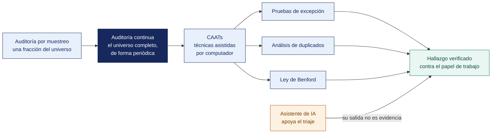

[Semana 06](README.md) · **Teoría** · [Dinámica de aula](2-DINAMICA.md) · [Taller de laboratorio](3-TALLER.md)

# Teoría · Auditoría Continua y CAATs · Exposición de Trabajos · Examen de Unidad I

**SI-084 · Auditoría de Sistemas** · Semana 06 · Sesión 1 en aula · 2 horas académicas, 100 min, con la dinámica incluida

> ¿Un término no le resulta claro? Está definido en el [glosario técnico del curso](../GLOSARIO.md).

---

## La pregunta de esta sesión

Un auditor prueba 60 pagos de una población de 17 798 y no encuentra ninguna excepción. Concluye, con un 95 % de confianza, que la tasa de excepción no supera cierto porcentaje. El informe es estadísticamente correcto.

En esa población había seis pagos que la misma persona registró y aprobó. La muestra aleatoria no los tocó, y no los habría tocado casi nunca — eran seis entre casi dieciocho mil.

> **La pregunta que ordena el material de esta unidad.** *Si el dato completo está a una consulta de distancia, ¿por qué seguir mirando solo una fracción?*

## Antes de empezar

| Lo que necesita traer | De dónde sale |
|---|---|
| Las áreas auditables y la estructura de un procedimiento | Semana 05 |
| La distinción entre prueba de diseño y de eficacia operativa | Semana 04 |
| El registro de riesgos con escala declarada | Semana 03 |
| Nociones de consulta sobre datos y de hoja de cálculo | Cursos previos de la carrera |

> **Autocomprobación, antes de leer el material.** Antes de leer, responda para sí mismo tres preguntas y anote lo que contesta. *¿Qué puede afirmar el auditor del caso y qué no? ¿Qué habría hecho falta para encontrar los seis pagos? ¿Es más fuerte una muestra bien diseñada o una consulta sobre todo?* Al terminar el material, vuelva a sus respuestas.

## Distribución del tiempo

| Momento | Minutos |
|---|---|
| Exposición de avance de la Unidad I | 60 |
| Examen teórico de Unidad I | 40 |
| **Total de la sesión de aula** | **100** |

## Mapa de la sesión



---

## Material de estudio de la unidad

> **No se dicta en clase.** Los 100 minutos de aula de esta semana se reparten entre la exposición de avance y el examen teórico. Este material —50 minutos de desarrollo— **se estudia por cuenta propia antes de la sesión y entra en el examen teórico de la Unidad I**. Está aquí completo, no resumido. Es el mismo desarrollo que tendría en aula.

### Auditoría continua y CAATs · por qué el muestreo está en retirada

**El límite del muestreo.** Probar 25 transacciones de 180 000 permite concluir sobre el control con un nivel de confianza estadístico, pero **no detecta el fraude concentrado**. Un desfalco de 40 operaciones diseñadas para pasar bajo el umbral es prácticamente invisible a una muestra aleatoria. Cuando el dato es accesible por consulta, el muestreo deja de ser una necesidad metodológica y pasa a ser una limitación autoimpuesta.

**CAAT (Computer-Assisted Audit Techniques).** Son las técnicas que permiten al auditor examinar el **100 % de la población** y ejecutar pruebas que serían imposibles manualmente. ITAF las reconoce como evidencia de máxima fuerza cuando se documenta la integridad del dato extraído.

| Técnica | Qué hace | Ejemplo de aplicación |
|---|---|---|
| **Extracción y análisis de datos** | Consulta sobre el 100 % de la población | Todos los pagos del año agrupados por proveedor y por aprobador |
| **Pruebas de excepción** | Reglas de negocio aplicadas exhaustivamente | Pagos en fin de semana, montos justo bajo el umbral de aprobación |
| **Pruebas de duplicados** | Coincidencia exacta y difusa | Mismo monto, misma fecha, mismo proveedor |
| **Análisis de brechas y secuencias** | Series numéricas incompletas | Facturas o comprobantes faltantes |
| **Correlación entre archivos** | Cruce de bases independientes | Empleados cuya cuenta bancaria coincide con la de un proveedor |
| **Análisis de tendencias y atípicos** | Estadística descriptiva y detección de anomalías | Un proveedor que factura 12 veces más en el mes de cierre |
| **Ley de Benford** | Distribución esperada del primer dígito | Detección de importes fabricados |
| **Datos de prueba / simulación paralela** | El auditor procesa datos conocidos y compara | Verificar que el cálculo de intereses del sistema es correcto |

**La Ley de Benford.** En conjuntos de números que abarcan varios órdenes de magnitud y surgen de procesos naturales o económicos, la frecuencia del primer dígito significativo no es uniforme:

```
P(d) = log10(1 + 1/d)

d = 1 → 30.1 %      d = 4 →  9.7 %      d = 7 →  5.8 %
d = 2 → 17.6 %      d = 5 →  7.9 %      d = 8 →  5.1 %
d = 3 → 12.5 %      d = 6 →  6.7 %      d = 9 →  4.6 %
```

Cuando alguien fabrica importes, tiende a distribuir los dígitos iniciales de forma más uniforme y a evitar el 1. Una desviación significativa —medida con un contraste chi-cuadrado— **no prueba fraude. Prioriza dónde mirar**. Ese matiz es la diferencia entre un auditor competente y una acusación infundada. Condiciones de aplicabilidad que deben verificarse antes — la población debe abarcar varios órdenes de magnitud, no tener mínimos o máximos impuestos, no ser una numeración asignada y tener suficiente volumen.

**Ejemplo trabajado — la misma prueba, con muestreo y con CAAT.** Objetivo. *Detectar pagos aprobados por quien los registró.*

| | Con muestreo | Con CAAT |
|---|---|---|
| **Población** | 17 798 pagos | 17 798 pagos |
| **Qué se examina** | 60 registros seleccionados al azar | **Los 17 798** |
| **Tiempo** | 6 horas de revisión manual | 4 minutos de ejecución, más 2 horas de preparación |
| **Resultado posible** | 0 excepciones en la muestra | 6 pagos autoaprobados, con su identificador |
| **Qué se puede afirmar** | «Con un nivel de confianza del 95 %, la tasa de excepción no supera el X %» | «Existen exactamente 6 excepciones, y son estas» |
| **Si el auditado las discute** | Se discute la representatividad de la muestra | Se muestran los seis registros |

> **Con 60 registros de 17 798, seis excepciones son casi invisibles**. La probabilidad de que ninguna caiga en la muestra es alta. El muestreo no falló, **estaba mal elegido** para una población procesable automáticamente.

**Cuándo el muestreo sigue siendo correcto.** Cuando la evidencia no es procesable —expedientes en papel, actas firmadas, observación física— o cuando el costo de extraer la población supera el del muestreo.

> **Autoevaluación (6 min) · lo que se puede afirmar.** Después de leer este apartado, responda por escrito antes de mirar la columna de la derecha. Si su respuesta a la primera coincide con la esperada, ha entendido el matiz que separa una prioridad de una prueba.

| Caso | Qué debe contener una buena respuesta |
|---|---|
| ¿La ley de Benford prueba que hay fraude? | No. Prueba que la distribución de primeros dígitos se aparta de lo esperado, y **dice dónde mirar**. La conclusión viene de las pruebas dirigidas que siguen |
| Los datos cumplen Benford. ¿Se concluye que no hay anomalías? | No. Unas pocas anomalías no desvían la distribución de una población grande. Es el error de razonamiento más frecuente en este taller |
| ¿Qué se hace si el auditado entrega los datos en PDF? | Se registra en la matriz PBC como limitación, se solicita el formato procesable y, si no llega, se declara la limitación en el alcance del informe |
> **El error frecuente.** Concluir que no hay anomalías porque la población cumple la distribución de Benford. Benford **prioriza dónde mirar, no prueba nada**. Unas pocas anomalías en una población grande no desvían la distribución, exactamente igual que en una empresa real, y quien cierra la prueba ahí se equivocó de método.

### Inteligencia artificial en el proceso de auditoría

**Dónde ayuda genuinamente.**

| Uso | Aporte real | Verificación obligatoria del auditor |
|---|---|---|
| **Triaje y agrupamiento de hallazgos** | Consolida cientos de salidas de herramientas en temas | Revisar manualmente una muestra de la clasificación |
| **Mapeo a marcos normativos** | Sugiere el control ISO o el objetivo COBIT aplicable | **Verificar el código contra la norma**. Los modelos inventan códigos plausibles |
| **Redacción del borrador de hallazgo** | Estructura CCCER a partir de notas del auditor | Contrastar cada afirmación contra la evidencia |
| **Análisis de documentos extensos** | Localiza cláusulas en políticas y contratos | Leer la cláusula citada en el documento original |
| **Generación de código de análisis** | Escribe la consulta SQL o el script de pandas | Revisar la lógica y validar con un caso conocido |
| **Detección de anomalías** | Aísla registros atípicos en grandes volúmenes | **Investigar cada atípico.** El modelo señala, no concluye |

**Las tres reglas no negociables.**

1. **Confidencialidad.** La evidencia de auditoría contiene información clasificada de la organización. Enviarla a un servicio en la nube de terceros **sin autorización expresa y sin acuerdo de tratamiento de datos es una falta ética y, si contiene datos personales, un incumplimiento de la Ley 29733**. Por eso este laboratorio usa **Ollama en local**. El dato no sale del equipo.
2. **El auditor responde, no el modelo.** ITAF y el Código de Ética de ISACA exigen debida diligencia profesional. Un hallazgo con un control ISO inexistente porque «lo dijo la IA» es responsabilidad del auditor que lo firmó.
3. **Trazabilidad.** Todo uso de IA se documenta en el papel de trabajo — qué modelo, qué versión, qué se le entregó, qué devolvió y **qué verificó el auditor**. La salida de un modelo no es evidencia; es una hipótesis que orienta el trabajo.

---

**Ejemplo trabajado — qué puede y qué no puede hacer un modelo en el encargo.**

| Tarea | ¿Se puede delegar? | Por qué |
|---|---|---|
| Redactar el borrador de un hallazgo a partir de la condición y el criterio | **Sí, con revisión** | Acelera la redacción. El auditor verifica que el criterio citado exista y diga lo que se afirma |
| Agrupar 400 excepciones en categorías | **Sí** | Es clasificación sobre datos que el auditor ya obtuvo |
| Proponer qué pruebas aplicar a un riesgo | **Sí, como punto de partida** | El programa de trabajo lo aprueba y firma el auditor |
| Decidir si una excepción es hallazgo | **No** | Requiere juicio profesional y responde el auditor |
| Citar el numeral de una norma | **No sin verificar** | Los modelos inventan numerales que suenan correctos. **Toda cita se comprueba en la norma** |
| Concluir sobre la eficacia de un control | **No** | Es la opinión del auditor, y es indelegable |
| Procesar datos del auditado en un servicio externo | **No sin autorización** | Es una transferencia de información confidencial. Puede infringir el encargo y la Ley 29733 |

> **La regla del curso.** El uso de IA se declara en los papeles de trabajo. Qué se le pidió, qué devolvió y qué verificó el auditor. Un informe donde no se puede distinguir qué revisó una persona no es auditable.

> **Autoevaluación (5 min) · verificar al modelo.** Estas tres preguntas son las que el examen práctico va a exigir. Respóndalas antes de continuar.

| Caso | Qué debe contener una buena respuesta |
|---|---|
| ¿Por qué usar un modelo local y no uno en línea para el triaje? | Porque los datos del auditado no salen del entorno controlado. Enviarlos a un servicio externo es una transferencia que el encargo no autorizó |
| El modelo cita «ISO 27001, control A.9.4.7». ¿Se usa? | Se verifica primero. En la versión 2022 la numeración cambió; un control con esa nomenclatura puede no existir. Citar una norma inexistente destruye la credibilidad del informe |
| ¿Cambia la responsabilidad del auditor si usó IA? | No. La firma es suya. La herramienta no responde ante nadie |
> **El error frecuente.** Aceptar la salida de un modelo de lenguaje como evidencia. El modelo cita controles que no existen en la edición vigente de la norma y describe hallazgos plausibles que los datos no sostienen. Toda salida se **verifica contra el papel de trabajo** antes de entrar al informe, y esa verificación se documenta.

## Exposición de avance de la Unidad I

Cada equipo expone el avance de su producto ante el aula y el docente. **6 minutos por equipo**, 10 equipos, sin margen. Se corta al minuto seis.

| Momento | Duración | Qué se muestra |
|---|---|---|
| Qué se propuso el equipo para esta unidad | 1 min | El objetivo declarado al inicio de la unidad |
| **Lo construido, funcionando** | 3 min | Producto real, no diapositivas de lo que se piensa hacer |
| Lo que no se logró y por qué | 1 min | Con honestidad. Ocultarlo cuesta más que declararlo |
| Preguntas | 1 min | Del docente |

> **Se evalúa el avance verificable, no la presentación.** Un equipo que muestra poco pero real puntúa por encima de uno que muestra mucho y no lo tiene.

## Examen de Unidad I

El Examen de Unidad se rinde en dos partes, y juntas valen el 25 % de la nota de la unidad.

| Parte | Dónde y cuándo | Duración | Qué evalúa | Materiales |
|---|---|---|---|---|
| **Teórico** | Aula, al cierre de esta sesión | 40 min | Preguntas de alternativas sobre las Semanas 01 a 06, incluido el material de estudio de esta semana que no se dicta en clase | Apuntes propios. **Sin** internet ni asistentes de inteligencia artificial |
| **Práctico** | Laboratorio | 100 min | Identificación del control aplicable con su código, clasificación del hallazgo y redacción en CCCER sobre evidencia real de herramienta | Laboratorio de cómputo, **con inteligencia artificial permitida** y declarada |


## Cierre · qué se lleva de esta unidad

**La respuesta a la pregunta del material.** Porque cuando el dato es accesible por consulta, el muestreo deja de ser una necesidad metodológica y pasa a ser **una limitación autoimpuesta**. El auditor del caso no se equivocó en la estadística. Se equivocó al aceptar una restricción que ya no existía. Sobre el 100 % de la población se afirma que hay exactamente seis excepciones y cuáles son.

**Las tres ideas que deben quedar.**

| Idea | Por qué importa en el ejercicio profesional |
|---|---|
| El muestreo no detecta el fraude concentrado | Un desfalco diseñado para pasar bajo el umbral es prácticamente invisible a una muestra aleatoria |
| Las técnicas asistidas son evidencia de máxima fuerza cuando se documenta la integridad de la extracción | Sin conteo, total de control y hash, la consulta prueba lo que haya en un archivo cuyo origen nadie verificó |
| La Ley de Benford prioriza, no prueba | Es el matiz que separa a un auditor competente de una acusación infundada |

**Lo que sigue.** El [taller de esta semana](3-TALLER.md) ejecuta ocho pruebas de excepción sobre el 100 % de la población de su empresa, aplica Benford verificando antes sus condiciones de aplicabilidad, y exige documentar **al menos un error del modelo de lenguaje** detectado por el equipo.

---

---

[Semana 06](README.md) · **Teoría** · [Dinámica de aula](2-DINAMICA.md) · [Taller de laboratorio](3-TALLER.md)

---

**Docente** · Dr. Oscar Juan Jimenez Flores
[oscarjimenezflores@upt.pe](mailto:oscarjimenezflores@upt.pe) · [LinkedIn](https://www.linkedin.com/in/oscar-jimenez-flores/) · [CTI Vitae — CONCYTEC](https://ctivitae.concytec.gob.pe/appDirectorioCTI/VerDatosInvestigador.do?id_investigador=33398)

Escuela Profesional de Ingeniería de Sistemas · Universidad Privada de Tacna · Tacna, Perú
