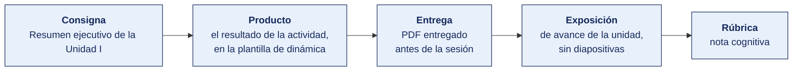
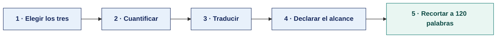

[Semana 06](README.md) · [Teoría](1-TEORIA.md) · **Dinámica de aula** · [Taller de laboratorio](3-TALLER.md)

# Dinámica de aula · Resumen ejecutivo de la Unidad I

**SI-084 · Auditoría de Sistemas** · Semana 06 · **Trabajo previo a la sesión** · calificación **cognitiva**

> ¿Un término no le resulta claro? Está definido en el [glosario técnico del curso](../GLOSARIO.md).

---

> **Esta actividad no se resuelve en aula.** La semana de cierre de unidad dedica sus 100 minutos de aula a la **exposición de avance (60 min)** y al **examen teórico (40 min)**. La dinámica se prepara durante la semana y **se entrega antes de la sesión**. Es el insumo con el que el equipo arma su exposición.

## Cómo funciona la actividad

## Qué entregas

| | |
|---|---|
| **Archivo** | `SI084-S06-DINAMICA-Grupo<N>.pdf` |
| **Plantilla obligatoria** | [SI084-PLANTILLA-DINAMICA.docx](../PLANTILLAS/SI084-PLANTILLA-DINAMICA.docx) |
| **Formato** | PDF exportado desde la plantilla en Word, con la carátula de la UPT y los apellidos, nombres y códigos de todos los integrantes |
| **Qué va dentro** | El producto de cierre de unidad que se describe más abajo, desarrollado por el grupo con la evidencia acumulada en la unidad |
| **Dónde se sube** | Aula virtual, tarea «Dinámica · Semana 06» |
| **Cuándo vence** | Al cierre de la unidad, antes del examen |
| **Exposición** | En la **exposición de avance de la unidad**, dentro de esta misma sesión. El grupo lee y explica su resultado ante el aula. No se usan diapositivas |

> No se califica un trabajo entregado en `.docx`, sin carátula, sin los códigos de los integrantes o con las tablas del producto vacías.

---

> En esta semana la nota cognitiva se compone de la **exposición del programa de trabajo (sección 1.1)** y del **examen de unidad**. No se asigna una dinámica nueva, para no fragmentar el tiempo de evaluación.

**Producto adicional obligatorio, entregado al cierre de la unidad.**

> **«Resumen ejecutivo de la Unidad I»** — Un único producto por equipo, dirigido **a la gerencia general de la empresa auditada**, que responda en menos de 120 palabras. *¿Cuáles son los tres riesgos más importantes que encontramos y qué recomendamos hacer en los próximos 90 días?*

**Restricciones deliberadas.** Prohibido el vocabulario técnico sin traducir (nada de «CVE», «CVSS», «socket»), prohibido listar herramientas y obligatorio cuantificar el efecto. Es el primer ejercicio de la competencia **AG-I04 Comunicación**, que se evalúa en la sustentación de la Unidad III.

---

## Consigna

> **«Resumen ejecutivo de la Unidad I»**
> Un único producto por equipo, dirigido **a la gerencia general de la empresa auditada**, que responda en menos de 120 palabras. *¿Cuáles son los tres riesgos más importantes que encontramos y qué recomendamos hacer en los próximos 90 días?*

| | |
|---|---|
| **Su papel** | **Jefe de equipo** con un minuto de la gerencia general en el pasillo |
| **Misión** | Decir los tres riesgos más importantes de cinco semanas de trabajo y qué hacer en los próximos 90 días |
| **Restricción** | **Menos de 120 palabras y ni una herramienta nombrada.** La gerencia no sabe qué es Greenbone y no tiene por qué saberlo |

Que el equipo traduzca todo lo que encontró en cinco semanas a un lenguaje que la gerencia general pueda leer en un minuto y sobre el que pueda decidir. Es el ejercicio que más cuesta, porque obliga a renunciar al detalle técnico que costó obtener.

## Cómo se prepara

**Paso 1 · Elegir los tres.** De todos los hallazgos acumulados se eligen tres, **por el tamaño de su efecto, no por su dificultad técnica**. Un hallazgo difícil de encontrar y de efecto menor no entra.

**Paso 2 · Cuantificar.** Cada uno con su cifra, tomada de los datos del caso. Soles expuestos, horas de interrupción posible o exposición legal con la norma nombrada.

**Paso 3 · Traducir.** Se reescribe cada hallazgo sin una sola palabra técnica. La prueba es leérselo a alguien ajeno al curso y comprobar que entiende qué está en juego.

**Paso 4 · Declarar el alcance.** Una línea con lo que **no** se revisó. Un resumen que no declara su alcance induce a error a quien decide sobre él.

**Paso 5 · Recortar a 120 palabras.** Se cuentan. Lo que sobra casi siempre es la explicación de cómo se encontró el problema, que a la gerencia no le hace falta.

## Material de trabajo

**Este producto no se resuelve en aula y no necesita material nuevo.** Se construye con lo que el equipo ya produjo en las Semanas 01 a 05 sobre su propia organización, más los datos del caso que sostienen las cifras.

| Para qué | Archivo del caso | Qué contiene |
|---|---|---|
| Los hallazgos propios | Productos de las Semanas 01 a 05 del equipo | Hallazgo inicial, matriz de segregación, ficha de riesgo, matriz de controles y programa de trabajo |
| Las cifras que respaldan el efecto | `datos/pagos.csv` · `datos/presupuesto_ti.csv` · `datos/usuarios_erp.csv` | Para cuantificar la exposición en soles, en número de transacciones o en cuentas afectadas |
| El destinatario | `FICHA.md` | Sector, tamaño y objetivo declarado para TI, que fijan qué le importa a esa gerencia |

## Lo que la teoría de hoy te da

Esta dinámica aplica piezas concretas de la sesión de teoría de hoy. Se usan tal cual, sin buscar nada más.

| De la teoría | Para qué se usa aquí |
|---|---|
| [Auditoría continua y CAATs](1-TEORIA.md) | Justifica por qué una cifra obtenida sobre la población completa es más fuerte ante la gerencia que una proyección de muestra |
| [Inteligencia artificial en el proceso de auditoría](1-TEORIA.md) | Fija qué puede apoyarse en un modelo y qué debe verificar una persona antes de firmar el resumen |

## Producto

**Un solo producto**, que va en la sección 2 de la plantilla, «El producto». Dirigida a la gerencia general de la empresa auditada.

| Campo | Contenido |
|---|---|
| Título | Una oración que diga qué se revisó y en qué periodo |
| Los tres riesgos | Uno por línea, con su efecto **cuantificado**. Pérdida posible, exposición legal o interrupción en horas |
| Recomendación por riesgo | Qué hacer, quién y en cuántos días |
| Lo que no se revisó | Una línea. Un resumen que no declara su alcance induce a error |

**Límite. 120 palabras en total.**

> **Dónde va.** Este producto se presenta en la **sección 2 de la [plantilla de dinámica](../PLANTILLAS/SI084-PLANTILLA-DINAMICA.docx)**, «El producto». No se copia la consigna ni la teoría. Solo el resultado y lo que lo sostiene.

## Ejemplo resuelto

*El caso de este ejemplo es distinto del que le toca a tu grupo. Sirve para que veas el nivel de detalle que se espera, no para copiarlo.*

**Un resumen ejecutivo bien resuelto.** El ejemplo corresponde a otra empresa auditada.

> **Los tres riesgos más importantes y qué recomendamos**
>
> Cualquier persona del área de TI puede entrar al servidor donde están las planillas y los estados financieros sin que quede registro de quién fue. Son seis personas usando tres cuentas compartidas. Si mañana desaparece información, la empresa no puede saber quién la borró ni sostenerlo ante un juez. **Recomendamos** una cuenta por persona antes de fin de mes.
>
> Las copias de seguridad se guardan en un disco conectado al mismo servidor. Si ese servidor se daña o se cifra, se pierden los datos y las copias a la vez. La última prueba de restauración documentada tiene once meses. **Recomendamos** una copia adicional desconectada y una prueba de restauración trimestral, empezando en 30 días.
>
> El sistema de facturación funciona sobre una versión del gestor de base de datos sin soporte del fabricante desde hace dos años. No recibe correcciones de seguridad. La empresa factura S/ 1,2 millones mensuales por ese sistema. **Recomendamos** planificar la actualización en los próximos 90 días, con una ventana de parada acordada con Comercial.

**La diferencia entre aprobar y no aprobar.**

| Así no | Así sí |
|---|---|
| «Se identificaron vulnerabilidades críticas con CVSS mayor a 9 en el servidor de base de datos.» | «El sistema de facturación funciona sobre una versión sin soporte del fabricante desde hace dos años. La empresa factura S/ 1,2 millones mensuales por ese sistema.» |
| «Se recomienda implementar controles de acceso.» | «Una cuenta por persona antes de fin de mes.» |
| «Se utilizó Greenbone, Lynis y Trivy.» | *(La gerencia no necesita saber la herramienta. Se elimina.)* |
| «Existe riesgo de pérdida de información.» | «Si ese servidor se daña o se cifra, se pierden los datos y las copias a la vez.» |

## Reglas

- Se entrega **antes de la sesión de cierre de unidad**, no se resuelve en aula.
- **Prohibido el vocabulario técnico sin traducir.** Nada de «CVE», «CVSS», «socket», «hash».
- **Prohibido listar herramientas.** A la gerencia no le importa con qué se encontró el riesgo.
- **Obligatorio cuantificar.** «Riesgo alto» no es una cifra; «hasta S/ 87 000 en pagos sin doble control» sí lo es.
- Exposición de 6 minutos por equipo en la sesión de cierre.

## Rúbrica cognitiva (20 puntos)

| Criterio | 5 | 3 | 1 |
|---|---|---|---|
| **Selección de los tres riesgos** | Son los tres de mayor exposición real, y se justifica por qué | Son riesgos relevantes, sin justificar la selección | Se listan hallazgos sin jerarquía |
| **Cuantificación del efecto** | Los tres efectos están en soles, horas o exposición legal concreta | Uno o dos están cuantificados | Se usan calificativos — alto, crítico, grave |
| **Lenguaje para la gerencia** | Ningún término técnico sin traducir; se entiende sin saber de TI | Uno o dos términos sin traducir | Es un informe técnico reducido |
| **Recomendación accionable** | Cada riesgo tiene qué, quién y en cuántos días | Hay recomendación sin responsable o sin plazo | Recomendaciones genéricas: «mejorar la seguridad» |

---

[Semana 06](README.md) · [Teoría](1-TEORIA.md) · **Dinámica de aula** · [Taller de laboratorio](3-TALLER.md)

---

**Docente** · Dr. Oscar Juan Jimenez Flores
[oscarjimenezflores@upt.pe](mailto:oscarjimenezflores@upt.pe) · [LinkedIn](https://www.linkedin.com/in/oscar-jimenez-flores/) · [CTI Vitae — CONCYTEC](https://ctivitae.concytec.gob.pe/appDirectorioCTI/VerDatosInvestigador.do?id_investigador=33398)

Escuela Profesional de Ingeniería de Sistemas · Universidad Privada de Tacna · Tacna, Perú
