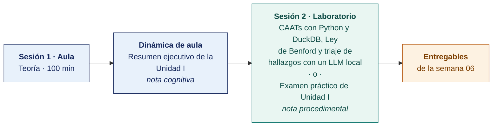

  
  &nbsp;&nbsp;&nbsp;&nbsp;&nbsp;&nbsp;
  

  <strong>Universidad Privada de Tacna</strong> 
  Facultad de Ingeniería · Escuela Profesional de Ingeniería de Sistemas

<h1 align="center">Semana 06</h1>
<h2 align="center">Auditoría Continua y CAATs · Exposición de Trabajos · Examen de Unidad I</h2>

  <strong>SI-084 · Auditoría de Sistemas</strong> 
  4 horas académicas de 50 min · 100 min de exposiciones y examen de unidad en aula · 100 min de taller en laboratorio

---

## Datos de la asignatura

| | |
|---|---|
| **Asignatura** | SI-084 · Auditoría de Sistemas |
| **Escuela** | Escuela Profesional de Ingeniería de Sistemas |
| **Ciclo** | X · 04 horas semanales · 03 créditos · Obligatorio |
| **Prerrequisito** | SI-985 Gestión de la Configuración de Software |
| **Unidad** | I — Seguridad de la Información en Auditoría de Sistemas (cierre) |
| **Semana** | 06 de 17 |
| **Duración** | 4 horas académicas de 50 min · 100 min de exposiciones y examen de unidad en aula · 100 min en laboratorio, compartidos entre el taller y el examen práctico |
| **Resultados de aprendizaje** | **RA1** Analiza e interpreta los conceptos y terminología de Auditoría de Sistemas · **RA2** Evalúa la seguridad de la información en Auditoría de Sistemas |
| **Atributos del graduado** | AG-I04 Comunicación (CD1 y CD3, nivel 4) · AG-I11 Uso de Herramientas (CD2, nivel 4) |

### Lo que indica el sílabo

**Contenido conceptual.** Exposición de trabajos, estudio de casos. Evaluación de Unidad I.

**Contenido procedimental.** Resuelve su evaluación y expone sus trabajos de investigación.

## Materiales de esta semana

| | Documento | Qué encontrarás | Dónde y cuánto dura |
|---|---|---|---|
| 1 | **[Teoría](1-TEORIA.md)** | Exposición de los programas de trabajo · Auditoría continua y técnicas asistidas por computador · Inteligencia artificial en el proceso de auditoría | Aula · 100 min |
| 2 | **[Dinámica de aula](2-DINAMICA.md)** | Resumen ejecutivo de la Unidad I, con su material, su ejemplo resuelto y su rúbrica | **Trabajo previo**, se entrega antes de la sesión |
| 3 | **[Taller de laboratorio](3-TALLER.md)** | CAATs con Python y DuckDB, Ley de Benford y triaje de hallazgos con un LLM local | Laboratorio · 100 min · **comparte sesión con el examen práctico** |

> **El laboratorio de esta semana lo reclaman dos documentos y solo caben los 100 minutos de una sesión.** El **examen práctico** y el **[taller](3-TALLER.md)** están escritos completos y son independientes entre sí. El docente publica en el aula virtual el que ocupará la sesión y deja el otro como trabajo fuera de ella, y lo comunica al inicio de la semana. **El plazo no cambia con esa decisión** — ambos vencen contando desde la sesión de laboratorio, que se dicta igual en cualquiera de los dos casos.

## Ruta de la semana

## Entregables

| Entregable | Formato y nombre del archivo | Vence |
|---|---|---|
| **Dinámica de aula** · Resumen ejecutivo de la Unidad I | PDF desde la [plantilla de dinámica](../PLANTILLAS/SI084-PLANTILLA-DINAMICA.docx) · `SI084-S06-DINAMICA-Grupo<N>.pdf` | Según lo programado en el aula virtual |
| **Informe del taller de laboratorio N.º 06** | PDF en formato EPIS desde la [plantilla de taller](../PLANTILLAS/SI084-PLANTILLA-TALLER.docx) · `SI084-S06-TALLER-Grupo<N>.pdf` | Según lo programado en el aula virtual |
| Exposición del programa de trabajo | Presentación de 10 min | Sesión de teoría |
| **Examen teórico de Unidad I** | Presencial, 40 min, Preguntas de alternativas | Sesión de aula |
| **Examen práctico de Unidad I** | 40 min, individual, con inteligencia artificial permitida y declarada | Sesión de laboratorio, si el docente le asigna la sesión |
| **Expediente consolidado de la Unidad I** | Repositorio Git con la etiqueta `unidad-1` | 72 h después de la sesión de laboratorio |

> La dinámica y el informe del taller se entregan en **PDF**, con la carátula de la UPT y los códigos de todos los integrantes. Las plantillas obligatorias están en [`PLANTILLAS/`](../PLANTILLAS/).

## Cómo se evalúa

| Criterio | Instrumento | Peso en la unidad |
|---|---|---|
| Actitudinal | Registro de participación, puntualidad, trabajo en equipo y cumplimiento de las reglas de seguridad del laboratorio en las semanas 01–06 | 15 % |
| Cognitivo | Promedio de las rúbricas de las dinámicas de aula S01–S05 + exposición del programa de trabajo + resumen ejecutivo | 25 % |
| Procedimental | Promedio de las listas de cotejo de los laboratorios 01–06 + calidad del expediente consolidado | 35 % |
| Examen de Unidad | **Teórico** en aula, 40 min, Preguntas de alternativas · **Práctico** en laboratorio, 40 min, con inteligencia artificial permitida | 25 % |
| | **La Unidad I aporta el 25 % de la nota final del curso** | |

## Preparación para la Unidad II

La Unidad II cambia por completo de registro — **se deja de ejecutar herramientas y se empieza a planificar auditorías**. Todos los laboratorios de las semanas 07 a 12 producen **planes**, no salidas de escáneres.

- **Leer.** ISACA, *COBIT 2019 Framework: Governance and Management Objectives* — introducción y los cinco dominios.
- **Leer.** ISO 19011:2018, cláusulas 5 (gestión del programa de auditoría) y 6 (realización de la auditoría).
- Leer el [Encargo 07](../ENCARGOS-UNIDAD-II/CASO-07-gobierno-y-gestion-de-ti.md) y el [Modelo del Plan de Auditoría](../MODELO-PLAN-DE-AUDITORIA.md). **La Unidad II produce seis planes de auditoría completos, uno por semana**, sobre la organización asignada.
- Preparar la entrevista inicial con el responsable de TI de la empresa auditada.

---

**Docente** · Dr. Oscar Juan Jimenez Flores
[oscarjimenezflores@upt.pe](mailto:oscarjimenezflores@upt.pe) · [LinkedIn](https://www.linkedin.com/in/oscar-jimenez-flores/) · [CTI Vitae — CONCYTEC](https://ctivitae.concytec.gob.pe/appDirectorioCTI/VerDatosInvestigador.do?id_investigador=33398)

Escuela Profesional de Ingeniería de Sistemas · Universidad Privada de Tacna · Tacna, Perú
