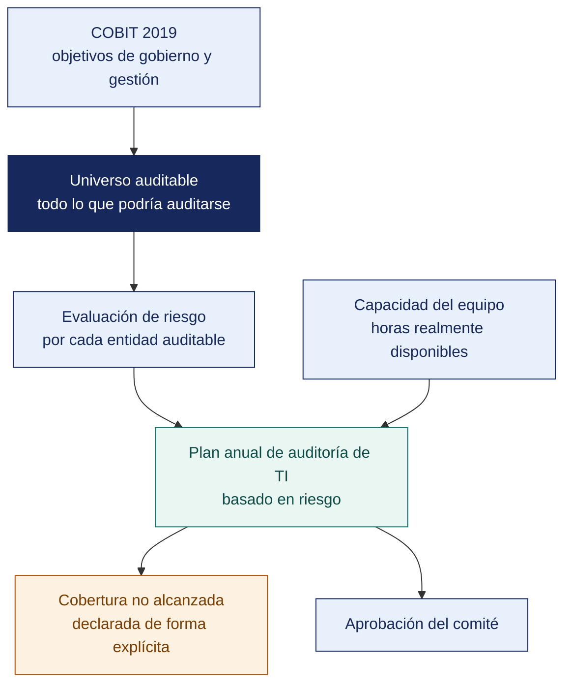

[Semana 07](README.md) · **Teoría** · [Dinámica de aula](2-DINAMICA.md) · [Taller de laboratorio](3-TALLER.md)

# Teoría · Auditoría de los Componentes de TI · Los Pasos de la Auditoría de Sistemas

**SI-084 · Auditoría de Sistemas** · Semana 07 · Sesión 1 en aula · 2 horas académicas, 100 min, con la dinámica incluida

> ¿Un término no le resulta claro? Está definido en el [glosario técnico del curso](../GLOSARIO.md).

---

## La pregunta de esta sesión

El gerente general de una distribuidora decide cada semana a qué proveedores paga. Toma la decisión con un reporte que le llega por correo. Ese reporte lo arma una persona en una hoja de cálculo, cruzando a mano lo que sale del sistema con lo que le pasan por teléfono desde el almacén.

Esa persona renunció el mes pasado. El reporte sigue llegando, armado por alguien que heredó el archivo sin saber de dónde salen tres de sus columnas.

> **La pregunta que ordena esta sesión.** *¿Qué sistemas hay que auditar en una organización que tiene catorce, y cómo se decide cuáles?*

## Antes de empezar

| Lo que necesita traer | De dónde sale |
|---|---|
| Las ocho áreas auditables y cómo se acota el alcance | Semana 05 |
| La estructura de un procedimiento de auditoría | Semana 05 |
| Las técnicas asistidas por computador y el análisis sobre el 100 % | Semana 06 |
| La distinción entre controles generales y de aplicación | Semana 04 |

> **Exploración (5 min), antes de cualquier definición.** Antes de cualquier definición, el aula responde y se anota. *¿Qué sistema hay que auditar en esta empresa? ¿Y si le dijeran que la hoja de cálculo no es un sistema? ¿Por dónde empezaría usted el encargo?* No se corrige nada todavía.

## Distribución del tiempo

| Momento | Minutos |
|---|---|
| El caso del reporte heredado y la exploración inicial | 8 |
| Retroalimentación del cierre de la Unidad I | 7 |
| **Bloque 1.** Los componentes de TI como soporte a la decisión · con su microaplicación | 20 |
| **Bloque 2.** Los pasos de la auditoría de sistemas | 12 |
| **Bloque 3.** El universo auditable y el plan anual basado en riesgo · con su microaplicación | 13 |
| Cierre, respuesta a la pregunta de la sesión y puente a la dinámica | 5 |
| **Total de la sesión de aula** | **65** |

## Mapa de la sesión



---

## Retroalimentación del cierre de la Unidad I

Devolución del examen y de los resúmenes ejecutivos. Lección estructural — **la gerencia no lee hallazgos, lee consecuencias**. El equipo cuyo resumen ejecutivo mencionó una herramienta perdió al lector en la primera línea.

## Bloque 1 · Los componentes de TI como soporte a la decisión

> **La pregunta del bloque.** *¿Se audita el sistema más grande o el que sostiene la decisión más importante?*

**Por qué el auditor evalúa componentes y no cajas.** Una organización no toma decisiones con servidores. Las toma con **información**. El auditor recorre la cadena que va del hecho de negocio a la decisión y busca dónde se rompe:

```
Hecho de negocio → Captura → Procesamiento → Almacenamiento → Integración
       → Reporte → Interpretación → DECISIÓN
```

Cada eslabón tiene un riesgo característico y un control asociado:

| Eslabón | Componente de TI | Riesgo si falla | Efecto sobre la decisión |
|---|---|---|---|
| Captura | Aplicaciones transaccionales, dispositivos, formularios | Dato incompleto, inexacto o no autorizado | La decisión parte de un hecho que no ocurrió |
| Procesamiento | Lógica de negocio, integraciones, procesos programados | Cálculo erróneo, transacción perdida o duplicada | La magnitud está mal medida |
| Almacenamiento | Bases de datos, repositorios documentales | Pérdida, alteración no trazable | No se puede reconstruir la historia |
| Integración | ETL, API, colas, archivos planos | Desfase entre sistemas, duplicación | Dos áreas deciden con cifras distintas |
| Reporte | *Data warehouse*, tableros, hojas de cálculo | Definición ambigua del indicador, versión no controlada | Se optimiza el número equivocado |
| Interpretación | Gobierno del dato, glosario, dueños | Cada área define «cliente activo» a su manera | La decisión no es comparable en el tiempo |

**El riesgo de la hoja de cálculo (*End-User Computing*).** En la mayoría de las empresas peruanas medianas, decisiones de millones se toman sobre hojas de cálculo mantenidas por una persona, sin control de versiones, sin validación de fórmulas y sin respaldo. Es un área auditable propia con controles específicos — inventario de hojas críticas, protección de fórmulas, control de versiones, revisión independiente del cálculo y plan de sucesión del responsable.

**La pregunta que ordena esta área.** El auditor no pregunta «¿qué sistemas tienen?». Pregunta. **«¿Cuáles son las cinco decisiones más importantes que toma esta gerencia y con qué información las toma?»** Los sistemas que alimentan esas cinco decisiones son el núcleo del universo auditable; el resto es periferia.

> **El error frecuente del bloque.** Preguntar «¿qué sistemas tienen?» y construir el universo auditable con esa lista. Produce un plan que audita el ERP porque es grande y deja fuera la hoja de cálculo que sostiene la decisión de pagos. La pregunta correcta es **cuáles son las cinco decisiones más importantes y con qué información se toman**.

## Bloque 2 · Los pasos de la auditoría de sistemas

> **La pregunta del bloque.** *¿Dónde empieza realmente un encargo, y quién lo decide?*

El ciclo completo, según ISO 19011:2018 e ITAF de ISACA:

```
 FASE 0 · GESTIÓN DEL PROGRAMA         (anual, nivel dirección)
   └─ Universo auditable → evaluación de riesgo → PLAN ANUAL

 FASE 1 · INICIO DEL ENCARGO
   └─ Designación del equipo → contacto → verificación de viabilidad
      → declaración de independencia

 FASE 2 · PLANIFICACIÓN
   └─ Comprensión de la entidad → objetivos → alcance → criterios
      → materialidad → riesgo → PROGRAMA DE TRABAJO → recursos

 FASE 3 · EJECUCIÓN (trabajo de campo)
   └─ Reunión de apertura → pruebas de diseño → pruebas de eficacia
      → papeles de trabajo → hallazgos preliminares

 FASE 4 · COMUNICACIÓN
   └─ Validación de hallazgos con el auditado → reunión de cierre
      → INFORME → respuesta de la administración

 FASE 5 · SEGUIMIENTO
   └─ Plan de acción → verificación de implementación → cierre o escalamiento
```

**Fase 2 en detalle. Los seis insumos de la planificación.**

| Insumo | Pregunta que responde | Fuente |
|---|---|---|
| **Comprensión de la entidad** | ¿A qué se dedica, cómo gana dinero, qué la regula? | Estados financieros, organigrama, entrevistas, normativa sectorial |
| **Objetivo de la auditoría** | ¿Qué pregunta debe responder el informe? | Encargo del comité de auditoría o de la dirección |
| **Alcance** | ¿Qué sistemas, procesos, ubicaciones y periodo? | Negociado y **documentado con lo excluido explícito** |
| **Criterios** | ¿Contra qué se compara? | Normas, políticas internas, contratos, legislación |
| **Materialidad** | ¿A partir de qué magnitud importa? | Cuantitativa (monto) y cualitativa (reputación, legalidad) |
| **Evaluación de riesgo** | ¿Dónde se concentra el esfuerzo? | Matriz de riesgo del encargo |

> **La materialidad en auditoría de sistemas** rara vez es monetaria pura. Un hallazgo de S/ 3 000 en pérdidas puede ser material si revela que **cualquier usuario puede alterar registros sin dejar rastro**, porque el efecto no es la pérdida observada sino la que no se puede descartar.

**Fase 4. La validación previa.** Ningún hallazgo se publica sin haber sido contrastado con el auditado. No es cortesía. Es control de calidad. El auditado puede aportar evidencia que el auditor no vio, y un hallazgo basado en información incompleta destruye la credibilidad de todo el informe. **La discrepancia que persiste tras la validación se documenta en el informe con la posición de ambas partes.**

**Fase 5. El paso que casi nadie ejecuta.** Un informe sin seguimiento es un documento de archivo. ITAF exige verificar la implementación de las recomendaciones y, si la administración decidió no actuar, **documentar formalmente la aceptación del riesgo residual por parte de quien tenía autoridad para aceptarlo**.

**Ejemplo trabajado — el mismo encargo recorriendo los pasos.** Auditoría de accesos en una distribuidora.

| Paso | Qué se hace aquí | Producto | Error frecuente |
|---|---|---|---|
| **1. Planificación** | Se define alcance, criterio y periodo. Se solicita la información por matriz PBC | Carta de encargo y programa | Empezar a pedir datos sin haber definido el criterio |
| **2. Relevamiento** | Se entiende cómo opera el proceso hoy. Entrevista y narrativa | Narrativa validada por el auditado | Tomar la narrativa como evidencia. Es una declaración, no una prueba |
| **3. Evaluación de controles** | Se prueba diseño y luego eficacia operativa | Matriz de controles con su resultado | Probar eficacia de un control cuyo diseño ya falló |
| **4. Pruebas sustantivas** | Se examinan los datos directamente | Papeles de trabajo con la evidencia | Concluir sobre la población habiendo mirado 10 registros |
| **5. Hallazgos** | Se construyen con sus cinco elementos | Fichas de hallazgo | Presentar la condición sola y llamarla hallazgo |
| **6. Comunicación** | Reunión de cierre y respuesta de la administración | Acta y respuestas incorporadas | Emitir el informe sin dar derecho a réplica |
| **7. Informe** | Se emite al destinatario del encargo | Informe final | Dirigirlo a quien pidió el trabajo en lugar de al destinatario acordado |
| **8. Seguimiento** | Se verifica la implantación de lo recomendado | Matriz de seguimiento | Cerrar el encargo con la entrega del informe |

> **El paso 8 es el que más se omite y el que da sentido a los siete anteriores.** Una recomendación que nadie verifica es una opinión archivada.

> **Microaplicación (6 min) · rastrear la decisión hasta su dato.** En parejas, el aula toma la decisión del caso —a qué proveedor se le paga— y **recorre la cadena hacia atrás** hasta nombrar dónde nace el dato y quién es su dueño. Se recogen dos recorridos antes de continuar.

| Caso | Qué debe contener una buena respuesta |
|---|---|
| ¿Por qué la narrativa validada no es evidencia suficiente? | Porque describe lo que la organización **dice** que hace. La evidencia es lo que hizo. Los datos del sistema |
| El auditado se niega a firmar el acta de cierre. ¿Se detiene el informe? | No. Se deja constancia de la negativa en el acta y se emite igual. El derecho de réplica se ofreció; no ejercerlo es decisión del auditado |
| ¿En qué paso aparece por primera vez el criterio? | En el 1. Si aparece después, el trabajo se hizo buscando qué criticar en lugar de verificar contra un estándar |
## Bloque 3 · El universo auditable y el plan anual basado en riesgo

> **La pregunta del bloque.** *¿Cómo se justifica ante un comité que unas entidades se auditan y otras no?*

**Universo auditable.** El inventario completo de entidades auditables — procesos, sistemas, unidades organizativas, proyectos y proveedores. Se construye una vez y se mantiene vivo.

**Cómo se prioriza.** No por intuición, sino por un modelo de factores de riesgo con pesos definidos y aprobados:

| Factor | Peso | Escala 1–5 |
|---|---|---|
| **Impacto financiero** | 25 % | Volumen transaccional y materialidad asociada |
| **Exposición regulatoria** | 20 % | ¿Lo revisa la SBS, la Contraloría, la SMV, la ANPD? |
| **Criticidad operativa** | 20 % | ¿La empresa opera sin este sistema? RTO tolerable |
| **Complejidad y cambio** | 15 % | Cambios recientes, integraciones, deuda técnica |
| **Historial** | 10 % | Incidentes previos, hallazgos abiertos, rotación de personal clave |
| **Tiempo sin auditar** | 10 % | Años desde la última revisión |

```
Puntaje = Σ (factor_i × peso_i)     →     Prioridad: Alta > 3.5 · Media 2.5–3.5 · Baja < 2.5
```

**Del puntaje al plan.** El plan anual asigna horas reales:

| Elemento | Contenido |
|---|---|
| Encargos del año | Los de prioridad alta, más una muestra rotativa de los de prioridad media |
| Horas por encargo | Estimadas por complejidad, no repartidas por igual |
| Capacidad disponible | Horas del equipo menos capacitación, vacaciones y **reserva para trabajos no planificados (15–20 %)** |
| Cobertura declarada | **Qué queda sin auditar este año y por qué** — este párrafo es el que protege al auditor |
| Aprobación | Comité de auditoría o directorio, con acta |

**COBIT 2019 como fuente del universo auditable.** Sus **40 objetivos de gobierno y gestión** en cinco dominios ofrecen un universo auditable pre-construido y trazable a un marco reconocido:

| Dominio | Objetivos | Naturaleza |
|---|---|---|
| **EDM** — Evaluar, Dirigir y Supervisar | EDM01–EDM05 | **Gobierno**: lo ejecuta el directorio |
| **APO** — Alinear, Planificar y Organizar | APO01–APO14 | **Gestión.** Estrategia, arquitectura, riesgo, proveedores, datos |
| **BAI** — Construir, Adquirir e Implementar | BAI01–BAI11 | **Gestión.** Proyectos, requisitos, cambios, activos, configuración |
| **DSS** — Entregar, Dar Servicio y Soporte | DSS01–DSS06 | **Gestión.** Operaciones, incidentes, continuidad, seguridad, controles de proceso |
| **MEA** — Supervisar, Evaluar y Valorar | MEA01–MEA04 | **Gestión.** Desempeño, control interno, cumplimiento, aseguramiento |

Los **factores de diseño** de COBIT 2019 (estrategia empresarial, metas, perfil de riesgo, panorama de amenazas, requisitos de cumplimiento, rol de TI, modelo de aprovisionamiento, método de desarrollo, tamaño de la empresa) permiten **priorizar los 40 objetivos según la organización concreta**, que es exactamente lo que necesita el plan anual.

**Ejemplo trabajado — de 17 entidades auditables a un plan de 3 encargos.** El área dispone de 480 horas-auditor al año.

| Entidad auditable | Riesgo | Última auditoría | Obligación legal | Horas estimadas | ¿Entra al plan? |
|---|---|---|---|---|---|
| Gestión de accesos | **Extremo** | Nunca | No | 160 | **Sí — 1.º** |
| Protección de datos personales | Alto | Nunca | **Sí, plazo vencido** | 120 | **Sí — 2.º**, entra por obligación aunque no sea el mayor riesgo |
| Ciclo de compras y pagos | Alto | Hace 2 años | No | 140 | **Sí — 3.º** |
| Continuidad y respaldos | Alto | Nunca | No | 120 | No. **Se declara como no cubierto** |
| Proveedor de nube | Medio | Nunca | No | 80 | No |
| Los 12 restantes | Medio o bajo | — | No | — | No |
| **Total comprometido** | | | | **420** | Quedan 60 h de reserva para trabajos no planificados |

> **Las dos decisiones que el plan debe hacer explícitas.** Por qué protección de datos entra antes que otros de mayor riesgo —porque hay un plazo legal vencido, y eso no compite—, y **qué queda sin cubrir**. Un plan que promete cubrirlo todo no es creíble; uno que declara su cobertura real permite al comité decidir si acepta el remanente.

> **Microaplicación (5 min) · lo que el plan deja fuera.** El aula responde a mano alzada una sola pregunta antes de la explicación — *si el plan anual no alcanza para todo, ¿quién firma lo que queda sin auditar?* La respuesta correcta incomoda y por eso conviene recogerla primero.

| Caso | Qué debe contener una buena respuesta |
|---|---|
| ¿Por qué reservar horas para trabajos no planificados? | **Porque siempre aparecen.** Una denuncia, un incidente, un pedido del directorio. Sin reserva, cada imprevisto desplaza un encargo comprometido |
| ¿Se audita primero lo de mayor riesgo o lo que nunca se auditó? | El riesgo manda, pero «nunca auditado» es un factor de riesgo en sí: no se sabe qué hay ahí |
| El comité pide agregar un encargo sin quitar ninguno. ¿Qué se responde? | Se muestra la capacidad comprometida y se pide que indique cuál se posterga. La decisión es del comité; la restricción es aritmética |
> **El error frecuente del bloque.** Presentar un plan anual que cubre todo el universo auditable. Si cabe entero en la capacidad disponible, o el universo está incompleto o las horas están mal estimadas. Un plan profesional **declara su cobertura no alcanzada** y hace que alguien la asuma por escrito.

## Cierre · qué se lleva de aquí

**La respuesta a la pregunta con la que abrimos.** Se auditan los sistemas que sostienen las decisiones que importan, y eso se determina preguntando por las decisiones, no por los sistemas. En el caso de hoy el objeto auditable no es el ERP — es **la hoja de cálculo con tres columnas de origen desconocido**, que además concentra el conocimiento en una persona que ya no está.

**Las tres ideas que deben quedar.**

| Idea | Por qué importa en el ejercicio profesional |
|---|---|
| La organización decide con información, no con sistemas | Cambia la pregunta con la que se construye el universo auditable y, con ella, todo el plan anual |
| La hoja de cálculo crítica es un área auditable con controles propios | Es donde se toman decisiones de millones sin control de versiones, sin dueño formal y sin respaldo |
| El plan anual se prioriza por riesgo y declara lo que deja fuera | Es lo que convierte el plan en una decisión de gobierno y no en una lista de intenciones |

**Volviendo a la exploración del inicio.** Se releen las respuestas del inicio. Casi todo el mundo nombró el ERP y casi nadie la hoja de cálculo, que es exactamente el sesgo que este bloque corrige — se audita lo que parece un sistema, no lo que sostiene la decisión.

**Lo que sigue.** La [dinámica de esta sesión](2-DINAMICA.md) pide identificar **las cinco decisiones gerenciales más importantes** de su organización y rastrear con qué información se toma cada una. Y exige señalar si el dato pasa en algún punto por una hoja de cálculo, que es el hallazgo que este caso anticipa.


La pregunta que cierra la sesión. *¿qué quedó fuera del plan anual y quién firmó esa decisión?* Un plan que pretende cubrir todo no cubre nada; un plan honesto declara su cobertura y sus vacíos.
---

---

[Semana 07](README.md) · **Teoría** · [Dinámica de aula](2-DINAMICA.md) · [Taller de laboratorio](3-TALLER.md)

---

**Docente** · Dr. Oscar Juan Jimenez Flores
[oscarjimenezflores@upt.pe](mailto:oscarjimenezflores@upt.pe) · [LinkedIn](https://www.linkedin.com/in/oscar-jimenez-flores/) · [CTI Vitae — CONCYTEC](https://ctivitae.concytec.gob.pe/appDirectorioCTI/VerDatosInvestigador.do?id_investigador=33398)

Escuela Profesional de Ingeniería de Sistemas · Universidad Privada de Tacna · Tacna, Perú
