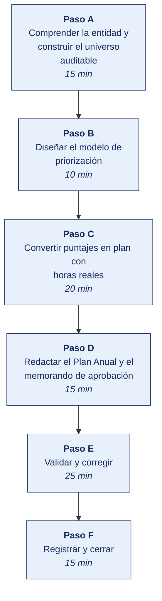

[Semana 07](README.md) · [Teoría](1-TEORIA.md) · [Dinámica de aula](2-DINAMICA.md) · **Taller de laboratorio**

# Taller de laboratorio 07 · Construcción del Plan Anual de Auditoría de TI basado en riesgo

**SI-084 · Auditoría de Sistemas** · Semana 07 · Sesión 2 en laboratorio · 100 min · calificación **procedimental**

> ¿Un término no le resulta claro? Está definido en el [glosario técnico del curso](../GLOSARIO.md).

---

## Secuencia del taller



## Qué entregas

| | |
|---|---|
| **Archivo** | `SI084-S07-TALLER-Grupo<N>.pdf` |
| **Plantilla obligatoria** | [SI084-PLANTILLA-TALLER.docx](../PLANTILLAS/SI084-PLANTILLA-TALLER.docx) |
| **Formato** | PDF exportado desde la plantilla en Word, con la carátula de la UPT, el índice actualizado y las capturas numeradas |
| **Qué va dentro** | Las secciones de la plantilla. La **5. Resultados y evidencias** se califica contra la tabla de resultados esperados de esta guía, y **cada resultado necesita la evidencia que lo demuestre**. No se copian de aquí los objetivos, la duración ni los resultados de aprendizaje |
| **Dónde se sube** | Aula virtual, tarea «Taller · Semana 07» |
| **Cuándo vence** | 48 horas después de la sesión de laboratorio |

> No se califica un informe entregado en `.docx`, sin carátula, sin los códigos de los integrantes o con resultados declarados sin evidencia.

---

## El reto

| | |
|---|---|
| **Situación** | Hay más entidades auditables que horas disponibles y el comité pedirá justificar por qué unas sí y otras no. Decir «por riesgo» sin modelo no es una respuesta. |
| **Misión** | Construir el modelo de priorización con escalas definidas, convertir puntajes en horas reales y declarar por escrito la cobertura que queda sin alcanzar. |
| **Criterio de éxito** | Cada calificación tiene una línea de evidencia detrás, y el plan declara lo que no se va a auditar y por qué. |

## 1. Información sobre el evento práctico

### 1.1. Título del evento práctico

Elaboración del universo auditable de una organización real a partir de los 40 objetivos de gobierno y gestión de COBIT 2019, su priorización mediante un modelo de factores de riesgo ponderados y la construcción del Plan Anual de Auditoría de TI con asignación real de horas.

### 1.2. Objetivos

- Construir el **universo auditable** de la organización combinando el marco COBIT 2019 con los procesos y sistemas realmente existentes.
- Aplicar los **factores de diseño de COBIT 2019** para descartar objetivos no pertinentes de forma justificada.
- Diseñar un **modelo de priorización por factores de riesgo ponderados**, con escalas definidas y pesos aprobados.
- Calcular el puntaje de riesgo de cada entidad auditable y producir el **mapa de calor**.
- Elaborar el **Plan Anual de Auditoría de TI** con encargos, horas, capacidad disponible y **declaración explícita de la cobertura no alcanzada**.
- Redactar el **memorando de aprobación** dirigido al comité de auditoría.

### 1.3. Tiempo de duración

**100 minutos.**

### 1.4. Resultados de Aprendizaje (RA)

- **RA1** Analiza e identifica las responsabilidades que asume un auditor de sistemas.
- **RA2** Valora la importancia de los roles del auditor de sistemas.

### 1.5. Recursos

| Recurso | Detalle |
|---|---|
| **COBIT 2019 Framework: Introduction & Methodology** y **Governance and Management Objectives** | https://www.isaca.org/resources/cobit — resúmenes de acceso libre y *COBIT Focus Areas* |
| **LibreOffice Calc** o Google Sheets | Modelo de priorización |
| **Python 3.11+** con `pandas`, `matplotlib` | Cálculo y mapa de calor |
| **draw.io** (https://app.diagrams.net/) | Diagrama del universo auditable |
| Información de la empresa real | Organigrama, inventario de sistemas, notas de la entrevista inicial |
| `ANEXO-CASO-SIMULADO.md` | Alternativa para equipos sin acceso confirmado |

### 1.6. Seguridad

1. La información de la empresa real se clasifica como **Confidencial**. El repositorio del equipo debe ser **privado**.
2. Se anonimiza toda referencia a personas naturales. Se usan cargos, nunca nombres.
3. Antes de solicitar cualquier documento a la empresa se entrega la **carta de presentación institucional** y se firma el **acuerdo de confidencialidad**.
4. Ninguna prueba técnica se ejecuta sobre sistemas de la empresa en esta unidad. La Unidad II produce **planes**, no ejecuciones.

---

## 2. Procedimiento o Metodología

> **Documento del caso para esta semana.** La organización entrega **Extracto del plan institucional y actas**, en `CASOS/EMPRESA-<NN>-<slug>/documentos/plan-institucional-extracto.md`. Es consistente con los datos de `datos/`. Las personas, usuarios y proveedores que menciona existen en los archivos. **No señala sus debilidades**; declara lo que la organización dice hacer.

> **Documento adicional del caso.** La organización entrega también **Universo auditable y registro de riesgos**, en `CASOS/EMPRESA-<NN>-<slug>/documentos/universo-auditable-y-riesgos.md`.

### Paso A — Comprender la entidad y construir el universo auditable

**A.1 — Ficha de comprensión de la entidad.** Se completa `10_planificacion/PL01_comprension_entidad.md`:

| Campo | Contenido |
|---|---|
| Razón social, RUC, sector, tamaño (ventas y personal) | |
| **Modelo de negocio.** Cómo genera ingresos | |
| **Régimen regulatorio**: SBS / SMV / Contraloría / no regulado | |
| Procesos de negocio críticos | |
| Sistemas de información en producción (nombre, función, proveedor, criticidad) | |
| Proveedores de TI y servicios en la nube | |
| Estructura del área de TI — personas, roles, dependencia jerárquica | |
| Incidentes de TI de los últimos 24 meses | |
| Auditorías previas y hallazgos abiertos | |
| **Las cinco decisiones** de la dinámica de aula | |

**A.2 — Universo auditable.** Se construye combinando dos ejes:

```python
# 10_planificacion/PL02_universo.py
import pandas as pd

# Eje 1 — Objetivos COBIT 2019 pertinentes tras aplicar los factores de diseño
COBIT = [
 ("EDM01","Marco de gobierno establecido y mantenido","Gobierno"),
 ("EDM03","Optimización del riesgo asegurada","Gobierno"),
 ("APO01","Marco de gestión de I&T","Gestión"),
 ("APO12","Gestión del riesgo","Gestión"),
 ("APO13","Gestión de la seguridad","Gestión"),
 ("APO14","Gestión de datos","Gestión"),
 ("BAI06","Gestión de cambios de TI","Gestión"),
 ("BAI07","Gestión de aceptación y transición del cambio","Gestión"),
 ("BAI09","Gestión de activos","Gestión"),
 ("BAI10","Gestión de la configuración","Gestión"),
 ("DSS01","Gestión de operaciones","Gestión"),
 ("DSS02","Gestión de solicitudes e incidentes de servicio","Gestión"),
 ("DSS04","Gestión de la continuidad","Gestión"),
 ("DSS05","Gestión de servicios de seguridad","Gestión"),
 ("DSS06","Gestión de controles de procesos de negocio","Gestión"),
 ("MEA01","Gestión del desempeño y la conformidad","Gestión"),
 ("MEA03","Gestión del cumplimiento de requisitos externos","Gestión"),
]

# Eje 2 — Entidades auditables propias de ESTA organización
ENTIDADES = [
 "ERP - Módulo de Compras y Pagos",
 "ERP - Módulo de Inventarios",
 "Sistema de Planilla",
 "Portal de comercio electrónico",
 "Infraestructura y red corporativa",
 "Servicios en la nube contratados",
 "Hojas de cálculo críticas de Gerencia Comercial",
 "Proceso de gestión de accesos",
 "Proceso de gestión de cambios",
 "Respaldo y continuidad operativa",
 "Cumplimiento de la Ley 29733 (datos personales)",
 "Contratos con proveedores de TI",
]

universo = pd.DataFrame([{"id": f"UA-{i+1:02d}", "entidad_auditable": e}
                         for i, e in enumerate(ENTIDADES)])
universo.to_csv("PL02_universo_auditable.csv", index=False)
print(universo.to_string(index=False))
```

**A.3 — Justificar las exclusiones.** Se documenta qué objetivos de COBIT **no** se incluyeron y por qué, usando los factores de diseño. **Ejemplo.** *«BAI03 Gestión de la identificación y construcción de soluciones se excluye porque la organización no desarrolla software: adquiere sistemas empaquetados. El riesgo se traslada a APO10 Gestión de proveedores.»* **Una exclusión sin justificación es un vacío de cobertura no declarado.**

### Paso B — Diseñar el modelo de priorización

```python
# 10_planificacion/PL03_priorizacion.py
import pandas as pd, numpy as np, matplotlib.pyplot as plt

PESOS = {"impacto_financiero":.25, "exposicion_regulatoria":.20,
         "criticidad_operativa":.20, "complejidad_cambio":.15,
         "historial":.10, "tiempo_sin_auditar":.10}
assert abs(sum(PESOS.values()) - 1) < 1e-9, "Los pesos deben sumar 1"

# Las ESCALAS se documentan; sin ellas la calificación no es replicable
ESCALAS = {
 "impacto_financiero": {1:"< S/ 100k anuales", 2:"S/ 100k–500k", 3:"S/ 500k–2M",
                        4:"S/ 2M–10M", 5:"> S/ 10M o afecta el estado financiero"},
 "exposicion_regulatoria": {1:"Sin regulación aplicable", 2:"Normativa general",
                        3:"Ley 29733 aplicable", 4:"Supervisión sectorial periódica",
                        5:"Supervisión directa con sanción (SBS/SMV/Contraloría)"},
 "criticidad_operativa": {1:"Interrupción tolerable > 1 semana", 2:"> 3 días",
                        3:"> 1 día", 4:"> 4 horas", 5:"La empresa se detiene de inmediato"},
 "complejidad_cambio": {1:"Estable, sin cambios en 24 meses", 2:"Cambios menores",
                        3:"Cambios trimestrales", 4:"Cambios mensuales o integraciones nuevas",
                        5:"Migración o implantación en curso"},
 "historial": {1:"Sin incidentes ni hallazgos", 2:"Hallazgos menores cerrados",
                        3:"Hallazgos abiertos", 4:"Incidente en los últimos 12 meses",
                        5:"Incidente grave o rotación del responsable clave"},
 "tiempo_sin_auditar": {1:"< 1 año", 2:"1–2 años", 3:"2–3 años",
                        4:"3–5 años", 5:"Nunca auditado"},
}

df = pd.read_csv("PL02_universo_auditable.csv")
# Cada equipo califica de 1 a 5 con evidencia documentada por cada calificación
CALIF = {  # id: (fin, reg, ope, cmp, hist, tiempo)
 "UA-01": (5,4,5,4,3,5), "UA-02": (4,2,4,3,2,4), "UA-03": (4,5,4,2,3,3),
 "UA-04": (5,4,5,5,4,5), "UA-05": (3,3,5,4,4,4), "UA-06": (3,4,4,4,2,5),
 "UA-07": (4,2,3,5,3,5), "UA-08": (3,4,4,3,5,3), "UA-09": (3,3,4,5,4,4),
 "UA-10": (5,3,5,2,4,5), "UA-11": (2,5,2,3,2,5), "UA-12": (3,4,3,2,2,5),
}
cols = list(PESOS)
for i, c in enumerate(cols):
    df[c] = df["id"].map(lambda k: CALIF[k][i])
df["puntaje"] = sum(df[c]*w for c, w in PESOS.items()).round(2)
df["prioridad"] = pd.cut(df.puntaje, [0,2.5,3.5,5],
                         labels=["Baja","Media","Alta"])
df = df.sort_values("puntaje", ascending=False)
df.to_csv("PL03_universo_priorizado.csv", index=False)
print(df[["id","entidad_auditable","puntaje","prioridad"]].to_string(index=False))

# Mapa de calor · impacto financiero vs. criticidad operativa
fig, ax = plt.subplots(figsize=(8,6))
sc = ax.scatter(df.criticidad_operativa, df.impacto_financiero,
                s=df.puntaje**3*8, c=df.puntaje, cmap="RdYlGn_r",
                edgecolors="black", alpha=.85)
for _, r in df.iterrows():
    ax.annotate(r["id"], (r.criticidad_operativa, r.impacto_financiero),
                fontsize=8, ha="center", va="center")
ax.set_xlabel("Criticidad operativa"); ax.set_ylabel("Impacto financiero")
ax.set_title("Mapa de calor del universo auditable"); ax.grid(alpha=.3)
plt.colorbar(sc, label="Puntaje de riesgo"); plt.tight_layout()
plt.savefig("PL03_mapa_calor.png", dpi=140)
```

> **Regla de calidad.** Cada calificación de 1 a 5 debe tener **una línea de evidencia** en el papel de trabajo. *«UA-04 recibe 5 en exposición regulatoria porque el portal procesa datos personales de 40 000 clientes, alcanzados por la Ley 29733»*. Sin esa línea, el modelo es una opinión con decimales.

### Paso C — Convertir puntajes en plan con horas reales

```python
# 10_planificacion/PL04_plan_anual.py
import pandas as pd

df = pd.read_csv("PL03_universo_priorizado.csv")

# --- CAPACIDAD REAL DEL EQUIPO ---
AUDITORES, SEMANAS, HORAS_SEM = 2, 44, 40
BRUTAS = AUDITORES * SEMANAS * HORAS_SEM
DESCUENTOS = {"Capacitación y certificación": .08, "Administración del área": .10,
              "Reserva para trabajos no planificados": .18}
NETAS = BRUTAS * (1 - sum(DESCUENTOS.values()))
print(f"Horas brutas {BRUTAS:,.0f} → netas disponibles {NETAS:,.0f}")
for k, v in DESCUENTOS.items(): print(f"   -{v:.0%}  {k}")

HORAS = {"Alta": 160, "Media": 100, "Baja": 60}
df["horas_estimadas"] = df.prioridad.map(HORAS)
df["acumulado"] = df.horas_estimadas.cumsum()
df["en_plan"] = df.acumulado <= NETAS

plan = df[df.en_plan].copy()
TRIM = ["Q1","Q1","Q2","Q2","Q3","Q3","Q4","Q4"]
plan["trimestre"] = [TRIM[i % len(TRIM)] for i in range(len(plan))]
plan[["id","entidad_auditable","prioridad","puntaje","horas_estimadas","trimestre"]]\
    .to_csv("PL04_plan_anual.csv", index=False)

fuera = df[~df.en_plan]
print(f"\nEncargos en el plan : {len(plan)}  ({plan.horas_estimadas.sum():,.0f} h)")
print(f"FUERA DE COBERTURA  : {len(fuera)}")
print(fuera[["id","entidad_auditable","puntaje","prioridad"]].to_string(index=False))
```

### Paso D — Redactar el Plan Anual y el memorando de aprobación

Se produce `10_planificacion/PLAN_ANUAL_AUDITORIA_TI.md` con esta estructura obligatoria:

```markdown
# Plan Anual de Auditoría de Tecnologías de Información — Ejercicio anual
## <Razón social>

## 1. Propósito y marco de referencia
Propósito del plan; marcos aplicados (COBIT 2019, ISO 19011:2018, ITAF de ISACA);
normativa sectorial aplicable a la entidad.

## 2. Comprensión de la entidad
Resumen de PL01: modelo de negocio, régimen regulatorio, sistemas críticos,
estructura del área de TI, incidentes y hallazgos abiertos.

## 3. Universo auditable
Tabla de las N entidades auditables. **Objetivos COBIT excluidos y justificación
de cada exclusión con el factor de diseño que la sustenta.**

## 4. Metodología de priorización
Factores, pesos, escalas 1–5 con su definición operativa y fuente de la calificación.

## 5. Resultados de la evaluación de riesgo
Tabla priorizada + mapa de calor + análisis de los tres encargos de mayor riesgo.

## 6. Capacidad del equipo
Horas brutas, descuentos aplicados con su justificación y horas netas disponibles.

## 7. Plan de encargos del período
Encargo · objetivo · alcance preliminar · horas · trimestre · auditor responsable.

## 8. COBERTURA NO ALCANZADA          ← sección obligatoria
Entidades auditables que quedan fuera del plan, su puntaje de riesgo y el motivo.
Declaración de que la dirección conoce y acepta este vacío de cobertura.

## 9. Supuestos, restricciones y condiciones de revisión del plan
Qué eventos obligarían a replanificar durante el año.

## 10. Aprobación
Elaborado por · Revisado por · Aprobado por (comité de auditoría) · Fecha.
```

**Memorando de aprobación** (`10_planificacion/PL05_memorando.md`), máximo una página, dirigido al comité de auditoría, que responda. *Qué se auditará, por qué esos y no otros, cuánto costará en horas y qué queda sin cubrir.*

Sellado:

```bash
sha256sum 10_planificacion/* >> 20_evidencia/SHA256SUMS_PL.txt
git add . && git commit -m "PL: universo auditable, priorizacion y Plan Anual de Auditoria de TI"
```

---

### Paso E — Validar y corregir (25 min)

El resultado no vale por estar hecho, sino por resistir una comprobación. Se ejecutan estas tres y **se corrige lo que falle antes de cerrar la sesión**.

1. Comprobar que los pesos del modelo suman 1 y que las seis escalas 1–5 tienen definición operativa.
2. Verificar que **cada** calificación asignada tiene su línea de evidencia, no solo las primeras.
3. Revisar que la sección de cobertura no alcanzada existe y nombra entidades concretas, no generalidades.

> Lo que no se pueda corregir hoy se anota en la sección **Problemas y mejoras** de la evidencia, con lo que faltó y por qué. Un resultado parcial documentado con honestidad vale más que uno declarado sin prueba.

### Paso F — Registrar la evidencia y cerrar (15 min)

Se versiona lo producido, se anota la URL de cada resultado y se responde en dos frases la pregunta de transferencia — **qué riesgo correría una organización real si esto se hiciera mal**.

---

## 3. Resultados

> **Evidencia obligatoria en GitHub.** Todo resultado de este taller se versiona en el repositorio del equipo. El informe **no consigna capturas sueltas**. Consigna la **URL** del artefacto en GitHub. Una captura no permite verificar autoría, fecha ni contenido; un enlace sí.
>
> | Qué se entrega | Dónde vive | Qué se escribe en el informe |
> |---|---|---|
> | Código y archivos de configuración | Rama del taller, fusionada a `develop` vía Pull Request | URL del Pull Request |
> | Documentos y matrices | `docs/`, en formato de texto versionable | URL del archivo en la rama |
> | Capturas y videos que el taller exija | `docs/evidencias/S07/` | URL del archivo |
> | Salida de comandos | `docs/evidencias/S07/salidas/*.txt` | URL del archivo |
>
> **Etiqueta del taller.** Al cerrar el taller se crea la etiqueta `taller-07` sobre el commit entregado:
>
> ```bash
> git tag -a taller-07 -m "Taller 07 · SI084"
> git push origin taller-07
> ```
>
> La URL que se consigna en el informe apunta a esa etiqueta:
> `https://github.com/<organizacion>/<repositorio>/tree/taller-07`
>
> **El informe es lo que se califica; el repositorio es lo que lo prueba.** Cada resultado de la sección 3 del informe lleva la URL con la que se verifica, y **un resultado sin su URL se califica como no logrado**, por bien redactado que esté. Lo que no se puede abrir no se puede dar por hecho.

### 3.1. Los tres resultados que se califican

Son los que la rúbrica evalúa. El resto de la lista tiene que existir, pero no se califica fila por fila.

| Resultado | Qué demuestra | Dónde está |
|---|---|---|
| **El modelo de priorización** | Pesos que suman 1 y las seis escalas definidas operativamente | `PL03_priorizacion.py` |
| **La evidencia por calificación** | Una línea de evidencia por cada puntaje asignado | Papel de trabajo |
| **La cobertura no alcanzada** | Lo que el plan deja fuera, con nombre y razón | Sección del `PLAN_ANUAL_AUDITORIA_TI.md` |

### 3.2. Lista de comprobación del taller

Todo esto debe existir al cerrar la sesión.

| # | Resultado esperado | Verificación |
|---|---|---|
| 1 | `PL01_comprension_entidad.md` completo, con el **régimen regulatorio identificado** | Contenido del archivo |
| 2 | Universo auditable con al menos 12 entidades, trazado a objetivos COBIT 2019 | `PL02_universo_auditable.csv` |
| 3 | **Objetivos COBIT excluidos con justificación** basada en factores de diseño | Sección 3 del plan |
| 4 | Modelo de priorización con pesos que suman 1 y **las seis escalas 1–5 definidas operativamente** | `PL03_priorizacion.py` |
| 5 | **Una línea de evidencia por cada calificación** asignada | Papel de trabajo |
| 6 | Mapa de calor generado | `PL03_mapa_calor.png` |
| 7 | Cálculo de capacidad con horas brutas, descuentos justificados y netas | `PL04_plan_anual.py` |
| 8 | Plan Anual con las 10 secciones, incluida la de **cobertura no alcanzada** | `PLAN_ANUAL_AUDITORIA_TI.md` |
| 9 | Memorando de aprobación de una página | `PL05_memorando.md` |
| 10 | Hashes y *commit* en Git | `SHA256SUMS_PL.txt` |

## Rúbrica procedimental (20 puntos)

Se aplica sobre el informe entregado y la evidencia enlazada en el repositorio. **Cada criterio se califica de forma independiente.**

| Criterio | 4 — Logrado | 2 — En proceso | 0 — Insuficiente |
|---|---|---|---|
| **Comprender la entidad y construir el universo auditable** | Completo y correcto, con la evidencia que lo respalda | Completo con errores menores, o correcto pero sin toda la evidencia | Incompleto, o entregado sin ejecutar |
| **Convertir puntajes en plan con horas reales** | Completo y correcto, con la evidencia que lo respalda | Completo con errores menores, o correcto pero sin toda la evidencia | Incompleto, o entregado sin ejecutar |
| **Evidencia verificable en el repositorio** | Cada resultado tiene su URL sobre la etiqueta `taller-NN`, y el enlace abre lo que dice | La mayoría tiene URL; alguna evidencia es una captura suelta | Se declaran resultados sin enlace, o el enlace no corresponde |
| **Trazabilidad de la evidencia** | Todo hallazgo o dato se rastrea hasta el archivo, registro y fecha que lo sustenta | Rastreable en su mayoría; algún dato sin origen | Se afirman hechos sin poder ubicarlos en la evidencia |
| **La evidencia entregada** | Las secciones de la plantilla completas; los papeles de trabajo quedan archivados y referenciados | Secciones completas con papeles de trabajo incompletos | Faltan secciones o no hay papeles de trabajo |

| Puntaje | Equivalencia |
|---|---|
| 18 – 20 | Destacado |
| 14 – 17 | Logrado |
| 6 – 13 | En proceso |
| 0 – 5 | Insuficiente |

> **Un resultado declarado sin evidencia enlazada no se califica**, aunque el trabajo se haya hecho. La tabla de la sección 3.1 es la lista de cotejo; esta rúbrica es lo que determina la nota.

## 4. Conclusiones

Mínimo tres. Líneas argumentales esperadas:

1. Un plan anual de auditoría es una decisión de asignación de un recurso escaso —horas de auditor— y su calidad depende de que la priorización sea trazable a evidencia, no a la percepción del jefe de auditoría.
2. La sección de cobertura no alcanzada es la más incómoda y la más importante. Declara explícitamente qué riesgo permanece sin evaluar y transfiere esa decisión a quien tiene autoridad para asumirla.
3. Los factores de diseño de COBIT 2019 permiten descartar objetivos con justificación en lugar de por omisión, que es la diferencia entre un alcance acotado y un vacío no declarado.

## 5. Referencias Bibliográficas

- ISACA. (2018). *COBIT 2019 Framework: Introduction and Methodology*. https://www.isaca.org/resources/cobit
- ISACA. (2018). *COBIT 2019 Framework: Governance and Management Objectives*. https://www.isaca.org/resources/cobit
- ISACA. (2018). *COBIT 2019 Design Guide: Designing an Information and Technology Governance Solution*. https://www.isaca.org/resources/cobit
- ISACA. (2019). *Developing the IT Audit Plan Using COBIT 2019*. ISACA Journal, vol. 3. https://www.isaca.org/resources/isaca-journal/issues/2019/volume-3/developing-the-it-audit-plan-using-cobit-2019
- ISACA. *ITAF: A Professional Practices Framework for IS Audit/Assurance* (5.ª ed.). https://www.isaca.org/resources/frameworks-standards-and-models
- ISO 19011:2018, cláusula 5 «Gestión de un programa de auditoría». https://www.iso.org/standard/70017.html
- The Institute of Internal Auditors. *Global Internal Audit Standards*. https://www.theiia.org/en/standards/
- Piattini Velthuis, M., Del Peso Navarro, E. y Del Peso Ruiz, M. (2009). *Auditoría de tecnologías y sistemas de información* (6.ª ed.). Alfaomega / Ra-Ma.
- Franklin F., E. B. (2007). *Auditoría administrativa: gestión estratégica del cambio*. Pearson.

## 6. Anexos

- `anexo_A_universo_priorizado.xlsx` — modelo completo con las escalas visibles.
- `anexo_B_mapa_calor.png`
- `anexo_C_plan_anual.pdf` — plan completo firmado por el equipo.
- `anexo_D_evidencia_calificaciones.pdf` — la línea de evidencia de cada calificación.

---

---

[Semana 07](README.md) · [Teoría](1-TEORIA.md) · [Dinámica de aula](2-DINAMICA.md) · **Taller de laboratorio**

---

**Docente** · Dr. Oscar Juan Jimenez Flores
[oscarjimenezflores@upt.pe](mailto:oscarjimenezflores@upt.pe) · [LinkedIn](https://www.linkedin.com/in/oscar-jimenez-flores/) · [CTI Vitae — CONCYTEC](https://ctivitae.concytec.gob.pe/appDirectorioCTI/VerDatosInvestigador.do?id_investigador=33398)

Escuela Profesional de Ingeniería de Sistemas · Universidad Privada de Tacna · Tacna, Perú
