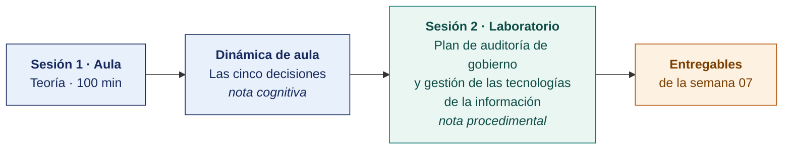

  
  &nbsp;&nbsp;&nbsp;&nbsp;&nbsp;&nbsp;
  

  <strong>Universidad Privada de Tacna</strong> 
  Facultad de Ingeniería · Escuela Profesional de Ingeniería de Sistemas

<h1 align="center">Semana 07</h1>
<h2 align="center">Auditoría de los Componentes de TI · Los Pasos de la Auditoría de Sistemas</h2>

  <strong>SI-084 · Auditoría de Sistemas</strong> 
  4 horas académicas de 50 min · 100 min de teoría con la dinámica incluida en aula · 100 min de taller en laboratorio

---

## Datos de la asignatura

| | |
|---|---|
| **Asignatura** | SI-084 · Auditoría de Sistemas |
| **Escuela** | Escuela Profesional de Ingeniería de Sistemas |
| **Ciclo** | X · 04 horas semanales · 03 créditos · Obligatorio |
| **Prerrequisito** | SI-985 Gestión de la Configuración de Software |
| **Unidad** | II — Diagnóstico, Evaluación y Metodología de Auditoría de Sistemas |
| **Semana** | 07 de 17 |
| **Duración** | 4 horas académicas de 50 min · 100 min de teoría con la dinámica incluida en aula · 100 min de taller en laboratorio |
| **Resultados de aprendizaje** | **RA1** Analiza e identifica las responsabilidades que asume un auditor de sistemas · **RA2** Valora la importancia de los roles del auditor de sistemas |
| **Atributos del graduado** | AG-I08 Análisis de Problemas (CD2 y CD3, nivel 4) · AG-I09 Diseño y Desarrollo de Soluciones (CD11, nivel 4) |

### Lo que indica el sílabo

**Contenido conceptual.** Auditoría de componentes de TI en las organizaciones como soporte en la toma de decisiones. Pasos de auditoría de sistemas.

**Contenido procedimental.** Evalúa los componentes de TI en las organizaciones como soporte de la toma de decisiones.

> **Qué plan construye esta semana.** El laboratorio produce un **plan de auditoría completo** de gobierno y gestión de las tecnologías de la información, con los criterios de COBIT 2019. La estructura es la del [Modelo del Plan de Auditoría](../MODELO-PLAN-DE-AUDITORIA.md) y el caso es el [Encargo 07](../ENCARGOS-UNIDAD-II/CASO-07-gobierno-y-gestion-de-ti.md).

> **La solicitud de su organización.** Está en [CASOS/](CASOS/README.md), una por organización del banco. La escribe la propia organización, expone sus problemas y pide la auditoría. Con ella el equipo propone el plan.

## Materiales de esta semana

| | Documento | Qué encontrarás | Dónde y cuánto dura |
|---|---|---|---|
| 1 | **[Teoría](1-TEORIA.md)** | Los componentes de TI como soporte a la decisión · Los pasos de la auditoría de sistemas · El universo auditable y el plan anual basado en riesgo | Aula · 100 min |
| 2 | **[Dinámica de aula](2-DINAMICA.md)** | Las cinco decisiones, con su material, su ejemplo resuelto y su rúbrica | Aula · dentro de los 100 min de la sesión de teoría |
| 3 | **[Taller de laboratorio](3-TALLER.md)** | Plan de auditoría de gobierno y gestión de las tecnologías de la información | Laboratorio · 100 min |

## Ruta de la semana

## Entregables

| Entregable | Formato y nombre del archivo | Vence |
|---|---|---|
| **Dinámica de aula** · Las cinco decisiones | PDF desde la [plantilla de dinámica](../PLANTILLAS/SI084-PLANTILLA-DINAMICA.docx) · `SI084-S07-DINAMICA-Grupo<N>.pdf` | Según lo programado en el aula virtual |
| **Informe del taller de laboratorio N.º 07** | PDF en formato EPIS desde la [plantilla de taller](../PLANTILLAS/SI084-PLANTILLA-TALLER.docx) · `SI084-S07-TALLER-Grupo<N>.pdf` | Según lo programado en el aula virtual |
| **El plan de auditoría del Encargo 07**, completo | Markdown y PDF en el repositorio, sobre la etiqueta `taller-07` | Según lo programado en el aula virtual |

> La dinámica y el informe del taller se entregan en **PDF**, con la carátula de la UPT y los códigos de todos los integrantes. Las plantillas obligatorias están en [`PLANTILLAS/`](../PLANTILLAS/).

## Cómo se evalúa

| Criterio | Instrumento | Peso |
|---|---|---|
| Cognitivo | Rúbrica de «Las cinco decisiones» + exposición de 10 min en la Semana 08 | 25 % |
| Procedimental | Lista de cotejo de los 10 resultados del laboratorio | 35 % |
| Actitudinal | Trato profesional y confidencial de la información de la empresa real | 15 % |

## Preparación para la Semana 08

- **Leer.** El [Encargo 08](../ENCARGOS-UNIDAD-II/CASO-08-seguridad-de-la-informacion.md), completo, antes de la sesión. Después, la solicitud de su organización en [SEMANA-08/CASOS/](../SEMANA-08/CASOS/README.md).
- **Leer.** La NTP-ISO/IEC 27001:2022, cláusulas 4 a 10, y la cláusula 6 de la ISO 19011:2018.
- **Solicitar.** Por escrito, la política del sistema de gestión de seguridad de la información y la declaración de aplicabilidad de la organización asignada.
- **Traer.** El plan del Encargo 07 etiquetado, del que se reutiliza la plantilla del expediente para las secciones IX a XII.
---

**Docente** · Dr. Oscar Juan Jimenez Flores
[oscarjimenezflores@upt.pe](mailto:oscarjimenezflores@upt.pe) · [LinkedIn](https://www.linkedin.com/in/oscar-jimenez-flores/) · [CTI Vitae — CONCYTEC](https://ctivitae.concytec.gob.pe/appDirectorioCTI/VerDatosInvestigador.do?id_investigador=33398)

Escuela Profesional de Ingeniería de Sistemas · Universidad Privada de Tacna · Tacna, Perú
