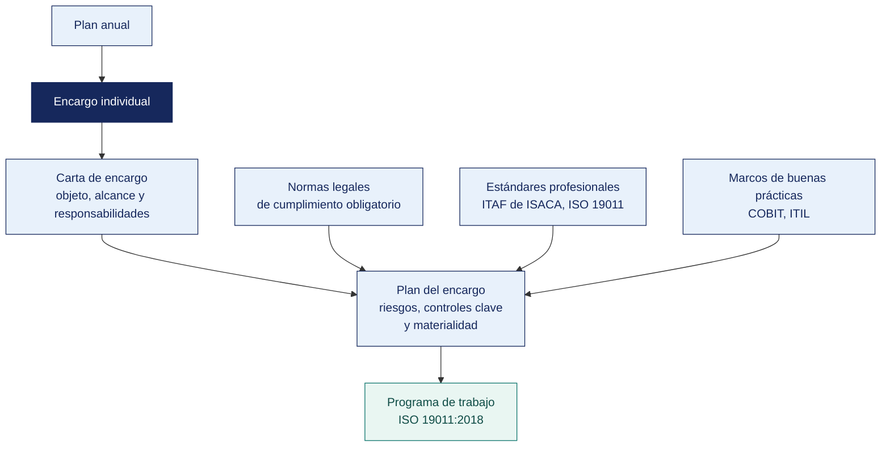

[Semana 08](README.md) · **Teoría** · [Dinámica de aula](2-DINAMICA.md) · [Taller de laboratorio](3-TALLER.md)

# Teoría · Planeación y Ejecución de la Auditoría · Controles, Normas Legales y Estándares

**SI-084 · Auditoría de Sistemas** · Semana 08 · Sesión 1 en aula · 2 horas académicas, 100 min, con la dinámica incluida

> ¿Un término no le resulta claro? Está definido en el [glosario técnico del curso](../GLOSARIO.md).

---

## La pregunta de esta sesión

Un auditor entrega su informe y el gerente responde que la norma que cita no le aplica, porque su empresa es privada y esa norma técnica es del Estado. El auditor no sabe qué contestar.

El hallazgo describía un hecho cierto y verificado. Pero el criterio con el que lo midió no alcanzaba a esa organización, y sin criterio aplicable el hallazgo se cae entero.

> **La pregunta que ordena esta sesión.** *¿Contra qué se mide lo que se observa, y cómo se sabe que ese criterio obliga a esta organización en concreto?*

## Antes de empezar

| Lo que necesita traer | De dónde sale |
|---|---|
| La estructura de un hallazgo y el papel del criterio | Semana 01 |
| Las ocho áreas auditables y el programa de trabajo | Semana 05 |
| El universo auditable y el plan anual basado en riesgo | Semana 07 |
| La familia ISO/IEC 27000 y qué norma se cita para qué | Semana 03 |

> **Exploración (5 min), antes de cualquier definición.** El aula responde antes de la teoría y las respuestas quedan anotadas. *¿Tiene razón el gerente? ¿Qué debió mirar el auditor antes de elegir el criterio? ¿Qué normas obligan sí o sí a una empresa privada peruana?* No se corrige nada todavía.

## Distribución del tiempo

| Momento | Minutos |
|---|---|
| El caso del criterio que no alcanzaba y la exploración inicial | 8 |
| **Bloque 1.** Del programa anual al encargo individual | 12 |
| **Bloque 2.** Los documentos que abren un encargo · con su microaplicación | 22 |
| **Bloque 3.** Los tres cuerpos normativos · con su microaplicación | 18 |
| Cierre, respuesta a la pregunta de la sesión y puente a la dinámica | 5 |
| **Total de la sesión de aula** | **65** |

## Mapa de la sesión

---

## Bloque 1 · Del programa anual al encargo individual

> **La pregunta del bloque.** *¿Qué separa el plan del año del plan de un encargo, y quién aprueba cada uno?*

La ISO 19011:2018 distingue con precisión dos niveles que en la práctica se confunden:

| | **Programa de auditoría** (cláusula 5) | **Plan de auditoría** (cláusula 6) |
|---|---|---|
| **Horizonte** | Anual o plurianual | Un encargo concreto |
| **Alcance** | Todas las auditorías del periodo | Un objeto auditable |
| **Quién lo aprueba** | Comité de auditoría o dirección | Responsable del encargo, acordado con el auditado |
| **Contenido** | Objetivos, recursos, riesgos del programa, criterios de selección | Objetivos, alcance, criterios, equipo, agenda, logística |
| **Producto de la Semana 07** | Sí Plan Anual de Auditoría de TI | |
| **Producto de esta semana** | | Sí Carta de encargo + Plan del encargo + Programa de trabajo |

## Bloque 2 · Los documentos que abren un encargo

> **La pregunta del bloque.** *¿Qué pasa con el alcance que no se fija por escrito antes de empezar?*

**1. Carta de encargo (*engagement letter*).** Fija por escrito el acuerdo antes de empezar. Sin ella, el alcance se negocia informalmente durante el trabajo y siempre termina reducido. Contenido mínimo:

| Sección | Contenido |
|---|---|
| Destinatario y objeto | A quién se dirige y qué se auditará |
| Objetivos | La pregunta que responderá el informe |
| Alcance | Sistemas, procesos, ubicaciones y **periodo cubierto**; **exclusiones explícitas** |
| Criterios | Normas y políticas contra las que se evaluará |
| Marco profesional | ISO 19011:2018, ITAF de ISACA, normativa sectorial |
| Responsabilidades del auditor | Planificar, ejecutar con debido cuidado profesional, comunicar |
| **Responsabilidades del auditado** | Proveer acceso a sistemas, información y personas **en los plazos acordados** |
| Independencia | Declaración expresa y salvaguardas |
| Confidencialidad | Tratamiento de la información y destino al cierre |
| Limitaciones inherentes | La auditoría da seguridad razonable, no absoluta; el muestreo tiene riesgo |
| Cronograma, entregables y honorarios | |
| Firmas | Auditor y representante de la organización |

**2. Declaración de independencia y objetividad.** Cada integrante declara ausencia de relación laboral, familiar, económica o de amistad con el área auditada. Si existe una amenaza, se documenta la **salvaguarda**. Rotación del auditor, revisión por un tercero o exclusión del procedimiento afectado. ITAF y el Código de Ética de ISACA lo exigen; ocultarlo es falta grave.

**3. Plan del encargo.** Traduce la carta en ejecución — comprensión del proceso, riesgos identificados, controles clave a probar, materialidad, enfoque (confianza en controles vs. pruebas sustantivas), recursos, cronograma detallado y logística.

**4. Reunión y acta de apertura.** Formaliza el inicio. Se acuerda — canal único de solicitudes, plazo estándar de respuesta (típicamente 3 días hábiles), mecanismo de escalamiento y regla de comunicación de hallazgos preliminares. **El acta firmada es la evidencia de que el auditado conocía el alcance**; sin ella, cualquier hallazgo puede ser respondido con «nunca nos dijeron que revisarían eso».

**Ejemplo trabajado — la carta de encargo, cláusula por cláusula.** Qué debe decir y qué pasa si falta.

| Cláusula | Qué establece | Si falta |
|---|---|---|
| **Objeto y alcance** | Qué se audita, qué queda fuera y de qué periodo | El auditado espera que se revise todo; el auditor entrega menos. Conflicto asegurado |
| **Criterio** | Contra qué norma o política se compara | Los hallazgos se discuten uno por uno porque no hay estándar acordado |
| **Destinatario del informe** | A quién se entrega | Quien contrató presiona por recibirlo primero, y a veces solo él |
| **Independencia** | Amenazas identificadas y salvaguardas | Un vínculo que aparece después invalida el trabajo hecho |
| **Acceso a la información** | Qué se entregará, en qué formato y en qué plazo | Los retrasos del auditado consumen el plazo del auditor sin registro |
| **Confidencialidad y destino de la información** | Qué pasa con los datos al terminar | Queda información sensible en poder del equipo sin regla de eliminación |
| **Plazo y honorarios** | Cuándo y cuánto | Presión de tiempo sin base para renegociar |

**La matriz PBC** —*Prepared By Client*— es el anexo que evita el conflicto más común del encargo. El auditado entrega tarde y el auditor queda sin plazo.

| Ítem | Qué se pide | Formato | Responsable | Fecha comprometida | Fecha real | Días de retraso |
|---|---|---|---|---|---|---|
| 1 | Relación de usuarios del ERP al cierre | CSV | Jefe de Sistemas | 05/04 | 26/04 | **21** |

> Esa columna de retraso no es burocracia. **Es la evidencia con la que se renegocia el plazo o se limita el alcance**, por escrito y sin discusión.

> **Microaplicación (5 min) · la exclusión que salva el encargo.** En parejas, el aula redacta **una sola línea de exclusión** para un encargo sobre accesos, y se comparan dos o tres. Casi todas las primeras versiones excluyen de más o de menos.

| Caso | Qué debe contener una buena respuesta |
|---|---|
| ¿Puede un auditor interno tener carta de encargo? | **Sí, con otro nombre.** Memorando de planificación aprobado por el comité de auditoría. El contenido es el mismo |
| El auditado entrega los datos en PDF y se pidió CSV. ¿Es un problema? | Sí, y se registra. Un PDF de 12 000 filas impide el análisis del 100 % y obliga a muestrear, lo que degrada la conclusión |
| ¿Se puede empezar el trabajo de campo sin carta firmada? | No. Sin ella no hay alcance acordado, ni derecho de acceso, ni destinatario definido |
> **El error frecuente del bloque.** Declarar el alcance solo por lo que incluye. Sin exclusiones explícitas, el auditado da por cubierto todo lo que no se nombró, y la discusión llega al final del encargo, cuando ya no hay tiempo. El alcance se define tanto por lo que entra como por **lo que queda fuera y consta por escrito**.

## Bloque 3 · Los tres cuerpos normativos que el auditor debe distinguir

> **La pregunta del bloque.** *COBIT y la ISO no son leyes. ¿Cuándo obligan entonces?*

Confundirlos produce informes inaplicables. Son tres cosas distintas:

| Cuerpo | Naturaleza | Consecuencia del incumplimiento | Ejemplos |
|---|---|---|---|
| **Ley y regulación** | Obligatorio por imperio de la ley | **Sanción administrativa, multa, responsabilidad civil o penal** | Ley 29733 (datos personales), D. Leg. 822 (derecho de autor), Ley 30096 (delitos informáticos), D. Leg. 1412 (gobierno digital), Res. SBS 504-2021, Ley 28716 (control interno estatal) |
| **Norma técnica y estándar** | Voluntario, salvo que una norma legal lo haga obligatorio | Pérdida de certificación, incumplimiento contractual | ISO/IEC 27001:2022, ISO 19011:2018, ISO/IEC 38500:2024, ISO 22301:2019, NTP-ISO/IEC 12207 |
| **Marco y buena práctica** | Referencia voluntaria | Ninguna consecuencia jurídica; sí de eficacia | COBIT 2019, ITIL 4, COSO (*Committee of Sponsoring Organizations of the Treadway Commission*) 2013, NIST CSF 2.0, OWASP (*Open Worldwide Application Security Project*) |

> **Caso peruano relevante.** La NTP-ISO/IEC 27001 es una norma técnica **voluntaria** en el sector privado y **obligatoria** en las entidades públicas por mandato de la Resolución de Secretaría de Gobierno y Transformación Digital n.° 003-2023-PCM/SGTD. La misma norma, distinta consecuencia. Redactar el hallazgo sin identificar el régimen es un error de criterio.

**El marco legal peruano de TI que todo auditor debe manejar.**

| Norma | Qué exige | Ámbito |
|---|---|---|
| **Ley 29733** y su Reglamento **D. S. 016-2024-JUS** (vigente, reemplaza al D. S. 003-2013-JUS) | Base legal para el tratamiento, consentimiento, medidas de seguridad, inscripción de bancos de datos, derechos ARCO, notificación a la autoridad | Toda organización que trate datos personales |
| **Decreto Legislativo 822**, Ley sobre el Derecho de Autor | Licenciamiento de software; la copia no autorizada genera responsabilidad | Toda organización |
| **Ley 30096** y Ley 30171, Delitos Informáticos | Tipifica acceso ilícito, atentado contra la integridad de datos y de sistemas | Define el límite de lo que el auditor puede ejecutar |
| **Decreto Legislativo 1412**, Ley de Gobierno Digital, y **D. S. 029-2021-PCM** | Gobierno digital, Líder de Gobierno Digital, Oficial de Seguridad de la Información, interoperabilidad | Entidades públicas |
| **Resolución SBS 504-2021** (mod. 1515-2021 y 3797-2023) | SGSI-C, gestión de incidentes, autenticación reforzada, reporte al supervisor | Sistema financiero, seguros y AFP |
| **Ley 28716** y directivas de la Contraloría | Sistema de control interno; auditoría del OCI | Entidades del Estado |
| **Ley 27269**, Firmas y Certificados Digitales | Validez legal de la firma digital y del documento electrónico | Toda organización |
| **D. Leg. 1310 y normas de libros electrónicos de SUNAT** | Conservación y disponibilidad de comprobantes y libros electrónicos | Contribuyentes |

**Cómo se cita el criterio en un hallazgo.** Mal. *«Incumple la ley de datos personales»*. **Bien.** *«Incumple el artículo 9 de la Ley 29733, que obliga al titular del banco de datos a adoptar las medidas técnicas y organizativas necesarias para garantizar la seguridad de los datos personales, en concordancia con el capítulo de medidas de seguridad de su Reglamento aprobado por D. S. 016-2024-JUS»*. La precisión del criterio es lo que hace exigible la recomendación.

**Ejemplo trabajado — el mismo hecho, tres criterios distintos.** Hecho. *La empresa no cifra los datos de salud de su personal.*

| Cuerpo normativo | Qué aporta | Fuerza | Si se incumple |
|---|---|---|---|
| **Ley 29733 y D. S. 016-2024-JUS** — norma legal | Obliga a adoptar medidas de seguridad sobre datos sensibles | **Obligatoria.** Su incumplimiento es infracción | Procedimiento sancionador de la ANPD |
| **NTP-ISO/IEC 27001:2022, A.8.24** — norma técnica | Detalla cómo se gestiona la criptografía | Voluntaria, salvo que una norma legal o un contrato la haga exigible | Nada por sí sola |
| **Política interna de seguridad, numeral 6.2** — norma interna | La propia empresa se obligó a cifrar datos sensibles | Obligatoria **para la empresa**, por decisión propia | Incumplimiento de su propio control |

> **El criterio más fuerte suele ser el interno.** Nadie puede alegar que desconocía una política que su propia gerencia aprobó. Cuando existan los tres, se citan los tres, y el hallazgo se vuelve muy difícil de discutir.

> **Microaplicación (5 min) · quién te sanciona.** El docente enuncia cuatro criterios —una ley, una norma técnica, un contrato y una política interna— y el aula responde para cada uno **quién sanciona su incumplimiento**. La columna de la autoridad es la que más se falla.

| Caso | Qué debe contener una buena respuesta |
|---|---|
| ¿Se puede sustentar un hallazgo solo en una norma ISO no adoptada? | Es débil. El auditado responderá que es voluntaria y tendrá razón. Se busca la norma legal, el contrato o la política interna que la haga exigible |
| Una NTP, ¿es obligatoria en el Perú? | En general no, salvo que una norma la declare de uso obligatorio, como ocurre con la NTP-ISO/IEC 27001 en el sector público |
| Si la política interna es más exigente que la ley, ¿cuál se cita? | Ambas. La ley fija el mínimo; la política fija el compromiso propio. Se incumple el más exigente |
> **El error frecuente del bloque.** Citar una norma técnica como si fuera obligación legal. Es el error del caso con el que abrimos. Una norma técnica obliga cuando la organización la adoptó, cuando un contrato la exige o cuando una norma peruana la incorpora. Si no se da ninguna de las tres, el criterio es técnico y el hallazgo se sustenta de otra manera, no desaparece.

## Cierre · qué se lleva de aquí

**La respuesta a la pregunta con la que abrimos.** El criterio se elige después de determinar **el régimen de la organización**, no antes. El gerente del caso tenía razón en la forma y se equivocaba en el fondo — la norma técnica no le obligaba, pero el hecho observado seguía siendo un hallazgo si se lo medía contra su propia política interna, contra un compromiso contractual o contra la ley que sí le alcanza. El auditor perdió la discusión por elegir mal el criterio, no por observar mal.

**Las tres ideas que deben quedar.**

| Idea | Por qué importa en el ejercicio profesional |
|---|---|
| El programa de auditoría es del año y el plan es del encargo, y los aprueban personas distintas | Confundirlos hace que el encargo se ejecute sin sustento ante el comité |
| El alcance se declara por lo que incluye y por lo que excluye | Sin exclusiones, la negociación llega al cierre y siempre reduce el alcance |
| Ley, norma técnica y obligación contractual no se sancionan igual ni por la misma autoridad | Determina qué se puede exigir, con qué fuerza y ante quién |

**Volviendo a la exploración del inicio.** Se releen las respuestas iniciales. La pregunta que casi nadie contesta completa es la tercera — la lista de lo que obliga a una empresa privada peruana es más corta de lo que se cree, y por eso la política interna de la propia organización es tantas veces el mejor criterio disponible.

**Lo que sigue.** La [dinámica de esta sesión](2-DINAMICA.md) entrega seis condiciones observadas en su organización y pide, para cada una, **el cuerpo normativo, la norma con su artículo, la consecuencia y la autoridad competente**. La sección A de la ficha de su empresa decide, y ese es el paso que el auditor del caso se saltó.

**Pregunta de cierre.** *si el auditado impugna el informe ante el directorio, ¿qué documento me protege?* La carta de encargo firmada, el acta de apertura y los papeles de trabajo trazables. En ese orden.
---

---

[Semana 08](README.md) · **Teoría** · [Dinámica de aula](2-DINAMICA.md) · [Taller de laboratorio](3-TALLER.md)

---

**Docente** · Dr. Oscar Juan Jimenez Flores
[oscarjimenezflores@upt.pe](mailto:oscarjimenezflores@upt.pe) · [LinkedIn](https://www.linkedin.com/in/oscar-jimenez-flores/) · [CTI Vitae — CONCYTEC](https://ctivitae.concytec.gob.pe/appDirectorioCTI/VerDatosInvestigador.do?id_investigador=33398)

Escuela Profesional de Ingeniería de Sistemas · Universidad Privada de Tacna · Tacna, Perú
