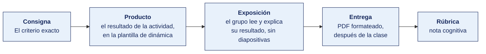

[Semana 08](README.md) · [Teoría](1-TEORIA.md) · **Dinámica de aula** · [Taller de laboratorio](3-TALLER.md)

# Dinámica de aula · El criterio exacto

**SI-084 · Auditoría de Sistemas** · Semana 08 · Actividad en aula, **dentro de los 100 min de la sesión de teoría** · calificación **cognitiva**

> ¿Un término no le resulta claro? Está definido en el [glosario técnico del curso](../GLOSARIO.md).

---

## Cómo funciona la actividad

## Qué entregas

| | |
|---|---|
| **Archivo** | `SI084-S08-DINAMICA-Grupo<N>.pdf` |
| **Plantilla obligatoria** | [SI084-PLANTILLA-DINAMICA.docx](../PLANTILLAS/SI084-PLANTILLA-DINAMICA.docx) |
| **Formato** | PDF exportado desde la plantilla en Word, con la carátula de la UPT y los apellidos, nombres y códigos de todos los integrantes |
| **Qué va dentro** | Lo que el grupo resolvió en aula. Las tablas de la sección **Producto** van completas, con los textos redactados, y cada decisión va justificada |
| **Dónde se sube** | Aula virtual, tarea «Dinámica · Semana 08» |
| **Cuándo vence** | Hasta 24 h después de la sesión de teoría. La tabla se resuelve en aula; el PDF se formatea y se sube después |
| **Exposición** | En la ronda de cierre de **esta misma sesión**. El grupo **lee y explica su resultado** ante el aula, con el documento a la vista. No se usan diapositivas |

> No se califica un trabajo entregado en `.docx`, sin carátula, sin los códigos de los integrantes o con las tablas del producto vacías.

---

## Consigna

> **«El criterio exacto»**
> Cada equipo recibe **seis condiciones de auditoría redactadas** (situaciones observadas en empresas peruanas reales, anonimizadas). Para cada una debe determinar **el cuerpo normativo aplicable, la norma exacta con su artículo o control, la consecuencia del incumplimiento y quién es la autoridad que podría sancionarlo.**

| | |
|---|---|
| **Su papel** | **Auditor que acuerda el criterio** antes de abrir el encargo, cuando todavía se puede negociar |
| **Misión** | Dar a cada condición su cuerpo normativo, su norma con numeral, su consecuencia y su autoridad |
| **Restricción** | **La sección A de la ficha manda.** Ninguna cita sin numeral, y una condición sin criterio aplicable se declara como tal en vez de forzar una norma |

Ejemplos de las condiciones entregadas:

1. Una clínica almacena historias clínicas digitales sin cifrado y con acceso de todo el personal administrativo.
2. Una entidad pública ejecuta su SGSI (Sistema de Gestión de Seguridad de la Información) sobre una versión derogada de la NTP-ISO/IEC 27001.
3. Una empresa usa 40 licencias de un software adquirido para 12 puestos.
4. Un banco no notificó a la SBS un incidente que afectó la disponibilidad de su banca por internet durante 6 horas.
5. Una empresa retail conserva los datos de tarjetas de sus clientes en una hoja de cálculo compartida.
6. Un equipo de TI accedió al correo personal de un trabajador para «investigar una fuga».

Que el equipo aprenda a pasar de «esto está mal» a «esto incumple esta norma, en este artículo, y lo sanciona esta autoridad». Sin ese paso, un hallazgo es una opinión técnica que el auditado puede desestimar sin costo.

## Cómo se desarrolla · 35 minutos

| | Bloque | Quién | Minutos |
|---|---|---|---|
| **1** | **Clasificar por cuerpo normativo.** Para cada condición se decide si estamos ante una obligación legal, una norma técnica adoptada o un compromiso contractual. **La sección A de la ficha decide**, porque una entidad pública y una empresa privada no responden ante lo mismo. | Equipo | 7 |
| **2** | **La norma exacta.** Se cita la norma con su artículo o el control con su código. «La Ley de Protección de Datos» no es una cita; «Ley 29733, artículo 14, y D. S. 016-2024-JUS» sí lo es. | Equipo | 8 |
| **3** | **La consecuencia.** Qué ocurre si no se corrige, en el lenguaje de la norma. Multa, observación de control, incumplimiento contractual o pérdida de certificación. | Equipo | 7 |
| **4** | **La autoridad.** Quién fiscaliza y sanciona en cada caso. Es la columna que más se equivoca, porque cambia según la naturaleza de la organización. | Equipo | 7 |
| **5** | **Repaso final.** El equipo revisa su propia tabla y comprueba si alguna condición quedó sin criterio aplicable. Si es así, se declara como tal en lugar de forzar una norma que no alcanza a la organización. | Equipo | 6 |

## Material de trabajo

**No se busca información fuera del aula.** Cada equipo trabaja con la organización que se le asignó del banco de casos, en `CASOS/EMPRESA-<NN>-<slug>/`. Las diez organizaciones tienen cifras, personas y documentos distintos, de modo que ningún equipo puede reutilizar el resultado de otro.

**Las seis condiciones son las de su organización**, no un listado genérico, y cambian de un equipo a otro.

| Para qué | Archivo del caso | Qué contiene |
|---|---|---|
| Las seis condiciones | `documentos/condiciones-de-auditoria.md` | Seis situaciones observadas en la organización, redactadas como condición de auditoría, más los marcos de referencia disponibles |
| El contexto que decide qué aplica | `FICHA.md` | Naturaleza pública o privada, sector y entidades que la regulan, sección A. **Es lo que determina qué cuerpo normativo alcanza a la organización** |
| Sistemas y datos implicados | `documentos/registro-datos-y-licencias.md` | Tratamiento de datos personales y licencias de software en uso |

## Lo que la teoría de hoy te da

Esta dinámica aplica piezas concretas de la sesión de teoría de hoy. Se usan tal cual, sin buscar nada más.

| De la teoría | Para qué se usa aquí |
|---|---|
| [Los tres cuerpos normativos que el auditor debe distinguir](1-TEORIA.md) | Es el eje de la actividad. Ley, norma técnica y obligación contractual no se sancionan igual ni por la misma autoridad |
| [Los documentos que abren un encargo](1-TEORIA.md) | Fija por qué el criterio se acuerda al inicio del encargo y no se elige después de ver la condición |
| [Del programa anual al encargo individual](1-TEORIA.md) | Explica cómo una condición sin criterio aplicable queda fuera del alcance y se comunica igualmente |

## Producto

**Producto único — Tabla de criterios.**

| # | Condición | Cuerpo normativo | Norma exacta (artículo / control) | Consecuencia | Autoridad competente |
|---|---|---|---|---|---|

> **Dónde va.** Este producto se presenta en la **sección 2 de la [plantilla de dinámica](../PLANTILLAS/SI084-PLANTILLA-DINAMICA.docx)**, «El producto». No se copia la consigna ni la teoría. Solo el resultado y lo que lo sostiene.

## Ejemplo resuelto

*El caso de este ejemplo es distinto del que le toca a tu grupo. Sirve para que veas el nivel de detalle que se espera, no para copiarlo.*

**Una fila bien resuelta.** Es una séptima condición, distinta de las seis que te tocan.

| # | Condición | Cuerpo normativo | Norma exacta | Consecuencia | Autoridad competente |
|---|---|---|---|---|---|
| 7 | Una universidad privada publica en su portal el padrón de estudiantes con nombres, DNI y notas, accesible sin autenticación y indexado por buscadores. | **Norma legal de cumplimiento obligatorio** | Ley 29733, artículo 5 (consentimiento) y artículo 28, numeral 3, que exige tratar los datos con la finalidad para la que se recogieron. Decreto Supremo 016-2024-JUS, sobre medidas de seguridad exigibles al responsable del tratamiento. | Infracción **grave** o **muy grave** según la escala del reglamento, con multa en unidades impositivas tributarias, orden de cese del tratamiento y eventual indemnización civil a los afectados. | **Autoridad Nacional de Protección de Datos Personales**, del Ministerio de Justicia y Derechos Humanos. |

**Cómo se distinguen los tres cuerpos normativos.** Es lo que más se falla en esta dinámica.

| Cuerpo | Qué es | Consecuencia de incumplirlo | Ejemplo |
|---|---|---|---|
| **Norma legal** | Obligatoria por ley o por norma sectorial | Sanción de una autoridad, con responsabilidad administrativa, civil o penal | Ley 29733, Decreto Legislativo 822, circulares de la SBS |
| **Estándar profesional** | Obligatorio para quien ejerce la profesión | Responsabilidad profesional del auditor, no de la organización auditada | ITAF de ISACA, ISO 19011:2018 |
| **Marco de buenas prácticas** | Voluntario, salvo que la organización lo haya adoptado formalmente | Ninguna sanción externa. Solo es criterio auditable si la organización lo adoptó por acto formal | COBIT 2019, ITIL 4 |

**La diferencia entre aprobar y no aprobar.**

| Así no | Así sí |
|---|---|
| «Incumple la Ley de Protección de Datos.» | «Ley 29733, artículo 28, numeral 3: tratar los datos con la finalidad para la que se recogieron.» |
| «Norma: ISO 27001.» *(para una entidad privada que no la adoptó)* | «La ISO/IEC 27001 no es criterio aquí: la organización no la adoptó formalmente. El criterio es la Ley 29733.» |
| «Autoridad: el Estado.» | «Autoridad Nacional de Protección de Datos Personales, del Ministerio de Justicia y Derechos Humanos.» |

## Reglas

- 35 min en aula, dentro de la sesión de teoría.
- **Obligatorio** citar artículo o control específico; «la Ley 29733» sin artículo no se califica.
- Al menos una condición debe requerir la distinción entre norma **obligatoria** y **voluntaria** según el régimen de la organización.
- La exposición es la ronda de cierre de esta misma sesión. El grupo **lee y explica su resultado**. No se usan diapositivas.

## Rúbrica cognitiva (20 puntos)

| Criterio | 5 | 3 | 1 |
|---|---|---|---|
| **Cuerpo normativo** | Clasifica correctamente las seis como ley, norma técnica o marco | Cuatro o cinco correctas | Confunde marco con ley |
| **Precisión del criterio** | Artículo o control exacto en al menos cinco condiciones | Norma correcta sin artículo | Referencia genérica |
| **Consecuencia** | Distingue sanción administrativa, penal, civil y contractual | Consecuencia pertinente sin tipificar | «Es un riesgo» |
| **Autoridad** | Identifica correctamente ANPD, SBS, Contraloría, INDECOPI o Ministerio Público | Mayoría correcta | Ausente o errónea |

---

---

[Semana 08](README.md) · [Teoría](1-TEORIA.md) · **Dinámica de aula** · [Taller de laboratorio](3-TALLER.md)

---

**Docente** · Dr. Oscar Juan Jimenez Flores
[oscarjimenezflores@upt.pe](mailto:oscarjimenezflores@upt.pe) · [LinkedIn](https://www.linkedin.com/in/oscar-jimenez-flores/) · [CTI Vitae — CONCYTEC](https://ctivitae.concytec.gob.pe/appDirectorioCTI/VerDatosInvestigador.do?id_investigador=33398)

Escuela Profesional de Ingeniería de Sistemas · Universidad Privada de Tacna · Tacna, Perú
