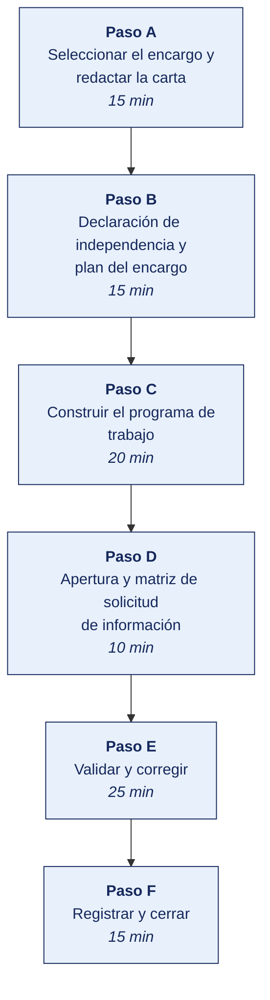

[Semana 08](README.md) · [Teoría](1-TEORIA.md) · [Dinámica de aula](2-DINAMICA.md) · **Taller de laboratorio**

# Taller de laboratorio 08 · Programa de auditoría ISO 19011:2018 y carta de encargo

**SI-084 · Auditoría de Sistemas** · Semana 08 · Sesión 2 en laboratorio · 100 min · calificación **procedimental**

> ¿Un término no le resulta claro? Está definido en el [glosario técnico del curso](../GLOSARIO.md).

---

## Secuencia del taller



## Qué entregas

| | |
|---|---|
| **Archivo** | `SI084-S08-TALLER-Grupo<N>.pdf` |
| **Plantilla obligatoria** | [SI084-PLANTILLA-TALLER.docx](../PLANTILLAS/SI084-PLANTILLA-TALLER.docx) |
| **Formato** | PDF exportado desde la plantilla en Word, con la carátula de la UPT, el índice actualizado y las capturas numeradas |
| **Qué va dentro** | Las secciones de la plantilla. La **5. Resultados y evidencias** se califica contra la tabla de resultados esperados de esta guía, y **cada resultado necesita la evidencia que lo demuestre**. No se copian de aquí los objetivos, la duración ni los resultados de aprendizaje |
| **Dónde se sube** | Aula virtual, tarea «Taller · Semana 08» |
| **Cuándo vence** | 48 horas después de la sesión de laboratorio |

> No se califica un informe entregado en `.docx`, sin carátula, sin los códigos de los integrantes o con resultados declarados sin evidencia.

---

## El reto

| | |
|---|---|
| **Situación** | El encargo se abre esta semana. Lo que no quede escrito ahora —alcance, exclusiones, independencia, materialidad— se discutirá al final, cuando ya no se pueda cambiar. |
| **Misión** | Redactar la carta de encargo con exclusiones explícitas, declarar la independencia de cada integrante y construir un programa que pase el validador. |
| **Criterio de éxito** | El validador devuelve PROGRAMA CONFORME y todos los criterios están citados con código de norma, control o artículo. |

## 1. Información sobre el evento práctico

### 1.1. Título del evento práctico

Elaboración del expediente completo de apertura de un encargo de auditoría de sistemas — carta de encargo, declaración de independencia, plan del encargo, programa de trabajo detallado y acta de reunión de apertura, conforme a la ISO 19011:2018 y a ITAF.

### 1.2. Objetivos

- Redactar la **carta de encargo** del primer encargo del Plan Anual construido en la Semana 07.
- Formalizar la **declaración de independencia** de cada integrante, con salvaguardas cuando corresponda.
- Elaborar el **plan del encargo** — comprensión del proceso, riesgos, controles clave, materialidad y enfoque.
- Construir el **programa de trabajo** con al menos **15 procedimientos** completos y ejecutables.
- Preparar la **agenda y el acta de la reunión de apertura**.
- Construir la **matriz de solicitud de información (PBC list)** con responsables y plazos.

### 1.3. Tiempo de duración

**100 minutos.**

### 1.4. Resultados de Aprendizaje (RA)

- **RA1** Analiza e identifica las responsabilidades que asume un auditor de sistemas.
- **RA2** Valora la importancia de los roles del auditor de sistemas.

### 1.5. Recursos

| Recurso | Detalle |
|---|---|
| **ISO 19011:2018** | Cláusula 6 — texto de referencia disponible en biblioteca UPT |
| **ITAF (ISACA)** | https://www.isaca.org/resources/frameworks-standards-and-models |
| **COBIT 2019** — objetivo del encargo seleccionado | https://www.isaca.org/resources/cobit |
| **LibreOffice Writer / Calc** o Google Workspace | Redacción y matrices |
| **Pandoc** | Conversión de Markdown a PDF: https://pandoc.org/ |
| **draw.io** | Cronograma y flujo del proceso auditado |
| Plan Anual de la Semana 07 | `PLAN_ANUAL_AUDITORIA_TI.md` |

### 1.6. Seguridad

1. La carta de encargo se elabora como **borrador académico**. No se firma ni se entrega a la empresa sin revisión y visto bueno del docente.
2. No se solicita información a la empresa antes de contar con la carta de presentación institucional de la UPT y el acuerdo de confidencialidad firmado.
3. Todo documento del expediente se marca **CONFIDENCIAL — USO ACADÉMICO**.
4. El repositorio del equipo permanece privado.

---

## 2. Procedimiento o Metodología

> **Documento del caso para esta semana.** La organización entrega **Las seis condiciones observadas**, en `CASOS/EMPRESA-<NN>-<slug>/documentos/condiciones-de-auditoria.md`. Es consistente con los datos de `datos/`. Las personas, usuarios y proveedores que menciona existen en los archivos. **No señala sus debilidades**; declara lo que la organización dice hacer.

### Paso A — Seleccionar el encargo y redactar la carta

Se toma el encargo de mayor puntaje del Plan Anual. Se crea `10_planificacion/E1_carta_encargo.md`:

```markdown
# Carta de Encargo — Auditoría de <entidad auditable>
**CONFIDENCIAL — USO ACADÉMICO**

Tacna, __ de ______ de ____

Señor(a)
<Cargo> — <Razón social>

## 1. Objeto
Comunicar los términos del encargo de auditoría de sistemas sobre **<entidad auditable>**,
incluido en el Plan Anual de Auditoría de TI con prioridad <alta/media> y puntaje <x.x>.

## 2. Objetivos de la auditoría
Determinar si <objetivo de control>, evaluando el **diseño** y la **eficacia operativa**
de los controles durante el periodo comprendido entre el __/__/____ y el __/__/____.

## 3. Alcance
**Incluye:** <sistemas, procesos, ubicaciones, periodo>.
**Excluye expresamente:** <lo que NO se auditará y por qué>.

## 4. Criterios de auditoría
- ISO/IEC 27001:2022, Anexo A, controles <códigos>
- COBIT 2019, objetivo <código> y sus prácticas de gestión
- <Normativa legal aplicable con artículo>
- Política interna <nombre, versión, fecha de aprobación>

## 5. Marco profesional
ISO 19011:2018; ITAF de ISACA; Código de Ética Profesional de ISACA.

## 6. Responsabilidades
**Del auditor:** planificar y ejecutar con debido cuidado profesional; mantener
independencia y confidencialidad; comunicar hallazgos oportunamente; emitir informe.
**De la organización:** designar contraparte; otorgar acceso de **solo lectura** a los
sistemas dentro del alcance; entregar la información solicitada en un máximo de
3 días hábiles; disponer la asistencia del personal a las entrevistas.

## 7. Independencia
Los integrantes del equipo declaran no mantener relación laboral, familiar, económica
ni de amistad con el personal del área auditada. Ver Anexo I.

## 8. Confidencialidad
Toda la información se trata como confidencial, se almacena cifrada y se destruye o
devuelve al cierre del encargo, según se acuerde.

## 9. Limitaciones inherentes
La auditoría proporciona **seguridad razonable, no absoluta**. Las pruebas por muestreo
conllevan riesgo de muestreo. El alcance excluido no fue objeto de evaluación y sobre él
no se emite conclusión alguna.

## 10. Cronograma y entregables
| Hito | Fecha | Entregable |
|---|---|---|
| Reunión de apertura | | Acta firmada |
| Trabajo de campo | | Papeles de trabajo |
| Comunicación de hallazgos preliminares | | Borrador de hallazgos |
| Reunión de cierre | | Acta con la respuesta de la administración |
| Informe final | | Informe de auditoría |

## 11. Aceptación
_______________________          _______________________
Auditor responsable               Representante de la organización
```

### Paso B — Declaración de independencia y plan del encargo

**B.1 — `10_planificacion/E1_independencia.md`**, una por integrante:

| Pregunta | Respuesta | Si es «sí», salvaguarda aplicada |
|---|---|---|
| ¿Mantiene o mantuvo relación laboral con el área auditada en los últimos 2 años? | | |
| ¿Tiene parentesco hasta el cuarto grado con personal del área? | | |
| ¿Tiene interés económico en la organización o en sus proveedores de TI? | | |
| ¿Participó en el diseño, implementación u operación de los controles a evaluar? | | |
| ¿Existe alguna circunstancia que un tercero razonable consideraría una amenaza a su objetividad? | | |

**B.2 — `10_planificacion/E1_plan_encargo.md`.**

```markdown
## 1. Comprensión del proceso auditado
Flujo del proceso (diagrama), sistemas que lo soportan, volúmenes, roles intervinientes.

## 2. Riesgos identificados
| Riesgo | Probabilidad | Impacto | Valor | Control clave asociado |

## 3. Controles clave a probar
| ID | Control | Tipo (P/D/C) | ITGC o aplicación | Frecuencia | Dueño |

## 4. Materialidad
**Cuantitativa:** <monto> — justificación.
**Cualitativa:** hallazgos que, con independencia del monto, se consideran materiales
(pérdida de trazabilidad, incumplimiento legal, exposición de datos personales).

## 5. Enfoque de auditoría
[ ] Confianza en controles (probar eficacia operativa y reducir pruebas sustantivas)
[ ] Enfoque sustantivo (los controles no son confiables; se prueba directamente el dato)
Justificación de la elección.

## 6. Recursos y cronograma
| Actividad | Horas | Responsable | Semana |

## 7. Comunicación
Contraparte designada · canal único · plazo de respuesta · mecanismo de escalamiento.
```

### Paso C — Construir el programa de trabajo

Núcleo del laboratorio. Se elabora `10_planificacion/E1_programa_trabajo.csv` con **mínimo 15 procedimientos**, todos con las columnas completas:

| Columna | Regla de calidad |
|---|---|
| `id` | P-01, P-02, … |
| `objetivo_control` | Qué se busca asegurar |
| `riesgo` | Qué ocurre si el control falla |
| `criterio` | Norma **con código**: `ISO/IEC 27001:2022 A.8.32`, `COBIT 2019 BAI06.01`, `Ley 29733 art. 9` |
| `tipo_prueba` | Indagación / Observación / Inspección documental / Inspección del sistema / **Reejecución** / **CAAT** |
| `poblacion` | Universo con su tamaño |
| `muestra` | Tamaño **y método** de selección |
| `justificacion_muestra` | Derivada de la frecuencia del control |
| `procedimiento` | Pasos en imperativo, ejecutables por un tercero |
| `evidencia_a_obtener` | Artefacto concreto |
| `definicion_excepcion` | Fijada **antes** de ver los datos |
| `horas_estimadas` | |
| `ejecutado_por` / `revisado_por` / `fecha` | Vacías al planificar |

**Distribución mínima exigida.**

| Tipo de prueba | Mínimo |
|---|---|
| Reejecución | 2 |
| CAAT sobre el 100 % | 2 |
| Inspección del sistema | 4 |
| Inspección documental | 4 |
| Observación | 1 |
| Indagación | Máximo 2, **nunca como sustento único** |

```python
# 10_planificacion/E1_valida_programa.py — control de calidad del propio programa
import pandas as pd
p = pd.read_csv("E1_programa_trabajo.csv")
print(f"Procedimientos: {len(p)} |  Horas totales: {p.horas_estimadas.sum()}")
print("\nPor tipo de prueba:\n", p.tipo_prueba.value_counts().to_string())

errores = []
if len(p) < 15: errores.append("Menos de 15 procedimientos")
if (p.tipo_prueba == "Reejecución").sum() < 2: errores.append("Faltan reejecuciones")
if (p.tipo_prueba == "CAAT").sum() < 2: errores.append("Faltan CAAT")
if (p.tipo_prueba == "Indagación").sum() > 2: errores.append("Exceso de indagación")
for col in ["criterio","definicion_excepcion","justificacion_muestra"]:
    v = p[p[col].isna() | (p[col].astype(str).str.strip()=="")]
    if len(v): errores.append(f"{len(v)} procedimientos sin '{col}': {list(v.id)}")
sin_codigo = p[~p.criterio.astype(str).str.contains(r"[A-Z]{2,}\s?\d|art\.|A\.\d", regex=True)]
if len(sin_codigo): errores.append(f"Criterio sin código en: {list(sin_codigo.id)}")

print("\n" + ("PROGRAMA CONFORME" if not errores else "NO CONFORMIDADES:\n - " + "\n - ".join(errores)))
```

### Paso D — Apertura y matriz de solicitud de información

**D.1 — Agenda y acta de apertura** (`10_planificacion/E1_acta_apertura.md`) — asistentes y cargos, presentación del equipo, objetivos, alcance con exclusiones, criterios, metodología y limitaciones, cronograma, canal único y plazos, mecanismo de escalamiento, regla de comunicación de hallazgos preliminares, acuerdos, y firmas.

**D.2 — Matriz de solicitud de información (PBC — *Provided By Client*)** en `10_planificacion/E1_pbc.csv`:

| id | Información solicitada | Formato | Procedimiento que la usa | Responsable de entregarla | Fecha solicitada | Fecha comprometida | Estado | Fecha de recepción |
|---|---|---|---|---|---|---|---|---|
| PBC-01 | Política de gestión de accesos vigente | PDF | P-01, P-02 | Jefe de TI | | | Pendiente | |
| PBC-02 | Extracción de usuarios activos del ERP con roles y fecha de última conexión | CSV | P-03, P-11 (CAAT) | DBA | | | Pendiente | |
| PBC-03 | Registro de solicitudes de cambio del periodo | CSV o export | P-06, P-07 | Jefe de Desarrollo | | | Pendiente | |
| … | | | | | | | | |

> **Por qué la PBC es un control del propio encargo.** El retraso en la entrega de información es la causa más frecuente de que una auditoría no concluya en plazo. La PBC con fechas comprometidas convierte ese retraso en un hecho documentado y trazable, no en una queja.

Sellado:

```bash
sha256sum 10_planificacion/E1_* >> 20_evidencia/SHA256SUMS_PL.txt
git add . && git commit -m "E1: carta de encargo, independencia, plan, programa de trabajo y apertura"
```

---

### Paso E — Validar y corregir (25 min)

El resultado no vale por estar hecho, sino por resistir una comprobación. Se ejecutan estas tres y **se corrige lo que falle antes de cerrar la sesión**.

1. Ejecutar el validador y comprobar que devuelve **PROGRAMA CONFORME**, corrigiendo lo que señale antes de cerrar.
2. Verificar que la carta de encargo tiene **exclusiones explícitas**, no solo el alcance incluido.
3. Revisar que la materialidad está justificada en sus dos dimensiones, cuantitativa y cualitativa.

> Lo que no se pueda corregir hoy se anota en la sección **Problemas y mejoras** de la evidencia, con lo que faltó y por qué. Un resultado parcial documentado con honestidad vale más que uno declarado sin prueba.

### Paso F — Registrar la evidencia y cerrar (15 min)

Se versiona lo producido, se anota la URL de cada resultado y se responde en dos frases la pregunta de transferencia — **qué riesgo correría una organización real si esto se hiciera mal**.

---

## 3. Resultados

> **Evidencia obligatoria en GitHub.** Todo resultado de este taller se versiona en el repositorio del equipo. El informe **no consigna capturas sueltas**. Consigna la **URL** del artefacto en GitHub. Una captura no permite verificar autoría, fecha ni contenido; un enlace sí.
>
> | Qué se entrega | Dónde vive | Qué se escribe en el informe |
> |---|---|---|
> | Código y archivos de configuración | Rama del taller, fusionada a `develop` vía Pull Request | URL del Pull Request |
> | Documentos y matrices | `docs/`, en formato de texto versionable | URL del archivo en la rama |
> | Capturas y videos que el taller exija | `docs/evidencias/S08/` | URL del archivo |
> | Salida de comandos | `docs/evidencias/S08/salidas/*.txt` | URL del archivo |
>
> **Etiqueta del taller.** Al cerrar el taller se crea la etiqueta `taller-08` sobre el commit entregado:
>
> ```bash
> git tag -a taller-08 -m "Taller 08 · SI084"
> git push origin taller-08
> ```
>
> La URL que se consigna en el informe apunta a esa etiqueta:
> `https://github.com/<organizacion>/<repositorio>/tree/taller-08`
>
> **El informe es lo que se califica; el repositorio es lo que lo prueba.** Cada resultado de la sección 3 del informe lleva la URL con la que se verifica, y **un resultado sin su URL se califica como no logrado**, por bien redactado que esté. Lo que no se puede abrir no se puede dar por hecho.

### 3.1. Los tres resultados que se califican

Son los que la rúbrica evalúa. El resto de la lista tiene que existir, pero no se califica fila por fila.

| Resultado | Qué demuestra | Dónde está |
|---|---|---|
| **La carta de encargo** | Las once secciones, con las exclusiones declaradas | `E1_carta_encargo.md` |
| **El programa validado** | Quince o más procedimientos y el validador en conforme | `E1_programa_trabajo.csv` y salida del validador |
| **La declaración de independencia** | Una por integrante, con salvaguarda donde aplique | `E1_independencia.md` |

### 3.2. Lista de comprobación del taller

Todo esto debe existir al cerrar la sesión.

| # | Resultado esperado | Verificación |
|---|---|---|
| 1 | Carta de encargo con las 11 secciones, **con exclusiones explícitas** | `E1_carta_encargo.md` |
| 2 | Declaración de independencia por cada integrante, con salvaguardas cuando aplique | `E1_independencia.md` |
| 3 | Plan del encargo con materialidad **cuantitativa y cualitativa** justificada | `E1_plan_encargo.md` |
| 4 | Enfoque de auditoría elegido y **justificado** | Sección 5 del plan |
| 5 | Programa con **≥ 15 procedimientos** y todas las columnas completas | `E1_programa_trabajo.csv` |
| 6 | Validador ejecutado con resultado **PROGRAMA CONFORME** | Salida de `E1_valida_programa.py` |
| 7 | Todos los criterios citados **con código de norma, control o artículo** | Validador |
| 8 | Acta de apertura con acuerdos, canal único y plazos | `E1_acta_apertura.md` |
| 9 | Matriz PBC con ≥ 12 solicitudes trazadas a procedimientos | `E1_pbc.csv` |
| 10 | Hashes y *commit* en Git | `SHA256SUMS_PL.txt` |

## Rúbrica procedimental (20 puntos)

Se aplica sobre el informe entregado y la evidencia enlazada en el repositorio. **Cada criterio se califica de forma independiente.**

| Criterio | 4 — Logrado | 2 — En proceso | 0 — Insuficiente |
|---|---|---|---|
| **Seleccionar el encargo y redactar la carta** | Completo y correcto, con la evidencia que lo respalda | Completo con errores menores, o correcto pero sin toda la evidencia | Incompleto, o entregado sin ejecutar |
| **Construir el programa de trabajo** | Completo y correcto, con la evidencia que lo respalda | Completo con errores menores, o correcto pero sin toda la evidencia | Incompleto, o entregado sin ejecutar |
| **Evidencia verificable en el repositorio** | Cada resultado tiene su URL sobre la etiqueta `taller-NN`, y el enlace abre lo que dice | La mayoría tiene URL; alguna evidencia es una captura suelta | Se declaran resultados sin enlace, o el enlace no corresponde |
| **Trazabilidad de la evidencia** | Todo hallazgo o dato se rastrea hasta el archivo, registro y fecha que lo sustenta | Rastreable en su mayoría; algún dato sin origen | Se afirman hechos sin poder ubicarlos en la evidencia |
| **La evidencia entregada** | Las secciones de la plantilla completas; los papeles de trabajo quedan archivados y referenciados | Secciones completas con papeles de trabajo incompletos | Faltan secciones o no hay papeles de trabajo |

| Puntaje | Equivalencia |
|---|---|
| 18 – 20 | Destacado |
| 14 – 17 | Logrado |
| 6 – 13 | En proceso |
| 0 – 5 | Insuficiente |

> **Un resultado declarado sin evidencia enlazada no se califica**, aunque el trabajo se haya hecho. La tabla de la sección 3.1 es la lista de cotejo; esta rúbrica es lo que determina la nota.

## 4. Conclusiones

Mínimo tres. Líneas argumentales esperadas:

1. La calidad de una auditoría se decide en la planificación. Un programa de trabajo con criterios citados por código y excepciones definidas a priori impide que el criterio se ajuste al resultado durante el trabajo de campo.
2. Las exclusiones explícitas de la carta de encargo protegen al auditor y al auditado por igual. Delimitan sobre qué se emite conclusión y sobre qué no.
3. La matriz PBC convierte la disponibilidad de información —principal causa de incumplimiento de plazos— en un compromiso documentado con responsable y fecha, verificable en el informe.

## 5. Referencias Bibliográficas

- ISO 19011:2018, cláusula 6 «Realización de una auditoría». https://www.iso.org/standard/70017.html
- ISACA. *ITAF: A Professional Practices Framework for IS Audit/Assurance* (5.ª ed.). https://www.isaca.org/resources/frameworks-standards-and-models
- ISACA. *Code of Professional Ethics*. https://www.isaca.org/credentialing/code-of-professional-ethics
- ISACA. (2018). *COBIT 2019 Framework: Governance and Management Objectives*. https://www.isaca.org/resources/cobit
- Ley 29733, Ley de Protección de Datos Personales, y su Reglamento D. S. 016-2024-JUS (vigente desde el 31 de marzo de 2025). https://www.gob.pe/institucion/anpd
- Decreto Legislativo 822, Ley sobre el Derecho de Autor. https://www.gob.pe/institucion/indecopi/
- Ley 30096 y Ley 30171, Delitos Informáticos.
- Decreto Legislativo 1412, Ley de Gobierno Digital, y D. S. 029-2021-PCM. https://www.gob.pe/13326-reglamento-de-la-ley-de-gobierno-digital
- Resolución SBS N.º 504-2021 y sus modificatorias. https://www.sbs.gob.pe/
- Ley 27269, Ley de Firmas y Certificados Digitales.
- Piattini Velthuis, M., Del Peso Navarro, E. y Del Peso Ruiz, M. (2009). *Auditoría de tecnologías y sistemas de información* (6.ª ed.). Alfaomega / Ra-Ma.

## 6. Anexos

- `anexo_A_carta_encargo.pdf`
- `anexo_B_programa_trabajo.xlsx` — programa completo con filtros por tipo de prueba.
- `anexo_C_pbc.xlsx`
- `anexo_D_acta_apertura.pdf`
- `anexo_E_flujo_proceso.png` — diagrama del proceso auditado.

---

---

[Semana 08](README.md) · [Teoría](1-TEORIA.md) · [Dinámica de aula](2-DINAMICA.md) · **Taller de laboratorio**

---

**Docente** · Dr. Oscar Juan Jimenez Flores
[oscarjimenezflores@upt.pe](mailto:oscarjimenezflores@upt.pe) · [LinkedIn](https://www.linkedin.com/in/oscar-jimenez-flores/) · [CTI Vitae — CONCYTEC](https://ctivitae.concytec.gob.pe/appDirectorioCTI/VerDatosInvestigador.do?id_investigador=33398)

Escuela Profesional de Ingeniería de Sistemas · Universidad Privada de Tacna · Tacna, Perú
