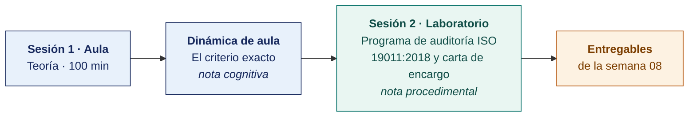

  
  &nbsp;&nbsp;&nbsp;&nbsp;&nbsp;&nbsp;
  

  <strong>Universidad Privada de Tacna</strong> 
  Facultad de Ingeniería · Escuela Profesional de Ingeniería de Sistemas

<h1 align="center">Semana 08 · Planeación y Ejecución de la Auditoría · Controles, Normas Legales y Estándares</h1>

  <strong>SI-084 · Auditoría de Sistemas</strong> 
  4 horas académicas de 50 min · 100 min de teoría con la dinámica incluida en aula · 100 min de taller en laboratorio

---

## Datos de la asignatura

| | |
|---|---|
| **Asignatura** | SI-084 · Auditoría de Sistemas |
| **Escuela** | Escuela Profesional de Ingeniería de Sistemas |
| **Ciclo** | X · 04 horas semanales · 03 créditos · Obligatorio |
| **Prerrequisito** | SI-985 Gestión de la Configuración de Software |
| **Unidad** | II — Diagnóstico, Evaluación y Metodología de Auditoría de Sistemas |
| **Semana** | 08 de 17 |
| **Duración** | 4 horas académicas de 50 min · 100 min de teoría con la dinámica incluida en aula · 100 min de taller en laboratorio |
| **Resultados de aprendizaje** | **RA1** Analiza e identifica las responsabilidades que asume un auditor de sistemas · **RA2** Valora la importancia de los roles del auditor de sistemas |
| **Atributos del graduado** | AG-I04 Comunicación (CD1, nivel 4) · AG-I08 Análisis de Problemas (CD3, nivel 4) |

### Lo que indica el sílabo

**Contenido conceptual.** Planeación y ejecución de auditoría, controles, normas legales, estándares.

**Contenido procedimental.** Reconoce las partes de un Plan y ejecución de auditoría, controles y normas legales, estándares.

> **Qué sección construye esta semana.** El índice completo del entregable de la unidad está en el [Modelo del Plan de Auditoría](../MODELO-PLAN-DE-AUDITORIA.md).

## Materiales de esta semana

| | Documento | Qué encontrarás | Dónde y cuánto dura |
|---|---|---|---|
| 1 | **[Teoría](1-TEORIA.md)** | Del programa anual al encargo individual · Los documentos que abren un encargo · Los tres cuerpos normativos que el auditor debe distinguir | Aula · 100 min |
| 2 | **[Dinámica de aula](2-DINAMICA.md)** | El criterio exacto, con su material, su ejemplo resuelto y su rúbrica | Aula · dentro de los 100 min de la sesión de teoría |
| 3 | **[Taller de laboratorio](3-TALLER.md)** | Programa de auditoría ISO 19011:2018 y carta de encargo | Laboratorio · 100 min |

## Ruta de la semana

## Entregables

| Entregable | Formato y nombre del archivo | Vence |
|---|---|---|
| **Dinámica de aula** · El criterio exacto | PDF desde la [plantilla de dinámica](../PLANTILLAS/SI084-PLANTILLA-DINAMICA.docx) · `SI084-S08-DINAMICA-Grupo<N>.pdf` | Antes de cerrar la sesión de teoría |
| **Informe del taller de laboratorio N.º 08** | PDF en formato EPIS desde la [plantilla de taller](../PLANTILLAS/SI084-PLANTILLA-TALLER.docx) · `SI084-S08-TALLER-Grupo<N>.pdf` | 48 h después del taller |
| Expediente de apertura del encargo | Commit en Git | 48 h después del laboratorio |

> Ambos se entregan en **PDF**, con la carátula de la UPT y los códigos de todos los integrantes. Las plantillas obligatorias están en [`PLANTILLAS/`](../PLANTILLAS/).

## Cómo se evalúa

| Criterio | Instrumento | Peso |
|---|---|---|
| Cognitivo | Rúbrica de «El criterio exacto» + exposición de 10 min en la Semana 09 | 25 % |
| Procedimental | Lista de cotejo de los 10 resultados del laboratorio | 35 % |
| Actitudinal | Rigor en la declaración de independencia y en el trato con la contraparte | 15 % |

## Preparación de la evidencia del Atributo del Graduado

> **Esta semana prepara la evidencia del atributo, y no se registra.** Las dos capturas que la Escuela fija son la de la **Semana 05** y la de la **Semana 16**. Lo que se produce aquí alimenta esas dos y **no modifica tu calificación** ni añade trabajo adicional.

| | |
|---|---|
| **Atributo** | **AG-I02 · Ética** |
| **Criterio medido** | **CD2** · Aplica los principios éticos y las normas de la práctica de la ingeniería (IEEE, ACM, CIP, PMI) |
| **Alineación con el sílabo** | **RA1** Analiza e identifica las responsabilidades que asume un auditor de sistemas · Contenido procedimental del sílabo: «Reconoce las partes de un Plan y ejecución de auditoría, controles y **normas legales, estándares**» |
| **Evidencia que se lee** | `SI084-S08-TALLER-Grupo<N>.pdf` · declaración de independencia y competencia de la carta de encargo |
| **Instrumento** | [Rúbrica AG-I02, escala 1–4](../ASSESSMENT/RUBRICAS-AG.md#ag-i02) |
| **Tipo de medición** | **Preparación de la evidencia** · no se registra |
| **Adónde va** | Alimenta la captura de la [Semana 16](../SEMANA-16/README.md) |

**Qué mira el evaluador.** Si la declaración de independencia identifica amenazas concretas y sus salvaguardas —ISO 19011:2018, cl. 4 y 7—, o repite una fórmula genérica. Es la **línea base** del atributo.

Mapa completo en [`ASSESSMENT/MAPA-AG.md`](../ASSESSMENT/MAPA-AG.md).

## Preparación para la Semana 09

- **Leer.** NTP-ISO/IEC 12207 — estructura de procesos del ciclo de vida del software.
- **Leer.** Código de Ética Profesional de ISACA (texto completo, es breve).
- **Traer.** Acceso de solo lectura al repositorio Git de un proyecto de software real (propio, de la empresa auditada o de un proyecto de curso anterior) — la Semana 09 audita su ciclo de vida.

---

**Docente** · Dr. Oscar Juan Jimenez Flores
[oscarjimenezflores@upt.pe](mailto:oscarjimenezflores@upt.pe) · [LinkedIn](https://www.linkedin.com/in/oscar-jimenez-flores/) · [CTI Vitae — CONCYTEC](https://ctivitae.concytec.gob.pe/appDirectorioCTI/VerDatosInvestigador.do?id_investigador=33398)

Escuela Profesional de Ingeniería de Sistemas · Universidad Privada de Tacna · Tacna, Perú
