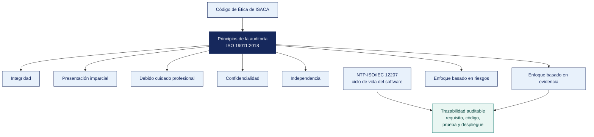

[Semana 09](README.md) · **Teoría** · [Dinámica de aula](2-DINAMICA.md) · [Taller de laboratorio](3-TALLER.md)

# Semana 09

## Principios del Auditor de Sistemas · NTP-ISO/IEC 12207 en Auditoría

**SI-084 · Auditoría de Sistemas** · Sesión 1 en aula · 2 horas académicas, 100 min, con la dinámica incluida

> ¿Un término no le resulta claro? Está definido en el [glosario técnico del curso](../GLOSARIO.md).

---

## Supuesto y pregunta

Un auditor recibe un encargo sobre el área de sistemas de una empresa. Es riguroso, no acepta ninguna declaración sin evidencia y su informe resulta impecable, pero al final del trabajo el regulador anula su conclusión.

El motivo no fue un error técnico, sino que su hermano dirige el área que auditó, y aunque el auditor nunca lo mencionó ni lo tuvo en cuenta, un tercero informado no tiene forma de saberlo.

> **¿Qué puede invalidar un trabajo de auditoría impecable aunque no aparezca en ninguna prueba?**

## Mapa de la sesión



---

## 1. Los principios de la auditoría (ISO 19011:2018)

> **¿Qué diferencia hay entre ser independiente y parecerlo?**

La norma establece siete principios que gobiernan la profesión. No son valores decorativos. Cada uno tiene una consecuencia operativa verificable.

| Principio | Enunciado | Cómo se verifica que se cumplió |
|---|---|---|
| **Integridad** | **Fundamento de la profesionalidad.** Honestidad, diligencia y responsabilidad | El auditor reportó también lo que perjudicaba su propia comodidad o la relación con el cliente |
| **Presentación imparcial** | Informar con veracidad y exactitud; reflejar las opiniones divergentes | El informe incluye la posición del auditado cuando persiste el desacuerdo |
| **Debido cuidado profesional** | Diligencia y juicio en función de la importancia de la tarea | Los papeles de trabajo muestran verificación, no aceptación de declaraciones |
| **Confidencialidad** | Seguridad de la información obtenida | Cifrado, control de acceso, devolución o destrucción al cierre |
| **Independencia** | Base de la imparcialidad y la objetividad de las conclusiones | Declaración firmada, salvaguardas documentadas |
| **Enfoque basado en la evidencia** | Método racional para conclusiones fiables y reproducibles | Cada conclusión referencia un papel de trabajo con evidencia trazable |
| **Enfoque basado en riesgos** | Considerar riesgos y oportunidades en la planificación y ejecución | El programa concentra horas donde el riesgo es mayor, con justificación |

**Independencia. Los cuatro tipos de amenaza.** Reconocerlas es obligación profesional:

| Amenaza | Situación típica en auditoría de sistemas | Salvaguarda |
|---|---|---|
| **Autorrevisión** | El auditor implantó el control que ahora evalúa | Excluir el procedimiento o rotar al auditor |
| **Interés propio** | Honorarios contingentes al resultado; el auditado decide su contratación futura | Contratación por el comité de auditoría, no por el área auditada |
| **Familiaridad** | Cinco años auditando la misma área; amistad con el jefe de TI | Rotación obligatoria del auditor responsable |
| **Intimidación** | Presión de la gerencia para suavizar un hallazgo | Escalamiento al comité de auditoría; documentación de la presión |

**La diferencia entre independencia de hecho y en apariencia.** La primera es un estado mental; la segunda, la percepción de un tercero informado y razonable. **Ambas deben preservarse.** Un auditor genuinamente objetivo cuyo hermano dirige el área auditada tiene independencia de hecho pero no en apariencia, y eso basta para invalidar la conclusión ante un regulador.

> **El error frecuente del bloque.** Creer que declarar la amenaza es admitir una falta. Es al revés — la amenaza declarada con su salvaguarda documentada **protege el encargo**; la amenaza ocultada lo destruye aunque nunca haya afectado al juicio del auditor. Ocultarla es más grave que tenerla.

## 2. Código de Ética Profesional de ISACA

> **¿Qué obliga a un profesional cuando la norma técnica no dice nada?**

Aplicable a todo profesional certificado (CISA, CRISC, CISM) y adoptado como referencia por la profesión. Sus principios operativos:

1. Apoyar la implementación de estándares y procedimientos para el gobierno y la gestión de los sistemas de información.
2. Desempeñar sus funciones con **objetividad, debida diligencia y cuidado profesional**, conforme a estándares profesionales.
3. Servir al interés de los interesados de manera legal, manteniendo **altos estándares de conducta y carácter**, sin desacreditar a la profesión ni a la asociación.
4. **Mantener la privacidad y confidencialidad** de la información obtenida, salvo que su divulgación sea requerida por autoridad legal. No usarla en beneficio propio ni divulgarla a partes no autorizadas.
5. Mantener la competencia y **emprender solo actividades para las que se posee la competencia** necesaria.
6. Informar los resultados del trabajo a las partes correspondientes, **divulgando todos los hechos significativos** conocidos que, de omitirse, podrían distorsionar el informe.
7. Apoyar la **educación profesional** de los interesados en la comprensión del gobierno y la gestión de los sistemas de información.

**El principio 5 en la práctica estudiantil.** Aceptar auditar una tecnología que no se conoce —un ERP propietario, un entorno mainframe, una arquitectura cloud compleja— y emitir conclusiones sobre ella **es una falta ética**, no un problema técnico. La salida profesional es declarar la limitación de competencia, acotar el alcance o incorporar a un especialista.

**Dilema para discusión (10 min).** *El gerente general le pide retirar del informe un hallazgo sobre el jefe de TI, argumentando que «lo van a despedir y es el único que sabe cómo funciona el sistema, la empresa se paraliza».* ¿Qué principios están en tensión? ¿Cuál prevalece? ¿Cuál es la salida profesional que no destruye ni el informe ni la operación de la empresa?

**Ejemplo trabajado — las cuatro amenazas a la independencia, con su salvaguarda.**

| Amenaza | Cómo se presenta | Salvaguarda aplicable |
|---|---|---|
| **Interés propio** | Al auditor le ofrecen un puesto en la empresa auditada durante el encargo | Declararlo de inmediato, apartarse del encargo o suspender la conversación hasta emitir el informe |
| **Autorrevisión** | El auditor evalúa un control que él mismo ayudó a diseñar el año anterior | Que lo audite otro integrante. Si no hay, declararlo y que un tercero revise esa parte |
| **Familiaridad** | Un integrante tiene un familiar directo en el área revisada | Reasignar esa área a otro auditor y dejar constancia |
| **Intimidación** | La gerencia condiciona el informe apelando a una consecuencia grave | Registrar la solicitud con fecha y términos; escalar al destinatario del encargo si persiste |

> **La independencia no es un estado, es una práctica.** No basta con no tener el vínculo. Hay que **identificar la amenaza, declararla y documentar la salvaguarda**. Un encargo sin esa declaración es vulnerable aunque el auditor haya sido impecable.

> **Microaplicación (5 min). Nombrar la amenaza.** El docente enuncia cuatro situaciones breves y el aula responde, para cada una, **cuál de las cuatro amenazas es y qué salvaguarda corresponde**. Se responde con el nombre exacto, no con una descripción.

| Caso | Qué debe contener una buena respuesta |
|---|---|
| ¿Basta con ser independiente, o hay que parecerlo? | Ambas. El numeral sobre objetividad habla de actividades que la comprometan **o aparenten comprometerla**. La apariencia importa porque el lector del informe no puede verificar la conducta |
| El auditado invita al equipo a almorzar al cierre. ¿Se acepta? | Un almuerzo corriente no compromete. Lo que se evalúa es proporción y momento. Durante el trabajo de campo y con valor significativo, no |
| ¿Qué se hace si la amenaza aparece a mitad del encargo? | Se declara en ese momento, se aplica la salvaguarda y se documenta. Ocultarla es más grave que la amenaza misma |
## 3. NTP-ISO/IEC 12207 y el ciclo de vida del software

> **Un sistema que nunca falla, ¿tiene algo que auditar?**

**Qué es.** La NTP-ISO/IEC 12207 —adopción peruana de la ISO/IEC/IEEE 12207— establece un marco común de **procesos del ciclo de vida del software**, con su terminología, para todos los intervinientes — adquirente, proveedor, desarrollador, operador y mantenedor.

**Por qué le importa al auditor.** Da un **criterio auditable** para preguntas que de otro modo se responden con opiniones. *¿Este desarrollo se hizo bien? ¿este proveedor cumple? ¿este cambio se probó?* Sin un marco de procesos, la respuesta es la impresión del jefe de proyecto.

**Los grupos de procesos y sus preguntas de auditoría.**

| Grupo | Procesos representativos | Pregunta de auditoría | Evidencia esperada |
|---|---|---|---|
| **Acuerdo** | Adquisición, Suministro | ¿El contrato define requisitos, criterios de aceptación, niveles de servicio y propiedad del código? | Contrato, anexo técnico, acta de aceptación |
| **Organizacionales habilitadores** | Gestión del modelo de ciclo de vida, Gestión de infraestructura, Gestión de recursos humanos, Gestión de la calidad, **Gestión del conocimiento** | ¿Existe una metodología definida y se aplica realmente? | Metodología documentada y evidencia de su uso en 3 proyectos |
| **Técnicos de gestión** | Planificación, Evaluación y control, **Gestión de decisiones**, **Gestión del riesgo**, **Gestión de la configuración**, Gestión de la información, Medición, **Aseguramiento de la calidad** | ¿Los cambios están controlados? ¿Se mide algo? ¿Las decisiones quedaron registradas? | Repositorio con historia, registro de decisiones, métricas del proyecto |
| **Técnicos** | Análisis de necesidades del negocio, Definición de requisitos, Definición de arquitectura, Diseño, Implementación, Integración, **Verificación**, Transición, **Validación**, Operación, **Mantenimiento**, Disposición | ¿Los requisitos son trazables al código y a las pruebas? ¿Se verificó y se validó? | Matriz de trazabilidad, planes y resultados de prueba, actas de aceptación |

**Verificación vs. validación — la distinción que más se confunde.**

| | **Verificación** | **Validación** |
|---|---|---|
| Pregunta | ¿Construimos el producto **correctamente**? | ¿Construimos el **producto correcto**? |
| Contra qué compara | La especificación | La necesidad real del usuario |
| Quién la ejecuta | El equipo técnico | El usuario o el dueño del proceso |
| Evidencia | Resultados de pruebas unitarias, de integración y de sistema | Acta de aceptación del usuario firmada |

**Trazabilidad. El control que sostiene todo lo demás.** La cadena completa que el auditor recorre:

```
Necesidad de negocio → Requisito → Diseño → Componente de código
    → Caso de prueba → Resultado de prueba → Aceptación → Despliegue
```

Cada eslabón debe apuntar hacia atrás. La prueba de auditoría es sencilla y demoledora — **se toma un requisito al azar y se pide al equipo que muestre el código que lo implementa y la prueba que lo verifica**; y a la inversa, se toma un componente de código en producción y se pide el requisito que lo justifica. El código sin requisito de origen es funcionalidad no autorizada.

**Los cuatro hallazgos más frecuentes en este dominio.**

1. **Ausencia de trazabilidad.** No se puede demostrar que lo desplegado corresponde a lo aprobado.
2. **Verificación sin validación.** El software pasó todas las pruebas técnicas y no resuelve el problema del usuario.
3. **Segregación desarrollo-producción rota.** El desarrollador despliega su propio código sin revisión independiente.
4. **Mantenimiento sin control.** Correcciones «urgentes» aplicadas directamente en producción sin registro, sin prueba y sin retropropagación al repositorio.

**Ejemplo trabajado — auditar un repositorio sin leer el código.** Métricas que un auditor obtiene con `git log` y qué condición revela cada una:

| Métrica observada | Qué sugiere | Cómo se confirma |
|---|---|---|
| **86 % de commits directos a la rama principal** | No hay revisión entre pares ni control de cambios | Contar Pull Requests con aprobación de un segundo. Si son 0, el control no existe |
| **3 autores, uno con el 88 % de los commits** | Dependencia crítica de una persona | **Cruzar con la planilla.** ¿Sigue trabajando ahí? |
| **Commits con mensaje de una palabra** | **Trazabilidad nula.** No se puede saber qué cambió ni por qué | Muestrear 10 y verificar si el cambio se puede reconstruir |
| **Ramas sin fusionar con más de 90 días** | Trabajo abandonado o cambios que nunca llegaron a producción | Preguntar por su estado; suele revelar procesos sin cierre |
| **Sin etiquetas de versión** | No hay gestión de la configuración. No se puede saber qué está en producción | Contrastar con el registro de despliegues |
| **Sin pruebas automatizadas** | Toda verificación es manual y depende de quien despliega | Revisar si existe evidencia de pruebas antes de cada despliegue |

> **El auditor de sistemas no evalúa si el código es bueno.** Evalúa si el **proceso** que lo produjo es controlado — si el cambio fue autorizado, probado, trazable y reversible. Esa distinción es lo que separa la auditoría de la revisión técnica.

> **Microaplicación (5 min). Del requisito al código.** El aula responde a mano alzada antes de la explicación. Después, en parejas, escribe **qué pediría exactamente** para comprobar que un requisito llegó al código y volvió a la prueba.

| Caso | Qué debe contener una buena respuesta |
|---|---|
| Un sistema funciona sin fallas desde hace cinco años. ¿Hay algo que auditar? | Sí. La ausencia de fallas no prueba control. Si nadie puede modificarlo sin romperlo, o si su autor ya no está, hay riesgo de mantenimiento y de continuidad |
| ¿Qué procesos de la 12207 aplican a un software comprado, no desarrollado? | Adquisición, gestión de la configuración, mantenimiento y verificación. Se audita al proveedor a través del contrato y de la aceptación |
| ¿Es hallazgo que no existan pruebas automatizadas? | Depende del criterio. Si la política interna o el contrato las exige, sí. Si no, la condición es **que no hay evidencia de prueba antes del despliegue**, sea manual o automatizada |
> **El error frecuente del bloque.** Confundir verificación con validación. Verificar es comprobar que el producto se construyó según su especificación; validar es comprobar que resuelve el problema del usuario. Un sistema puede pasar toda la verificación y no servirle a nadie, y ese es un hallazgo que ninguna prueba técnica encuentra.

## Cierre

**La respuesta a la pregunta con la que abrimos.** Sí, y esa es la lección incómoda de la sesión. La independencia tiene dos caras — la de hecho, que es un estado mental, y la de apariencia, que la juzga un tercero informado y razonable leyendo el legajo. **Ambas deben preservarse.** El auditor del caso conservaba la primera y perdió la segunda, y para el regulador eso basta.

**Las tres ideas que deben quedar.**

| Idea | Por qué importa en el ejercicio profesional |
|---|---|
| Los siete principios de la ISO 19011 tienen cada uno una verificación concreta | No son valores decorativos. Se comprueba si se cumplieron mirando los papeles de trabajo |
| La amenaza a la independencia se declara y se documenta su salvaguarda | Declararla protege el encargo; ocultarla lo invalida aunque el juicio haya sido correcto |
| Emprender un trabajo para el que no se tiene competencia es una falta ética, no un problema técnico | Lo dice el principio 5 del Código de ISACA, y obliga a declarar la limitación o incorporar a un especialista |

**Lo que suele fallar frente a este caso.** La mayoría defiende al auditor porque actuó bien, y ahí está el aprendizaje — en esta profesión **la percepción de un tercero es parte del producto**, y se gestiona documentándola, no explicándola después.

**Lo que sigue.** La [dinámica de esta sesión](2-DINAMICA.md) asigna a cada equipo un dilema ético distinto y pide resolverlo con **una salida profesional viable**, no con una negativa. La consigna exige nombrar la amenaza con el término de hoy y decir qué queda documentado, que es exactamente lo que le faltó al auditor del caso.


**Pregunta de cierre.** *si mañana el único desarrollador del sistema renuncia, ¿la empresa puede seguir manteniéndolo?* La respuesta depende de procesos de la 12207 que casi nunca se implementan. Gestión del conocimiento, gestión de la configuración y documentación de arquitectura.
---

---

[Semana 09](README.md) · **Teoría** · [Dinámica de aula](2-DINAMICA.md) · [Taller de laboratorio](3-TALLER.md)

---

**Docente** · Dr. Oscar Juan Jimenez Flores
[oscarjimenezflores@upt.pe](mailto:oscarjimenezflores@upt.pe) · [LinkedIn](https://www.linkedin.com/in/oscar-jimenez-flores/) · [CTI Vitae — CONCYTEC](https://ctivitae.concytec.gob.pe/appDirectorioCTI/VerDatosInvestigador.do?id_investigador=33398)

Escuela Profesional de Ingeniería de Sistemas · Universidad Privada de Tacna · Tacna, Perú
