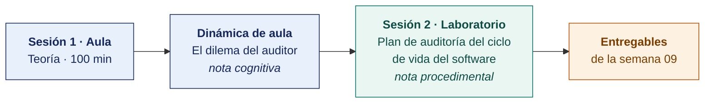

  
  &nbsp;&nbsp;&nbsp;&nbsp;&nbsp;&nbsp;
  

  <strong>Universidad Privada de Tacna</strong> 
  Facultad de Ingeniería · Escuela Profesional de Ingeniería de Sistemas

<h1 align="center">Semana 09</h1>
<h2 align="center">Principios del Auditor de Sistemas · NTP-ISO/IEC 12207 en Auditoría</h2>

  <strong>SI-084 · Auditoría de Sistemas</strong> 
  4 horas académicas de 50 min · 100 min de teoría con la dinámica incluida en aula · 100 min de taller en laboratorio

---

## Datos de la asignatura

| | |
|---|---|
| **Asignatura** | SI-084 · Auditoría de Sistemas |
| **Escuela** | Escuela Profesional de Ingeniería de Sistemas |
| **Ciclo** | X · 04 horas semanales · 03 créditos · Obligatorio |
| **Prerrequisito** | SI-985 Gestión de la Configuración de Software |
| **Unidad** | II — Diagnóstico, Evaluación y Metodología de Auditoría de Sistemas |
| **Semana** | 09 de 17 |
| **Duración** | 4 horas académicas de 50 min · 100 min de teoría con la dinámica incluida en aula · 100 min de taller en laboratorio |
| **Resultados de aprendizaje** | **RA1** Analiza e identifica las responsabilidades que asume un auditor de sistemas · **RA2** Valora la importancia de los roles del auditor de sistemas |
| **Atributos del graduado** | AG-I02 Ética (CD1, CD2 y CD3, nivel 4) · AG-I09 Diseño y Desarrollo de Soluciones (CD11, nivel 4) |

### Lo que indica el sílabo

**Contenido conceptual.** Principios del auditor de sistemas, NTP ISO 12207 en auditoría.

**Contenido procedimental.** Comprende los principios éticos que el auditor de sistemas debe cumplir.

> **Qué plan construye esta semana.** El laboratorio produce un **plan de auditoría completo** de el ciclo de vida del software, con los criterios de NTP-ISO/IEC 12207 y NTP-ISO/IEC 25010. La estructura es la del [Modelo del Plan de Auditoría](../MODELO-PLAN-DE-AUDITORIA.md) y el caso es el [Encargo 09](../ENCARGOS-UNIDAD-II/CASO-09-ciclo-de-vida-del-software.md).

> **La solicitud de su organización.** Está en [CASOS/](CASOS/README.md), una por organización del banco. La escribe la propia organización, expone sus problemas y pide la auditoría. Con ella el equipo propone el plan.

## Materiales de esta semana

| | Documento | Qué encontrarás | Dónde y cuánto dura |
|---|---|---|---|
| 1 | **[Teoría](1-TEORIA.md)** | Los principios de la auditoría (ISO 19011:2018) · Código de Ética Profesional de ISACA · NTP-ISO/IEC 12207 y el ciclo de vida del software | Aula · 100 min |
| 2 | **[Dinámica de aula](2-DINAMICA.md)** | El dilema del auditor, con su material, su ejemplo resuelto y su rúbrica | Aula · dentro de los 100 min de la sesión de teoría |
| 3 | **[Taller de laboratorio](3-TALLER.md)** | Plan de auditoría del ciclo de vida del software | Laboratorio · 100 min |

## Ruta de la semana

## Entregables

| Entregable | Formato y nombre del archivo | Vence |
|---|---|---|
| **Dinámica de aula** · El dilema del auditor | PDF desde la [plantilla de dinámica](../PLANTILLAS/SI084-PLANTILLA-DINAMICA.docx) · `SI084-S09-DINAMICA-Grupo<N>.pdf` | Según lo programado en el aula virtual |
| **Informe del taller de laboratorio N.º 09** | PDF en formato EPIS desde la [plantilla de taller](../PLANTILLAS/SI084-PLANTILLA-TALLER.docx) · `SI084-S09-TALLER-Grupo<N>.pdf` | Según lo programado en el aula virtual |
| **El plan de auditoría del Encargo 09**, completo | Markdown y PDF en el repositorio, sobre la etiqueta `taller-09` | Según lo programado en el aula virtual |

> La dinámica y el informe del taller se entregan en **PDF**, con la carátula de la UPT y los códigos de todos los integrantes. Las plantillas obligatorias están en [`PLANTILLAS/`](../PLANTILLAS/).

## Cómo se evalúa

| Criterio | Instrumento | Peso |
|---|---|---|
| Cognitivo | Rúbrica del dilema ético + exposición y debate plenario de 10 min en la Semana 10 | 25 % |
| Procedimental | Lista de cotejo de los 10 resultados del laboratorio | 35 % |
| Actitudinal | Respeto estricto del acceso de solo lectura y no divulgación de código propietario | 15 % |

## Preparación de la evidencia del Atributo del Graduado

> **Esta semana prepara la evidencia del atributo, y no se registra.** Las dos capturas que la Escuela fija son la de la **Semana 05** y la de la **Semana 16**. Lo que se produce aquí alimenta esas dos y **no modifica tu calificación** ni añade trabajo adicional.

| | |
|---|---|
| **Atributo** | **AG-I02 · Ética** |
| **Criterio medido** | **CD1** · Desarrolla razonamiento ético frente a dilemas y actúa en consecuencia |
| **Alineación con el sílabo** | **RA2** Valora la importancia de los roles del auditor de sistemas · Contenido procedimental del sílabo, **literal**: «**Comprende los principios éticos que el auditor de sistemas debe cumplir**». Es la alineación más directa de todo el plan: el sílabo pide exactamente lo que el atributo mide |
| **Evidencia que se lee** | `SI084-S09-DINAMICA-Grupo<N>.pdf` · «El dilema del auditor» |
| **Instrumento** | [Rúbrica AG-I02, escala 1–4](../ASSESSMENT/RUBRICAS-AG.md#ag-i02) |
| **Tipo de medición** | **Preparación de la evidencia** · no se registra |
| **Adónde va** | Alimenta la captura de la [Semana 16](../SEMANA-16/README.md) |

**Qué mira el evaluador.** Cuántas alternativas contrastó el equipo, contra qué norma o principio las contrastó, y si nombra **lo que se pierde** con la alternativa elegida. Un dilema resuelto sin costo declarado no es un dilema resuelto.

Mapa completo en [`ASSESSMENT/MAPA-AG.md`](../ASSESSMENT/MAPA-AG.md).

## Preparación para la Semana 10

- **Leer.** El [Encargo 10](../ENCARGOS-UNIDAD-II/CASO-10-gestion-de-servicios-de-ti.md), completo, antes de la sesión. Después, la solicitud de su organización en [SEMANA-10/CASOS/](../SEMANA-10/CASOS/README.md).
- **Leer.** Las prácticas de mesa de servicio, gestión de incidentes, gestión de problemas y gestión de niveles de servicio de ITIL 4.
- **Leer.** Los apartados 8.2.4, 8.3.3, 8.6.1 y 8.6.3 de la ISO/IEC 20000-1:2018, y el modelo de capacidad de procesos de COBIT 2019.
- **Solicitar.** Por escrito, el documento de la mesa de servicio y el cuestionario de diagnóstico de la organización asignada.
---

**Docente** · Dr. Oscar Juan Jimenez Flores
[oscarjimenezflores@upt.pe](mailto:oscarjimenezflores@upt.pe) · [LinkedIn](https://www.linkedin.com/in/oscar-jimenez-flores/) · [CTI Vitae — CONCYTEC](https://ctivitae.concytec.gob.pe/appDirectorioCTI/VerDatosInvestigador.do?id_investigador=33398)

Escuela Profesional de Ingeniería de Sistemas · Universidad Privada de Tacna · Tacna, Perú
