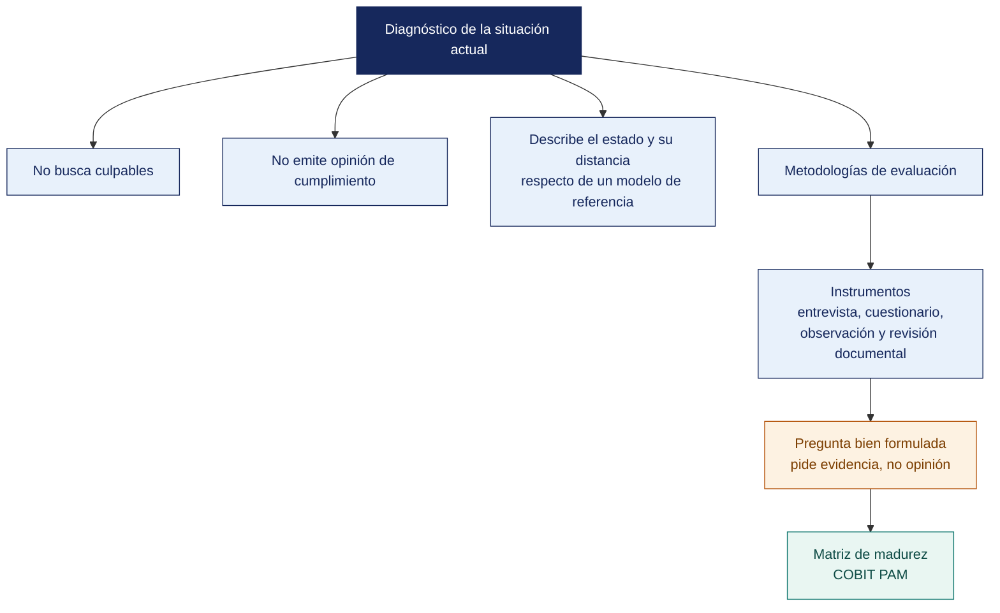

[Semana 10](README.md) · **Teoría** · [Dinámica de aula](2-DINAMICA.md) · [Taller de laboratorio](3-TALLER.md)

# Semana 10

## El Proceso de Auditoría · Diagnóstico de la Situación Actual · Metodologías de Evaluación

**SI-084 · Auditoría de Sistemas** · Sesión 1 en aula · 2 horas académicas, 100 min, con la dinámica incluida

> ¿Un término no le resulta claro? Está definido en el [glosario técnico del curso](../GLOSARIO.md).

---

## Supuesto y pregunta

Una entidad quiere saber en qué estado está su gestión de TI y aplica una encuesta a cuarenta usuarios. El 78 % responde que los sistemas son seguros, y el área de TI presenta el resultado al directorio como evidencia de madurez.

Dos meses después, una extracción del sistema muestra siete cuentas activas de personal que ya cesó, con accesos posteriores a la fecha de cese.

> **¿Qué evidencia permite concluir sobre el estado real de la gestión de TI?**

## Mapa de la sesión

---

## Debate plenario de los dilemas éticos

Exposiciones de 10 minutos y debate abierto sobre los ocho dilemas. Cierre del docente — **la ética profesional no se pone a prueba cuando es cómoda; se pone a prueba cuando el hallazgo correcto tiene un costo personal para el auditor.**

## 1. El diagnóstico de la situación actual

> **¿Por qué un diagnóstico no emite conformidades y aun así produce un número?**

**Qué no es.** Un diagnóstico no es una auditoría de cumplimiento. No emite conformidades ni no conformidades. **No busca culpables.**

**Es una fotografía estructurada y comparable del estado actual de la gestión de TI**, cuyo propósito es establecer la línea base desde la cual se planifica la mejora y contra la cual se medirá el progreso.

| | **Auditoría de cumplimiento** | **Diagnóstico de situación actual** |
|---|---|---|
| Pregunta | ¿Cumple el criterio? | ¿Dónde está y cuánto le falta? |
| Resultado | Conformidad / No conformidad | Nivel de madurez o capacidad |
| Escala | Binaria | Ordinal (0 a 5) |
| Uso | Certificación, informe a la dirección | Plan de mejora, plan estratégico de TI, presupuesto |
| Actitud del auditado | Defensiva | Colaborativa, si se conduce bien |
| Vínculo con otros cursos | | Es el insumo del **PETI (Plan Estratégico de Tecnologías de Información)** (SI-886, Semanas 6, 11 y 13) |

**Los cuatro instrumentos del diagnóstico y su fuerza probatoria.**

| Instrumento | Qué obtiene | Fortaleza | Debilidad | Cuándo se usa |
|---|---|---|---|---|
| **Cuestionario estructurado** | Cobertura amplia y comparable | Rápido; permite muchas áreas | Autoevaluación optimista | Barrido inicial |
| **Entrevista semiestructurada** | Contexto, causas, tensiones no escritas | Descubre lo que el cuestionario no pregunta | Costosa en tiempo; sesgo del entrevistado | Profundización |
| **Revisión documental** | Evidencia de la existencia de procesos | Objetiva | Un documento no prueba que se ejecute | Verificación del diseño |
| **Observación y verificación en el sistema** | Evidencia de que el proceso opera | Máxima fuerza | Puntual en el tiempo | **Triangulación obligatoria** |

> **Regla de triangulación.** Ninguna calificación de madurez se asigna con un solo instrumento. Si el cuestionario dice «nivel 3», la entrevista lo matiza y la evidencia documental o del sistema lo confirma o lo desmiente. **La calificación final es la que sostiene la evidencia, no la que declara el auditado.**

**Ejemplo trabajado — tres instrumentos sobre el mismo objeto, tres respuestas distintas.** Objeto. *¿Se controlan los accesos al ERP?*

| Instrumento | Qué se obtiene | Qué NO prueba | Cuándo usarlo |
|---|---|---|---|
| **Entrevista** al jefe de sistemas | «Revisamos los accesos cuando hay cambios importantes» | Que se haya revisado. Es una declaración | Para entender el proceso y formular las pruebas |
| **Cuestionario** a 40 usuarios | 12 admiten haber compartido su contraseña | Cuántos lo hacen realmente. Nadie admite lo que lo perjudica | Para detectar dónde mirar, no para concluir |
| **Extracción del sistema** | 7 cuentas habilitadas de personal cesado, con accesos posteriores al cese | **Nada más.** Es el hecho | Para **concluir**. Es la única evidencia de las tres |

> **Los tres son legítimos y ninguno reemplaza a otro.** La entrevista dirige, el cuestionario prioriza, **el dato concluye**. Un diagnóstico construido solo con entrevistas y encuestas no sostiene un hallazgo. Sostiene una impresión.

> **Microaplicación (5 min). Tres instrumentos, tres respuestas.** Con el caso del inicio a la vista, el aula responde en parejas **qué instrumento habría que aplicar y en qué orden** para poder concluir. Se recogen dos propuestas antes de dar la regla de triangulación.

| Caso | Qué debe contener una buena respuesta |
|---|---|
| El 78 % de encuestados dice que el sistema es seguro. ¿Qué concluye el auditor? | Nada sobre la seguridad. Solo que la percepción es alta, lo que puede ser un hallazgo en sí. Percepción alta con controles ausentes indica falsa sensación de seguridad |
| ¿Se puede auditar sin entrevistar a nadie? | Se puede probar, pero no se puede entender la causa. Sin causa, la recomendación es genérica y el auditado la rechaza con razón |
| La respuesta al cuestionario fue voluntaria y respondió el 14 %. ¿Sirve? | Para dirigir la prueba, sí. Para concluir sobre la población, no. Quien tiene una queja responde más que quien no la tiene |
> **El error frecuente del bloque.** Concluir con un solo instrumento. La encuesta del caso no es inútil — dice dónde mirar. Lo que no puede hacer es sostener una calificación. **La calificación final es la que sostiene la evidencia, no la que declara el auditado**, y por eso ninguna se asigna sin triangular.

## 2. Metodologías de evaluación de sistemas informáticos

> **¿Qué convierte «madurez media» en un dato que se puede defender?**

**1. COBIT 2019 — Process Capability (basado en ISO/IEC 33000).** Evalúa cada objetivo de gobierno o gestión en una escala de capacidad:

| Nivel | Nombre | Qué significa | Evidencia que lo sostiene |
|---|---|---|---|
| **0** | Incompleto | El proceso no se ejecuta o no logra su propósito | Ausencia de cualquier evidencia |
| **1** | Realizado | El proceso logra su propósito, pero de forma reactiva y sin gestión | Los productos del proceso existen |
| **2** | Gestionado | El proceso se planifica, se monitorea y se ajusta; sus productos se controlan | Plan, responsable asignado, registros |
| **3** | Establecido | Existe un proceso definido, estandarizado y adaptado a la organización | Procedimiento documentado y usado en toda la organización |
| **4** | Predecible | El proceso opera dentro de límites definidos y se mide cuantitativamente | Indicadores con metas y análisis de desviación |
| **5** | Optimizado | El proceso mejora continuamente en función de objetivos de negocio | Evidencia de mejoras implementadas a partir del análisis |

**Cómo se califica en la práctica.** Para cada objetivo, la calificación se sostiene en las **prácticas de gestión** y sus **actividades**. **La regla operativa.** *Un nivel N solo se alcanza si todos los niveles anteriores están completos.* Un proceso con indicadores sofisticados (apariencia de nivel 4) pero sin procedimiento documentado (nivel 3 incompleto) **es nivel 2**.

**2. Modelo de madurez del SGSI (Sistema de Gestión de Seguridad de la Información).** Aplica una lógica análoga a las cláusulas 4–10 y a los 93 controles del Anexo A de la ISO/IEC 27001:2022, produciendo un perfil de madurez por tema (organizacional, personas, físico, tecnológico).

**3. Evaluación por brechas (*gap analysis*).** Para cada requisito. Estado actual → estado objetivo → brecha → acción → esfuerzo → responsable → plazo. Es el formato que la gerencia entiende porque **produce directamente el plan de trabajo**.

**4. CMMI y modelos sectoriales.** CMMI para desarrollo; el NIST Cybersecurity Framework 2.0 con sus funciones **GOVERN, IDENTIFY, PROTECT, DETECT, RESPOND, RECOVER** para ciberseguridad; el modelo de madurez del gobierno digital peruano para entidades públicas.

**El error metodológico más frecuente.** Calificar madurez **por percepción**. El auditor pregunta «¿del 1 al 5, cómo evalúa su gestión de cambios?», el jefe de TI responde «4», y esa cifra entra al informe. Eso no es un diagnóstico. Es una encuesta de autoestima. La calificación debe **derivarse de la evidencia recolectada**, con la regla de decisión escrita antes de recolectarla.

**Ejemplo trabajado — el mismo proceso evaluado con dos escalas.** Proceso. *Gestión de cambios* en una distribuidora.

| | COBIT PAM · escala ISO/IEC 33020 | Escala propia «alto/medio/bajo» |
|---|---|---|
| **Qué mide** | Si el proceso alcanza cada atributo, con evidencia por atributo | La impresión del evaluador |
| **Nivel 1 — Ejecutado** | ¿El proceso logra su propósito? Hay cambios aplicados: **sí** | — |
| **Nivel 2 — Gestionado** | ¿Se planifica, se asignan responsables y se controlan los productos? Los cambios urgentes no se registran: **parcialmente** | — |
| **Nivel 3 — Establecido** | ¿Existe un proceso estándar definido y desplegado? No hay procedimiento escrito: **no** | — |
| **Resultado** | **Nivel 1**, con nivel 2 parcialmente alcanzado. Se detiene ahí. No se evalúan niveles superiores | «Madurez media» |
| **Qué permite recomendar** | Exactamente qué falta para alcanzar el nivel 2. Registrar los cambios urgentes y asignar responsable | Nada accionable |

> **La regla que más se incumple.** En la escala de capacidad, **si un nivel no se alcanza plenamente, no se evalúan los superiores**. Un proceso no puede estar en nivel 4 con el nivel 2 incompleto. Cuando un informe presenta niveles altos con bases sin cumplir, la escala se aplicó mal.

> **Microaplicación (5 min). La regla escrita antes.** El aula escribe, para un solo objetivo de COBIT, **qué evidencia exigiría en el nivel 2 y qué evidencia distinta exigiría en el nivel 3**. Si las dos respuestas se parecen, la escala no sirve.

| Caso | Qué debe contener una buena respuesta |
|---|---|
| ¿Por qué no basta con decir «madurez media»? | Porque no indica qué hacer. La escala de capacidad dice qué atributo falta y, por tanto, cuál es la siguiente acción concreta |
| ¿Puede una organización pequeña alcanzar nivel 3? | Sí. El nivel 3 exige un proceso definido y desplegado, no un área grande. Un procedimiento de dos páginas que se cumple alcanza |
| ¿Aspirar al nivel 5 en todos los procesos es un buen objetivo? | No. Cuesta y no siempre aporta. El nivel objetivo se fija por riesgo: alto en los procesos críticos, suficiente en el resto |
> **El error frecuente del bloque.** Escribir la regla de calificación después de recoger las respuestas. Es lo que convierte el nivel en una impresión con número. La regla se escribe **antes**, se versiona, y así la calificación deja de depender del ánimo de la reunión.

## 3. Diseño de los instrumentos de diagnóstico

> **¿Qué distingue una pregunta que obtiene un hecho de una que obtiene una opinión?**

**Preguntas que no sirven y su reformulación.**

| Pregunta defectuosa | Por qué falla | Reformulación |
|---|---|---|
| «¿Tienen una política de seguridad?» | Binaria, sesgada al sí | «Indique el nombre, la versión, la fecha de aprobación y quién la aprobó. Adjunte el documento.» |
| «¿Del 1 al 5, cómo califica su gestión de cambios?» | Autopercepción | «¿Cuántos cambios se desplegaron a producción el último trimestre? ¿Cuántos tienen aprobación registrada? Adjunte el registro.» |
| «¿Realizan respaldos?» | No distingue existencia de eficacia | «¿Cuál fue la fecha de la última prueba de restauración? ¿Cuánto tomó? ¿Quién firmó el acta? Adjúntela.» |
| «¿Está satisfecho con el proveedor?» | Opinión sin criterio | «¿Cuántos incidentes de nivel 1 hubo el último semestre? ¿Cuántos se resolvieron dentro del nivel de servicio contratado?» |

**Estructura de un buen cuestionario de diagnóstico.** Cada ítem incluye — enunciado que pide un **hecho verificable**, evidencia solicitada, nivel de capacidad que sustentaría cada respuesta y espacio para la observación del auditor. Al final de cada sección, el **veredicto de nivel** con su justificación.

**La entrevista semiestructurada.** Guion con preguntas abiertas de apertura («cuénteme cómo llega un cambio desde que alguien lo pide hasta que está en producción»), preguntas de profundización, y **preguntas de contraste** que verifican consistencia entre entrevistados. **Regla.** Se entrevista a **quien ejecuta**, no solo a quien dirige. La discrepancia entre lo que declara el jefe y lo que describe el operador es, en sí misma, un hallazgo.

## Cierre

**La respuesta a la pregunta con la que abrimos.** Se concluye con **evidencia verificable en el sistema**, y la encuesta sirve solo para decidir dónde buscarla. El 78 % del caso no era falso ni inútil — era una percepción, y la percepción no es evidencia de auditoría. Las siete cuentas activas de personal cesado sí lo son, y aparecieron con una extracción de diez minutos.

**Las tres ideas que deben quedar.**

| Idea | Por qué importa en el ejercicio profesional |
|---|---|
| El diagnóstico no busca culpables ni emite conformidades. Establece la línea base | Determina la actitud del auditado y, con ella, la calidad de la información que se obtiene |
| Ninguna calificación de madurez se asigna con un solo instrumento | Es la regla de triangulación, y es lo que separa un diagnóstico de una autoevaluación optimista |
| La regla de calificación se escribe antes de recolectar | Sin eso, el nivel se acomoda a lo que se encontró y el diagnóstico no se puede defender |

**Lo que suele fallar frente a este caso.** Casi todo el mundo detecta que la encuesta no basta, pero pocos dicen **para qué sí sirve**. Descartarla del todo es tan erróneo como concluir con ella.

**Lo que sigue.** La [dinámica de esta sesión](2-DINAMICA.md) entrega un cuestionario de diagnóstico defectuoso de doce preguntas y pide reformularlas **para que cada una obtenga un hecho verificable con su evidencia**, y definir la regla de decisión que convierte la respuesta en un nivel. Una de las doce está bien formulada, y encontrarla es parte del ejercicio.

**Pregunta de cierre.** *si el diagnóstico da nivel 2 en todos los procesos, ¿es un mal resultado?* No necesariamente. Para una empresa de 30 personas, nivel 2 sostenido puede ser el óptimo económico. **El diagnóstico no persigue el nivel 5. Persigue el nivel apropiado al riesgo y al tamaño de la organización.** Recomendar nivel 4 a una MYPE es un error profesional tan grave como no detectar el nivel 0.
---

---

[Semana 10](README.md) · **Teoría** · [Dinámica de aula](2-DINAMICA.md) · [Taller de laboratorio](3-TALLER.md)

---

**Docente** · Dr. Oscar Juan Jimenez Flores
[oscarjimenezflores@upt.pe](mailto:oscarjimenezflores@upt.pe) · [LinkedIn](https://www.linkedin.com/in/oscar-jimenez-flores/) · [CTI Vitae — CONCYTEC](https://ctivitae.concytec.gob.pe/appDirectorioCTI/VerDatosInvestigador.do?id_investigador=33398)

Escuela Profesional de Ingeniería de Sistemas · Universidad Privada de Tacna · Tacna, Perú
