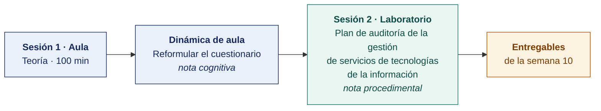

  
  &nbsp;&nbsp;&nbsp;&nbsp;&nbsp;&nbsp;
  

  <strong>Universidad Privada de Tacna</strong> 
  Facultad de Ingeniería · Escuela Profesional de Ingeniería de Sistemas

<h1 align="center">Semana 10</h1>
<h2 align="center">El Proceso de Auditoría · Diagnóstico de la Situación Actual · Metodologías de Evaluación</h2>

  <strong>SI-084 · Auditoría de Sistemas</strong> 
  4 horas académicas de 50 min · 100 min de teoría con la dinámica incluida en aula · 100 min de taller en laboratorio

---

## Datos de la asignatura

| | |
|---|---|
| **Asignatura** | SI-084 · Auditoría de Sistemas |
| **Escuela** | Escuela Profesional de Ingeniería de Sistemas |
| **Ciclo** | X · 04 horas semanales · 03 créditos · Obligatorio |
| **Prerrequisito** | SI-985 Gestión de la Configuración de Software |
| **Unidad** | II — Diagnóstico, Evaluación y Metodología de Auditoría de Sistemas |
| **Semana** | 10 de 17 |
| **Duración** | 4 horas académicas de 50 min · 100 min de teoría con la dinámica incluida en aula · 100 min de taller en laboratorio |
| **Resultados de aprendizaje** | **RA1** Analiza e identifica las responsabilidades que asume un auditor de sistemas · **RA2** Valora la importancia de los roles del auditor de sistemas |
| **Atributos del graduado** | AG-I08 Análisis de Problemas (CD2, nivel 4) · AG-I04 Comunicación (CD1, nivel 4) |

### Lo que indica el sílabo

**Contenido conceptual.** El proceso de auditoría de sistemas, diagnóstico de la situación actual. Metodologías de evaluación de sistemas informáticos.

**Contenido procedimental.** Identifica, evalúa, analiza y define acciones de la metodología de evaluación de sistemas.

> **Qué plan construye esta semana.** El laboratorio produce un **plan de auditoría completo** de la gestión de servicios de tecnologías de la información, con los criterios de ITIL 4 e ISO/IEC 20000-1:2018. La estructura es la del [Modelo del Plan de Auditoría](../MODELO-PLAN-DE-AUDITORIA.md) y el caso es el [Encargo 10](../ENCARGOS-UNIDAD-II/CASO-10-gestion-de-servicios-de-ti.md).

> **La solicitud de su organización.** Está en [CASOS/](CASOS/README.md), una por organización del banco. La escribe la propia organización, expone sus problemas y pide la auditoría. Con ella el equipo propone el plan.

## Materiales de esta semana

| | Documento | Qué encontrarás | Dónde y cuánto dura |
|---|---|---|---|
| 1 | **[Teoría](1-TEORIA.md)** | Debate plenario de los dilemas éticos · El diagnóstico de la situación actual · Metodologías de evaluación de sistemas informáticos | Aula · 100 min |
| 2 | **[Dinámica de aula](2-DINAMICA.md)** | Reformular el cuestionario, con su material, su ejemplo resuelto y su rúbrica | Aula · dentro de los 100 min de la sesión de teoría |
| 3 | **[Taller de laboratorio](3-TALLER.md)** | Plan de auditoría de la gestión de servicios de tecnologías de la información | Laboratorio · 100 min |

## Ruta de la semana

## Entregables

| Entregable | Formato y nombre del archivo | Vence |
|---|---|---|
| **Dinámica de aula** · Reformular el cuestionario | PDF desde la [plantilla de dinámica](../PLANTILLAS/SI084-PLANTILLA-DINAMICA.docx) · `SI084-S10-DINAMICA-Grupo<N>.pdf` | Según lo programado en el aula virtual |
| **Informe del taller de laboratorio N.º 10** | PDF en formato EPIS desde la [plantilla de taller](../PLANTILLAS/SI084-PLANTILLA-TALLER.docx) · `SI084-S10-TALLER-Grupo<N>.pdf` | Según lo programado en el aula virtual |
| **El plan de auditoría del Encargo 10**, completo | Markdown y PDF en el repositorio, sobre la etiqueta `taller-10` | Según lo programado en el aula virtual |

> La dinámica y el informe del taller se entregan en **PDF**, con la carátula de la UPT y los códigos de todos los integrantes. Las plantillas obligatorias están en [`PLANTILLAS/`](../PLANTILLAS/).

## Cómo se evalúa

| Criterio | Instrumento | Peso |
|---|---|---|
| Cognitivo | Rúbrica de reformulación + exposición de 10 min en la Semana 11 | 25 % |
| Procedimental | Lista de cotejo de los 10 resultados del laboratorio | 35 % |
| Actitudinal | Conducción respetuosa de las entrevistas y consentimiento informado | 15 % |

## Preparación para la Semana 11

- **Leer.** El [Encargo 11](../ENCARGOS-UNIDAD-II/CASO-11-cumplimiento-legal.md), completo, antes de la sesión. Después, la solicitud de su organización en [SEMANA-11/CASOS/](../SEMANA-11/CASOS/README.md).
- **Leer.** La Ley 29733, que es breve, y el título sobre medidas de seguridad de su Reglamento vigente, el D. S. 016-2024-JUS.
- **Leer.** El Decreto Legislativo 822, artículos sobre programas de ordenador.
- **Revisar.** El portal de la Autoridad Nacional de Protección de Datos Personales.
- **Solicitar.** Por escrito, el registro de tratamiento de datos y el inventario de software de la organización asignada.
---

**Docente** · Dr. Oscar Juan Jimenez Flores
[oscarjimenezflores@upt.pe](mailto:oscarjimenezflores@upt.pe) · [LinkedIn](https://www.linkedin.com/in/oscar-jimenez-flores/) · [CTI Vitae — CONCYTEC](https://ctivitae.concytec.gob.pe/appDirectorioCTI/VerDatosInvestigador.do?id_investigador=33398)

Escuela Profesional de Ingeniería de Sistemas · Universidad Privada de Tacna · Tacna, Perú
