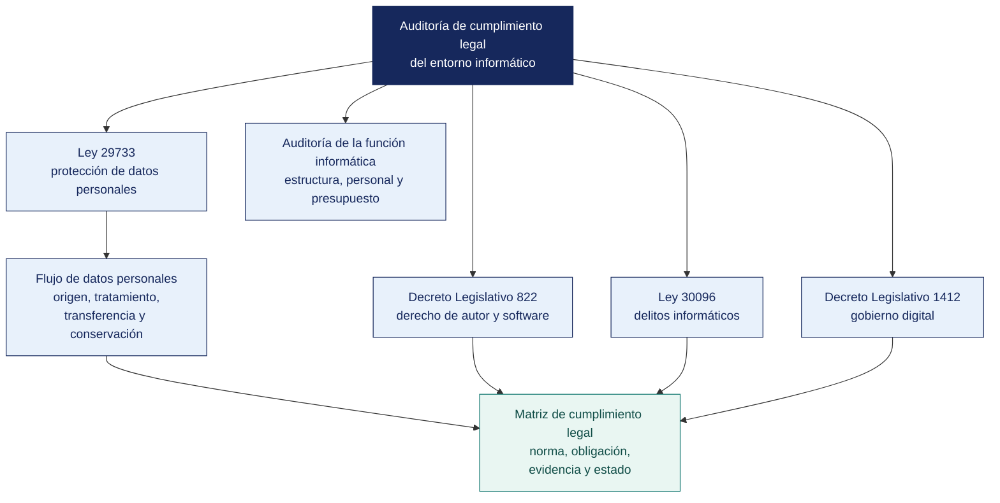

[Semana 11](README.md) · **Teoría** · [Dinámica de aula](2-DINAMICA.md) · [Taller de laboratorio](3-TALLER.md)

# Semana 11

## Auditoría de Cumplimiento Legal del Entorno Informático · Auditoría de la Función Informática

**SI-084 · Auditoría de Sistemas** · Sesión 1 en aula · 2 horas académicas, 100 min, con la dinámica incluida

> ¿Un término no le resulta claro? Está definido en el [glosario técnico del curso](../GLOSARIO.md).

---

## Supuesto y pregunta

Una empresa contrata un servicio de nube para su sistema de planillas, firma un contrato con cláusula de confidencialidad, exige contraseñas robustas y cifra la base, y su asesor legal revisa el contrato y lo aprueba.

Pero los servidores del proveedor están en otro país, nadie lo verificó ni lo autorizó y no consta ninguna garantía, de modo que la empresa está cometiendo una infracción desde el día uno y su contrato no la protege de nada.

> **¿Qué obligaciones legales le genera la tecnología a una organización aunque sus contratos estén bien redactados?**

## Mapa de la sesión

---

## 1. Auditoría de cumplimiento legal del entorno informático

> **¿Qué evalúa exactamente la auditoría de cumplimiento legal?**

**Es la evaluación del cumplimiento del marco legal y normativo aplicable al uso, tratamiento y explotación de la tecnología y de la información en la organización** — en la banca, por ejemplo, lo que exige la SBS sobre el sistema de gestión de seguridad de la información. Es el área donde **el incumplimiento tiene consecuencia sancionatoria directa**, no solo pérdida de eficacia. La calificación jurídica del incumplimiento es trabajo de un abogado; al auditor de sistemas le corresponde verificar el hecho — si el control exigido existe, está documentado y se aplica.

### 1.2.Protección de datos personales

**Marco vigente en el Perú.** La **Ley 29733** y su **Reglamento aprobado por Decreto Supremo 016-2024-JUS**, vigente desde el **31 de marzo de 2025**, que reemplazó al D. S. 003-2013-JUS y elevó considerablemente el nivel de exigencia (135 artículos). La autoridad de control es la **Autoridad Nacional de Protección de Datos Personales (ANPD)**, adscrita al Ministerio de Justicia y Derechos Humanos.

**Los conceptos que el auditor debe manejar con precisión.**

| Concepto | Definición operativa | Consecuencia de auditoría |
|---|---|---|
| **Dato personal** | Información numérica, alfabética, gráfica, fotográfica, acústica, sobre hábitos personales o de cualquier otro tipo, concerniente a una persona natural **identificada o identificable** | Un correo corporativo `nombre.apellido@empresa.pe` es dato personal |
| **Dato sensible** | Datos biométricos, origen racial y étnico, ingresos económicos, opiniones políticas, convicciones religiosas, salud, vida sexual | Exige consentimiento **expreso** y medidas reforzadas |
| **Banco de datos personales** | Conjunto organizado de datos personales, automatizado o no | Una hoja de cálculo de clientes es un banco de datos |
| **Titular del banco de datos** | Quien determina la finalidad y el contenido del tratamiento | Es el responsable ante la ANPD, **no el proveedor de nube** |
| **Encargado del tratamiento** | Quien trata datos por cuenta del titular | Exige contrato con cláusulas de tratamiento |
| **Flujo transfronterizo** | Transferencia de datos fuera del país | **Requiere garantías.** El proveedor de nube con servidores en el extranjero es un flujo transfronterizo |
| **Derechos ARCO** | Acceso, rectificación, cancelación y oposición | La organización debe tener un procedimiento con plazo de atención |

**Los procedimientos de auditoría del cumplimiento de la Ley 29733.**

| Proc. | Objetivo de control | Procedimiento | Excepción |
|---|---|---|---|
| **J-01** | Existe inventario de bancos de datos personales | Solicitar el inventario y contrastarlo con los sistemas identificados en el diagnóstico | Sistema que trata datos personales y no figura en el inventario |
| **J-02** | Cada tratamiento tiene base legal | Para cada banco, verificar la base legal (consentimiento, ley, contrato) y su evidencia | Tratamiento sin base legal identificada |
| **J-03** | El consentimiento es previo, expreso, informado e inequívoco | Inspeccionar los formularios de captación y la evidencia de consentimiento almacenada | Casilla premarcada, consentimiento tácito, o consentimiento no almacenado |
| **J-04** | Existe procedimiento de atención de derechos ARCO con plazo | Solicitar el procedimiento y el registro de solicitudes atendidas del periodo | Sin procedimiento, o solicitudes fuera de plazo |
| **J-05** | Se aplican medidas de seguridad proporcionales | Contrastar los controles técnicos verificados en la Unidad I contra el nivel de sensibilidad de los datos | Datos sensibles sin cifrado ni control de acceso diferenciado |
| **J-06** | Los encargados tienen contrato con cláusulas de tratamiento | Muestrear los contratos con proveedores que acceden a datos personales | Proveedor con acceso a datos sin cláusula de tratamiento |
| **J-07** | Los flujos transfronterizos cuentan con garantías | Identificar los servicios en la nube y verificar la ubicación de los servidores y las garantías | Flujo transfronterizo sin garantía documentada |
| **J-08** | Existe procedimiento de notificación de brechas | Solicitar el procedimiento y verificar su plazo y destinatarios | Sin procedimiento de notificación a la ANPD y a los titulares |
| **J-09** | Se aplica minimización y plazo de conservación | Verificar que cada banco tenga plazo de conservación definido y evidencia de depuración | Datos conservados indefinidamente sin justificación |

### 1.2.Licenciamiento de software y propiedad intelectual

El **Decreto Legislativo 822, Ley sobre el Derecho de Autor**, protege los programas de ordenador como obras. El uso de software sin licencia genera responsabilidad y es sancionable por **INDECOPI**.

**Procedimientos.** Inventario de software instalado contrastado contra licencias adquiridas (**el CAAT de la Semana 06 aplica directamente**); verificación del cumplimiento de los términos de licencias de código abierto —especialmente las **copyleft** como la GPL, cuyo incumplimiento puede obligar a liberar código propietario—; y verificación de la **titularidad del código desarrollado por terceros**, que si el contrato no la cede expresamente permanece con el proveedor.

### 1.2.Evidencia digital y delitos informáticos

| Norma | Exigencia auditable |
|---|---|
| **Ley 30096 y Ley 30171**, Delitos Informáticos | Define el límite de las pruebas del auditor y tipifica el acceso ilícito a sistemas y datos |
| **Ley 27269**, Firmas y Certificados Digitales, y su reglamento | Validez legal del documento electrónico y de la firma digital; uso de entidades de certificación acreditadas por INDECOPI |
| **D. Leg. 1412** y **D. S. 029-2021-PCM** | **Gobierno digital.** Líder de Gobierno Digital, Oficial de Seguridad de la Información, interoperabilidad vía PIDE |
| **Ley 28716** y directivas de la Contraloría | Sistema de control interno en entidades del Estado |
| **Resolución SBS 504-2021** y modificatorias | SGSI-C obligatorio en el sistema financiero, de seguros y AFP |
| **Normas de libros y comprobantes electrónicos de SUNAT** | Conservación, integridad y disponibilidad de la información tributaria electrónica |
| **Ley 30999**, Ley de Ciberdefensa | Ámbito de defensa nacional en el ciberespacio |

**Monitoreo del correo y de la actividad del trabajador.** Terreno de conflicto frecuente. El empleador puede establecer políticas de uso de los recursos informáticos, pero el monitoreo debe ser **previamente informado, proporcional y no invadir el contenido de comunicaciones privadas**. El acceso sin aviso al correo de un trabajador puede configurar vulneración del secreto de las comunicaciones, protegido constitucionalmente. La existencia de una **política de uso aceptable firmada por el trabajador** es la evidencia que separa el monitoreo legítimo del ilícito.

**Ejemplo trabajado — de la obligación legal al hallazgo.** Una cadena de farmacias con programa de fidelización.

| Paso | Contenido |
|---|---|
| **Hecho observado** | El programa registra nombre, teléfono e **historial de medicamentos adquiridos** |
| **Calificación del dato** | El historial de medicamentos permite inferir el estado de salud. Es **dato sensible** |
| **Norma aplicable** | Ley 29733 y D. S. 016-2024-JUS: los datos sensibles exigen consentimiento **expreso** y finalidad determinada |
| **Cómo se obtiene el consentimiento hoy** | Casilla premarcada en el formulario de afiliación |
| **Por qué eso no cumple** | Una casilla premarcada no es consentimiento expreso. No hay acto afirmativo del titular |
| **Condición** | 100 % de las afiliaciones del periodo se registraron con casilla premarcada, sobre datos sensibles |
| **Criterio** | Ley 29733, sobre consentimiento; D. S. 016-2024-JUS, sobre datos sensibles |
| **Efecto** | Tratamiento sin base legal válida de N titulares. Exposición a procedimiento sancionador de la ANPD |
| **Recomendación** | Rehacer el consentimiento con acto afirmativo, informar la finalidad y **no usar los datos ya recogidos** hasta regularizar |

> **Fíjese en el orden.** No se parte de la norma buscando qué incumplir. Se parte del **hecho**, se califica el dato y recién ahí se busca qué norma lo alcanza. Al revés se producen informes que citan leyes sin condición que las active.

> **Microaplicación (6 min). Quién responde ante la autoridad.** Con el caso del inicio a la vista, el aula responde en parejas **quién es el titular del banco de datos y quién el encargado**, y qué documento tendría que existir entre los dos. Se recogen dos respuestas antes de dar los conceptos.

| Caso | Qué debe contener una buena respuesta |
|---|---|
| ¿Es dato sensible el correo corporativo de un trabajador? | No por sí mismo. Es dato personal, no sensible. Sensibles son salud, biometría, origen étnico, convicciones, vida sexual y datos de menores |
| Una empresa privada guarda datos en un servidor en el extranjero. ¿Basta la cláusula de confidencialidad? | No. El flujo transfronterizo tiene requisito propio de autorización. La confidencialidad es otra obligación distinta |
| ¿Se puede auditar el cumplimiento del D. Leg. 822 sin ser abogado? | **Sí, en lo verificable.** Instalaciones contra licencias adquiridas. La calificación jurídica del incumplimiento es de otro especialista, y así se declara |
> **El error frecuente del bloque.** Creer que la responsabilidad se transfiere con el servicio. El titular del banco de datos es quien determina la finalidad del tratamiento, y **eso no se subcontrata**. El proveedor de nube es un encargado, y su existencia añade obligaciones a la organización en lugar de quitárselas.

## 2. Auditoría de la función informática

> **¿A quién debe reportar el área de TI, y qué se concluye cuando reporta a otro sitio?**

Evalúa el área de TI **como unidad organizativa**, no a sus sistemas. Es la puerta de entrada a la Unidad III.

| Dimensión | Objetivo de control | Evidencia | COBIT 2019 |
|---|---|---|---|
| **Posición organizacional** | TI reporta a un nivel que le permite alinearse con el negocio y no depender del área que audita | Organigrama, actas del comité de TI | EDM01, APO01 |
| **Planificación** | Existe un plan de TI alineado al plan estratégico institucional | PETI (Plan Estratégico de Tecnologías de Información) o plan operativo con metas y presupuesto | APO02 |
| **Presupuesto** | El gasto de TI se planifica, ejecuta y controla | Presupuesto aprobado vs. ejecutado, análisis de desviación | APO06 |
| **Recursos humanos** | Roles definidos, competencias, plan de sucesión, ausencia de dependencia crítica | Perfiles de puesto, matriz de competencias, factor bus | APO07 |
| **Gestión de proveedores** | Contratos con niveles de servicio medibles y penalidades | Contratos, reportes de nivel de servicio, actas de seguimiento | APO10 |
| **Gestión de la relación con el negocio** | Existe un mecanismo formal de priorización de demandas | Comité de TI, backlog priorizado, actas | APO08 |
| **Desempeño** | Se mide y reporta el desempeño de TI a la dirección | Tablero de indicadores con metas | MEA01 |
| **Cumplimiento** | Se identifica y monitorea el marco legal aplicable | **Matriz de cumplimiento legal con responsable por norma** | MEA03 |

**El hallazgo estructural más frecuente en el Perú.** El área de TI depende jerárquicamente de la Gerencia de Administración y Finanzas y su presupuesto compite con gasto corriente. **Consecuencia.** La inversión en control interno de TI se pospone sistemáticamente porque no genera ingreso visible. **Esto no es un problema técnico ni de presupuesto. Es un problema de gobierno**, y su solución es de directorio, no de TI. Redactarlo como «falta presupuesto para seguridad» pierde el hallazgo; redactarlo como «no existe un mecanismo de gobierno que evalúe el riesgo de TI a nivel de directorio» lo conserva.

**Ejemplo trabajado — qué se mira cuando se audita el área de TI misma.**

| Dimensión | Pregunta del auditor | Evidencia que la responde | Condición típica |
|---|---|---|---|
| **Posición organizacional** | ¿A quién reporta TI? | Organigrama aprobado | TI reporta a Administración y Finanzas. Sus prioridades las fija quien controla el presupuesto |
| **Recursos** | ¿La capacidad alcanza para lo que sostiene? | Planilla del área contra inventario de sistemas | 3 personas para 5 sistemas y 178 usuarios |
| **Dependencia de personas** | ¿Qué se detiene si alguien falta? | Matriz de conocimiento por sistema | Un solo integrante conoce el proceso de consolidación nocturna |
| **Contratos** | ¿Los servicios críticos tienen respaldo contractual vigente? | Contratos con sus fechas | Dos de cinco vencidos, con el servicio operando |
| **Presupuesto** | ¿Se ejecuta lo planificado, y en qué? | Planificado contra ejecutado por partida | 80 % en operación, 8 % en proyectos. El área no tiene capacidad de cambio |
| **Gobierno** | ¿Alguien decide sobre TI además de TI? | Actas del comité | El comité existe en el papel y no se reunió en el último año |

> **La condición más grave de esta lista no es técnica. Es la dependencia de una persona.** Un área con presupuesto, contratos y comité, pero con un único integrante que sabe operar el sistema crítico, tiene un punto de falla que ningún control técnico compensa.

> **Microaplicación (5 min). La dependencia jerárquica como hallazgo.** El aula responde a mano alzada antes de la explicación, y después escribe en una línea **qué decisión concreta se distorsiona** por esa dependencia. La primera respuesta suele ser que no es hallazgo.

| Caso | Qué debe contener una buena respuesta |
|---|---|
| ¿Es hallazgo que TI reporte a Administración y Finanzas? | Por sí solo no. Lo es si se demuestra el efecto. Decisiones de seguridad postergadas por criterio presupuestal, con casos concretos del periodo |
| ¿Cómo se prueba la dependencia de una persona? | Cruzando el inventario de sistemas con quién los administra, y verificando si hay documentación que permita a otro operarlos |
| Si el 92 % del presupuesto va a operación, ¿qué se recomienda? | No «aumentar el presupuesto». Se señala que la estructura de gasto impide ejecutar el plan, y se recomienda separar una partida de inversión con su gobierno |
> **El error frecuente del bloque.** Auditar la función informática entrevistando al jefe de sistemas. Es el área donde la evidencia declarativa engaña más, porque quien responde es a la vez el auditado y el único que conoce el detalle. La evidencia está en el **presupuesto ejecutado, las actas del órgano de gobierno y los contratos**, no en la entrevista.

## 3. Estudio de casos

Análisis dirigido de **dos casos documentados públicamente**, con la pregunta común. *¿qué control faltaba y qué auditoría lo habría detectado antes?*

**Caso A — Filtración de datos personales en una organización peruana.** Se trabaja sobre resoluciones sancionadoras publicadas por la ANPD (accesibles en el portal institucional). Se identifica — qué artículo se infringió, qué medida de seguridad faltaba, qué procedimiento de auditoría (J-01 a J-09) lo habría detectado y cuál fue la sanción.

**Caso B — Incidente de continuidad en una entidad supervisada.** Se analiza a partir de la normativa de la SBS sobre reporte de incidentes — qué obligación de notificación existía, en qué plazo, y qué evidencia habría necesitado la entidad para demostrar que cumplió.

> **Nota metodológica.** Los casos se construyen exclusivamente sobre **documentos oficiales publicados** (resoluciones de la ANPD, comunicados de la SBS, informes de la Contraloría). No se emplean reportes periodísticos ni fuentes sin autoría verificable.

## Cierre

**La respuesta a la pregunta con la que abrimos.** Las que nacen del **tratamiento del dato**, no de la relación contractual. Un contrato regula lo que dos partes se deben entre sí; la Ley 29733 regula lo que la organización le debe al titular del dato, y eso incluye el flujo transfronterizo, la base legal de cada tratamiento y las garantías del encargado. El asesor legal del caso revisó el contrato correcto y no miró dónde estaban los servidores.

**Las tres ideas que deben quedar.**

| Idea | Por qué importa en el ejercicio profesional |
|---|---|
| El titular del banco de datos responde ante la autoridad, y esa responsabilidad no se subcontrata | Determina a quién se dirige el hallazgo y quién asume la multa |
| El flujo transfronterizo requiere garantías, y casi ninguna organización sabe que lo tiene | Es el hallazgo jurídico más frecuente y el que más se pasa por alto |
| La función informática se audita con presupuesto, actas y contratos, no con entrevistas | Es el área donde la evidencia declarativa engaña más |

**Lo que suele fallar frente a este caso.** Casi todo el mundo señala el contrato o la seguridad técnica, y prácticamente nadie pregunta dónde están los servidores. Esa pregunta cabe en cinco palabras y decide la conformidad legal de todo el tratamiento.

**Lo que sigue.** La [dinámica de esta sesión](2-DINAMICA.md) pide rastrear el recorrido completo de un dato personal de su organización, desde que se capta hasta que se elimina, e identificar **los tres puntos de mayor exposición legal** con su artículo y su autoridad. La etapa de eliminación suele estar vacía, y ese vacío es el hallazgo.

**Pregunta de cierre.** *¿quién en esta organización sabe qué normas le aplican y quién responde por cada una?* Si nadie puede nombrar a un responsable por norma, la organización no gestiona su cumplimiento. Lo descubre cuando llega la sanción.
---

---

[Semana 11](README.md) · **Teoría** · [Dinámica de aula](2-DINAMICA.md) · [Taller de laboratorio](3-TALLER.md)

---

**Docente** · Dr. Oscar Juan Jimenez Flores
[oscarjimenezflores@upt.pe](mailto:oscarjimenezflores@upt.pe) · [LinkedIn](https://www.linkedin.com/in/oscar-jimenez-flores/) · [CTI Vitae — CONCYTEC](https://ctivitae.concytec.gob.pe/appDirectorioCTI/VerDatosInvestigador.do?id_investigador=33398)

Escuela Profesional de Ingeniería de Sistemas · Universidad Privada de Tacna · Tacna, Perú
