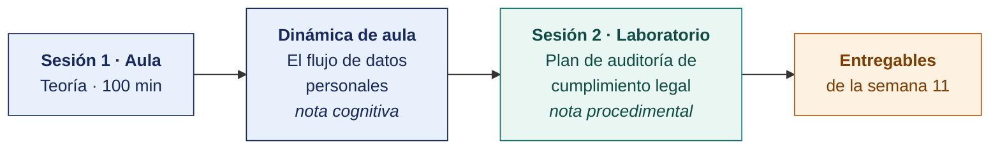

  
  &nbsp;&nbsp;&nbsp;&nbsp;&nbsp;&nbsp;
  

  <strong>Universidad Privada de Tacna</strong> 
  Facultad de Ingeniería · Escuela Profesional de Ingeniería de Sistemas

<h1 align="center">Semana 11</h1>
<h2 align="center">Auditoría de Cumplimiento Legal del Entorno Informático · Auditoría de la Función Informática</h2>

  <strong>SI-084 · Auditoría de Sistemas</strong> 
  4 horas académicas de 50 min · 100 min de teoría con la dinámica incluida en aula · 100 min de taller en laboratorio

---

## Datos de la asignatura

| | |
|---|---|
| **Asignatura** | SI-084 · Auditoría de Sistemas |
| **Escuela** | Escuela Profesional de Ingeniería de Sistemas |
| **Ciclo** | X · 04 horas semanales · 03 créditos · Obligatorio |
| **Prerrequisito** | SI-985 Gestión de la Configuración de Software |
| **Unidad** | II — Diagnóstico, Evaluación y Metodología de Auditoría de Sistemas |
| **Semana** | 11 de 17 |
| **Duración** | 4 horas académicas de 50 min · 100 min de teoría con la dinámica incluida en aula · 100 min de taller en laboratorio |
| **Resultados de aprendizaje** | **RA1** Analiza e identifica las responsabilidades que asume un auditor de sistemas · **RA2** Valora la importancia de los roles del auditor de sistemas |
| **Atributos del graduado** | AG-I02 Ética (CD3, nivel 4) · AG-I08 Análisis de Problemas (CD2 y CD3, nivel 4) |

### Lo que indica el sílabo

**Contenido conceptual.** Auditoria jurídica de entornos informáticos, auditoria de la función informática. Estudio de casos.

**Contenido procedimental.** Realiza análisis crítico jurídico, de auditoría de función, así como de sus entornos informáticos.

> **Qué plan construye esta semana.** El laboratorio produce un **plan de auditoría completo** de el cumplimiento legal del entorno informático, con los criterios de Ley 29733, D. S. 016-2024-JUS y D. Leg. 822. La estructura es la del [Modelo del Plan de Auditoría](../MODELO-PLAN-DE-AUDITORIA.md) y el caso es el [Encargo 11](../ENCARGOS-UNIDAD-II/CASO-11-cumplimiento-legal.md).

> **La solicitud de su organización.** Está en [CASOS/](CASOS/README.md), una por organización del banco. La escribe la propia organización, expone sus problemas y pide la auditoría. Con ella el equipo propone el plan.

## Materiales de esta semana

| | Documento | Qué encontrarás | Dónde y cuánto dura |
|---|---|---|---|
| 1 | **[Teoría](1-TEORIA.md)** | Auditoría de cumplimiento legal del entorno informático · Protección de datos personales · Licenciamiento de software y propiedad intelectual | Aula · 100 min |
| 2 | **[Dinámica de aula](2-DINAMICA.md)** | El flujo de datos personales, con su material, su ejemplo resuelto y su rúbrica | Aula · dentro de los 100 min de la sesión de teoría |
| 3 | **[Taller de laboratorio](3-TALLER.md)** | Plan de auditoría de cumplimiento legal del entorno informático | Laboratorio · 100 min |

## Ruta de la semana

## Entregables

| Entregable | Formato y nombre del archivo | Vence |
|---|---|---|
| **Dinámica de aula** · El flujo de datos personales | PDF desde la [plantilla de dinámica](../PLANTILLAS/SI084-PLANTILLA-DINAMICA.docx) · `SI084-S11-DINAMICA-Grupo<N>.pdf` | Según lo programado en el aula virtual |
| **Informe del taller de laboratorio N.º 11** | PDF en formato EPIS desde la [plantilla de taller](../PLANTILLAS/SI084-PLANTILLA-TALLER.docx) · `SI084-S11-TALLER-Grupo<N>.pdf` | Según lo programado en el aula virtual |
| **El plan de auditoría del Encargo 11**, completo | Markdown y PDF en el repositorio, sobre la etiqueta `taller-11` | Según lo programado en el aula virtual |

> La dinámica y el informe del taller se entregan en **PDF**, con la carátula de la UPT y los códigos de todos los integrantes. Las plantillas obligatorias están en [`PLANTILLAS/`](../PLANTILLAS/).

## Cómo se evalúa

| Criterio | Instrumento | Peso |
|---|---|---|
| Cognitivo | Rúbrica del flujo de datos + exposición de 10 min en la Semana 12 | 25 % |
| Procedimental | Lista de cotejo de los 11 resultados del laboratorio | 35 % |
| Actitudinal | Tratamiento del registro de actividades como información Restringida | 15 % |

## Preparación de la evidencia del Atributo del Graduado

> **Esta semana prepara la evidencia del atributo, y no se registra.** Las dos capturas que la Escuela fija son la de la **Semana 05** y la de la **Semana 16**. Lo que se produce aquí alimenta esas dos y **no modifica tu calificación** ni añade trabajo adicional.

| | |
|---|---|
| **Atributo** | **AG-I02 · Ética** |
| **Criterio medido** | **CD3** · Considera la legislación informática y respeta la diversidad de los grupos humanos |
| **Alineación con el sílabo** | **RA1** Analiza e identifica las responsabilidades que asume un auditor de sistemas · Contenido conceptual del sílabo: «Auditoría **jurídica** de entornos informáticos» · procedimental: «Realiza **análisis crítico jurídico**» |
| **Evidencia que se lee** | `SI084-S11-DINAMICA-Grupo<N>.pdf` y `SI084-S11-TALLER-Grupo<N>.pdf` · matriz de cumplimiento legal |
| **Instrumento** | [Rúbrica AG-I02, escala 1–4](../ASSESSMENT/RUBRICAS-AG.md#ag-i02) |
| **Tipo de medición** | **Preparación de la evidencia** · no se registra |
| **Adónde va** | Alimenta la captura de la [Semana 16](../SEMANA-16/README.md) |

**Qué mira el evaluador.** Si cada obligación se cita con su artículo y se resuelve sobre el caso concreto, y si el tratamiento de datos de grupos vulnerables recibe atención específica y no queda diluido en el promedio.

> **Ajuste de esta semana.** La matriz de cumplimiento incorpora una fila explícita sobre el **tratamiento de datos de grupos en situación de vulnerabilidad o desventaja**. Cubre la mitad del CD3 —«respeta la diversidad de los grupos humanos»— que de otro modo queda implícita.

Mapa completo en [`ASSESSMENT/MAPA-AG.md`](../ASSESSMENT/MAPA-AG.md).

## Preparación para la Semana 12

- **Leer.** El [Encargo 12](../ENCARGOS-UNIDAD-II/CASO-12-seguridad-del-canal-digital.md), completo, antes de la sesión. Después, la solicitud de su organización en [SEMANA-12/CASOS/](../SEMANA-12/CASOS/README.md). **Es el plan que se ejecuta en la Unidad III.**
- **Leer.** Los capítulos V1, V2, V3, V8, V9 y V14 del OWASP ASVS 4.0.3, y las diez categorías del OWASP Top 10:2021.
- **Solicitar.** Por escrito, el inventario del canal digital y las aplicaciones expuestas de la organización asignada.
- **Traer.** Los cinco planes de las semanas 07 a 11, etiquetados. El plan del Encargo 12 los cita en su sección I como su origen.
- **Preparar.** El examen de la Unidad II, semanas 07 a 12.
---

**Docente** · Dr. Oscar Juan Jimenez Flores
[oscarjimenezflores@upt.pe](mailto:oscarjimenezflores@upt.pe) · [LinkedIn](https://www.linkedin.com/in/oscar-jimenez-flores/) · [CTI Vitae — CONCYTEC](https://ctivitae.concytec.gob.pe/appDirectorioCTI/VerDatosInvestigador.do?id_investigador=33398)

Escuela Profesional de Ingeniería de Sistemas · Universidad Privada de Tacna · Tacna, Perú
