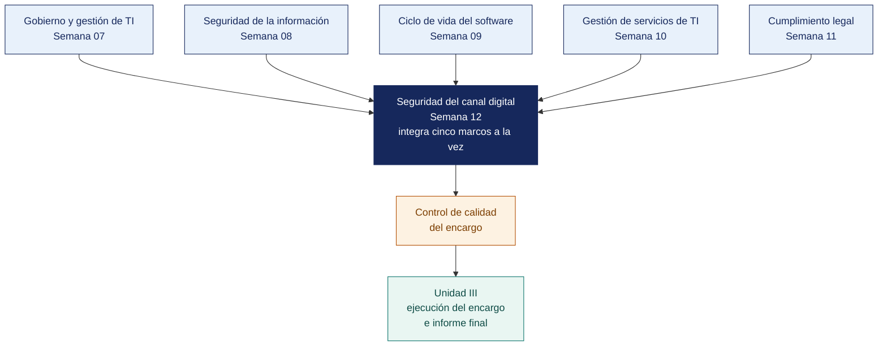

[Semana 12](README.md) · **Teoría** · [Dinámica de aula](2-DINAMICA.md) · [Taller de laboratorio](3-TALLER.md)

# Semana 12

## Integración Metodológica · Exposición de Trabajos · Examen de Unidad II

**SI-084 · Auditoría de Sistemas** · Sesión 1 en aula · 2 horas académicas, 100 min, con la dinámica incluida

> ¿Un término no le resulta claro? Está definido en el [glosario técnico del curso](../GLOSARIO.md).

---

## Supuesto y pregunta

Seis planes de auditoría sobre la misma organización, cada uno correcto por separado — el de gobierno prioriza la continuidad como el mayor riesgo, el de seguridad de la información dedica casi todas sus horas a revisar accesos, y el de servicios califica la gestión de cambios en el nivel más bajo de capacidad y, aun así, programa una prueba de eficacia operativa sobre ese mismo proceso.

Nadie leyó los seis documentos seguidos, porque cada uno se aprobó en su propia semana.

> **¿Dónde viven los defectos que no se ven leyendo cada documento por separado?**

## Mapa de la sesión



---

## Material de estudio de la unidad

> **No se dicta en clase.** Los 100 minutos de aula de esta semana se reparten entre la exposición de avance y el examen teórico. Este material —35 minutos de desarrollo— **se estudia por cuenta propia antes de la sesión y entra en el examen teórico de la Unidad II**. Está aquí completo, no resumido. Es el mismo desarrollo que tendría en aula.

### Cómo encajan los seis planes

Los seis planes construidos en la unidad no son documentos independientes. Son el **programa de auditoría del periodo** de una misma organización, y tienen que ser coherentes entre sí. El sexto, el del canal digital, es además el único que **integra cinco marcos dentro de un solo plan**, y por eso es el que se lleva a ejecución.

```
   PROGRAMA DE AUDITORÍA DEL PERIODO · una organización, seis materias de control

   S07 Gobierno y gestión de TI        COBIT 2019
   S08 Seguridad de la información     NTP-ISO/IEC 27001:2022 · ISO 19011:2018
   S09 Ciclo de vida del software      NTP-ISO/IEC 12207 · NTP-ISO/IEC 25010
   S10 Gestión de servicios de TI      ITIL 4 · ISO/IEC 20000-1:2018
   S11 Cumplimiento legal              Ley 29733 · D. S. 016-2024-JUS · D. Leg. 822
        │
        │  los cinco sustentan la selección del encargo que se ejecuta
        ▼
   S12 Seguridad del canal digital     OWASP ASVS · Top 10 · NTP 27001 · Ley 29733 · contrato
        │  un plan que cita cinco marcos sin mezclarlos
        ▼
   UNIDAD III · ejecución del encargo e informe final (S13 a S16)
```

**Las dos integraciones que esta unidad exige.**

| Integración | Qué significa | Dónde se verifica |
|---|---|---|
| **Entre planes** | Los seis planes del periodo no se contradicen entre sí | En las cinco comprobaciones cruzadas de abajo |
| **Dentro de un plan** | Un mismo plan cita criterios técnicos, de control, legales, contractuales y de gobierno, **y los mantiene separados** | En el plan del Encargo 12 |

**La integración dentro de un plan, con un ejemplo.** Un formulario del portal recoge documento de identidad y teléfono con una casilla de consentimiento sin texto legal. Es **una** condición, y produce **cinco** consecuencias distintas.

| Marco | Criterio | Consecuencia | Destinatario de la conclusión |
|---|---|---|---|
| OWASP ASVS 4.0.3 | Capítulo V8, protección de datos | Dato recogido sin minimización verificada | Equipo de desarrollo y proveedor del portal |
| NTP-ISO/IEC 27001:2022 | Control A.5.34 | Control de privacidad no implementado | Responsable de seguridad de la información |
| Ley 29733 | Artículo 13 y artículo 18 | Consentimiento no informado y deber de información incumplido | Gerencia general y área legal |
| Contrato del portal | Cláusula de responsabilidad | Nadie está obligado a corregirlo | Gerencia general |
| COBIT 2019 | DSS05 y MEA03 | Servicio de seguridad y cumplimiento externo no gestionados | Dirección |

> **Mezclarlos es el error.** Un hallazgo que dice «incumple OWASP y la Ley 29733» no se puede atender, porque el responsable del portal no puede resolver una obligación legal y el área legal no puede configurar una cabecera. **Cinco criterios, cinco consecuencias, cinco destinatarios.**

**Las cinco comprobaciones que se cruzan entre planes.**

| Comprobación | Qué debe ser consistente | Inconsistencia típica |
|---|---|---|
| **Objetivo → procedimiento** | Todo objetivo específico tiene procedimientos y todo procedimiento responde a un objetivo | Un objetivo sobre continuidad sin un solo procedimiento que la pruebe |
| **Criterio → régimen** | Todo criterio es exigible a **esta** organización | Citar la Resolución SBS N.º 504-2021 en una agroexportadora |
| **Enfoque → madurez** | Un proceso en el nivel más bajo de capacidad no admite prueba de eficacia operativa. No hay control que operar | Programar reejecución sobre un control que nadie opera |
| **Alcance → conclusión** | No se concluye sobre lo que el alcance excluyó | Emitir opinión sobre el canal digital cuando el alcance lo dejó fuera |
| **Horas → riesgo** | Las horas se concentran donde el riesgo inherente es mayor | Dedicar el 70 % de las horas al dominio de menor riesgo |

**El principio de proporcionalidad.** Un plan desproporcionado al tamaño de la organización se convierte en un documento que nadie ejecuta. Regla práctica. **Si el plan requiere más horas de auditoría que las que la organización dedica a operar el proceso auditado, el plan está mal dimensionado.**

---

**Ejemplo trabajado — qué aporta cada plan al encargo que se ejecuta.** El plan del Encargo 12 cita a los cinco anteriores en su sección I, y no por cortesía.

| Plan | Semana | Qué aporta al encargo que se ejecuta | Qué pasa si falta |
|---|---|---|---|
| Gobierno y gestión de tecnologías de la información | 07 | Justifica **por qué** se ejecuta este encargo y no otro, con el riesgo que lo prioriza | El encargo se hace porque alguien lo pidió, sin sustento ante el comité |
| Sistema de gestión de seguridad de la información | 08 | Dice qué controles del Anexo A la organización **declara** aplicar sobre el canal | Se audita el canal sin saber qué control organizativo debería respaldarlo |
| Ciclo de vida del software | 09 | Determina si el software que sostiene el canal es confiable | Se prueban controles de aplicación sobre un sistema que cualquiera puede alterar |
| Gestión de servicios de tecnologías de la información | 10 | Da el nivel de capacidad de la gestión del cambio, que decide el enfoque | Se programa prueba de eficacia sobre un proceso que no opera |
| Cumplimiento legal del entorno informático | 11 | Identifica qué obligaciones alcanzan a los datos que el canal recoge | Se omite el criterio más exigible, que es el legal |

> **Los seis no son seis trabajos. Son el programa de auditoría de una organización.** El error frecuente es entregarlos como documentos sueltos y llamar «programa» a ponerlos en la misma carpeta. Que formen un programa significa que **el riesgo que uno declara es el que otro prioriza, y que el nivel de capacidad que uno califica es el que otro usa para elegir el enfoque**.

**Ejemplo trabajado — cómo se detecta un programa mal integrado.**

| Señal | Qué revela |
|---|---|
| El plan de gobierno prioriza la continuidad y el encargo que se ejecuta audita el canal digital, sin decir por qué | La selección del encargo no sale del riesgo. Se eligió por otra razón no declarada |
| El plan de servicios califica la gestión del cambio en el nivel más bajo y el del canal digital programa prueba de eficacia del control de cambios | Se va a probar la operación de un control que el propio equipo calificó inexistente |
| El plan jurídico cita la Ley 29733 y ningún procedimiento del canal digital la usa como criterio | La pieza jurídica quedó decorativa |
| El plan del ciclo de vida concluye que el software no tiene control de cambios, y aun así se concluye sobre controles de aplicación | **Contradicción de fondo.** Los controles generales de tecnologías de la información fallaron y se concluyó igual |
| Los seis planes tienen fecha posterior al inicio del trabajo de campo | Se redactaron para el entregable, no para dirigir el encargo |

> **Autoevaluación (6 min). Las cinco comprobaciones.** Con el caso del inicio delante, señale para cada una de sus tres inconsistencias **cuál de las cinco comprobaciones la habría detectado**. Después compare con la tabla.

| Caso | Qué debe contener una buena respuesta |
|---|---|
| ¿Puede un encargo omitir el criterio legal? | Solo si el alcance no toca datos personales, software licenciado ni obligaciones sectoriales. Es raro, casi siempre toca alguno, y omitirlo se declara |
| ¿En qué orden se elaboran los seis planes? | El de gobierno primero, porque delimita el universo y prioriza. Los cuatro de dominio después, en cualquier orden. El del canal digital al final, porque integra a los cinco |
| ¿Qué se hace si el diagnóstico de capacidad contradice la prioridad del plan de gobierno? | Se documenta y se lleva al comité. Puede ser motivo legítimo para replantear el alcance, con acuerdo, no por decisión unilateral del auditor |

> **El error frecuente.** Revisar los seis planes leyéndolos de corrido. Las inconsistencias viven **entre** documentos, no dentro de ellos, y por eso se detectan cruzando cinco comprobaciones concretas y no releyendo. Un plan puede ser impecable por separado y ser inejecutable dentro del programa.

## Exposición de avance de la Unidad II

Cada equipo expone el avance de su producto ante el aula y el docente. **6 minutos por equipo**, 10 equipos, sin margen. Se corta al minuto seis.

| Momento | Duración | Qué se muestra |
|---|---|---|
| Qué se propuso el equipo para esta unidad | 1 min | El objetivo declarado al inicio de la unidad |
| **Lo construido, funcionando** | 3 min | Producto real, no diapositivas de lo que se piensa hacer |
| Lo que no se logró y por qué | 1 min | Con honestidad. Ocultarlo cuesta más que declararlo |
| Preguntas | 1 min | Del docente |

> **Se evalúa el avance verificable, no la presentación.** Un equipo que muestra poco pero real puntúa por encima de uno que muestra mucho y no lo tiene.

## Examen de Unidad II

El Examen de Unidad se rinde en dos partes, y juntas valen el 25 % de la nota de la unidad.

| Parte | Dónde y cuándo | Duración | Qué evalúa | Materiales |
|---|---|---|---|---|
| **Teórico** | Aula, al cierre de esta sesión | 40 min | Preguntas de alternativas sobre las Semanas 07 a 12, incluido el material de estudio de esta semana | Apuntes propios. **Sin** internet ni asistentes de inteligencia artificial |
| **Práctico** | Laboratorio | 100 min | Detectar lo que no cuadra **entre** los documentos del encargo, que es el trabajo de integración de esta semana | Laboratorio de cómputo, **con inteligencia artificial permitida** y declarada |


## Cierre

**La respuesta a la pregunta del material.** Entre los documentos. Cada uno de los seis planes puede estar bien construido y el conjunto contradecirse, porque nadie comprueba los cruces — que todo objetivo tenga procedimiento, que el criterio alcance al régimen de la organización, que no se pruebe la operación de controles inexistentes, que no se concluya sobre lo excluido y que las horas sigan al riesgo. Son cinco comprobaciones y ninguna exige releer.

**Las tres ideas que deben quedar.**

| Idea | Por qué importa en el ejercicio profesional |
|---|---|
| Los seis planes forman el programa de auditoría del periodo, no seis trabajos sueltos | Un defecto de integración entre ellos invalida el trabajo de las seis semanas |
| No se prueba la eficacia operativa de un control en nivel 0 | Si no hay control, no hay operación que probar, y la prueba consume horas sin producir evidencia |
| Un plan desproporcionado al tamaño de la organización no se ejecuta | Si exige más horas de auditoría que las de operación del proceso auditado, está mal dimensionado |

**Lo que sigue.** El [taller de esta semana](3-TALLER.md) construye el **plan del canal digital**, que es el que integra cinco marcos a la vez y el que se ejecuta en la Unidad III, y lo somete al **control de calidad del encargo** en el papel del revisor de calidad. Las cinco comprobaciones que acaba de ver son las que el verificador aplica.

---

---

[Semana 12](README.md) · **Teoría** · [Dinámica de aula](2-DINAMICA.md) · [Taller de laboratorio](3-TALLER.md)

---

**Docente** · Dr. Oscar Juan Jimenez Flores
[oscarjimenezflores@upt.pe](mailto:oscarjimenezflores@upt.pe) · [LinkedIn](https://www.linkedin.com/in/oscar-jimenez-flores/) · [CTI Vitae — CONCYTEC](https://ctivitae.concytec.gob.pe/appDirectorioCTI/VerDatosInvestigador.do?id_investigador=33398)

Escuela Profesional de Ingeniería de Sistemas · Universidad Privada de Tacna · Tacna, Perú
