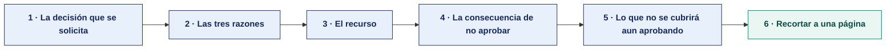

[Semana 12](README.md) · [Teoría](1-TEORIA.md) · **Dinámica de aula** · [Taller de laboratorio](3-TALLER.md)

# Semana 12

## La solicitud al comité

**SI-084 - Auditoría de Sistemas** - **Trabajo previo a la sesión** · calificación **cognitiva**

> ¿Un término no le resulta claro? Está definido en el [glosario técnico del curso](../GLOSARIO.md).

---

> **Esta actividad no se resuelve en aula.** La semana de cierre de unidad dedica el aula a la **exposición de avance** y al **examen teórico**. La dinámica se prepara durante la semana y **se entrega antes de la sesión**. Es el insumo con el que el equipo arma su exposición.

## Qué entregas

| | |
|---|---|
| **Archivo** | `SI084-S12-DINAMICA-Grupo<N>.pdf` |
| **Plantilla obligatoria** | [SI084-PLANTILLA-DINAMICA.docx](../PLANTILLAS/SI084-PLANTILLA-DINAMICA.docx) |
| **Formato** | PDF exportado desde la plantilla en Word, con la carátula de la UPT y los apellidos, nombres y códigos de todos los integrantes |
| **Qué va dentro** | El producto de cierre de unidad que se describe más abajo, desarrollado por el grupo con la evidencia acumulada en la unidad |
| **Dónde se sube** | Aula virtual, tarea «Dinámica · Semana 12» |
| **Cuándo vence** | Según lo programado en el aula virtual, antes del examen de la unidad |
| **Exposición** | En la **exposición de avance de la unidad**, dentro de esta misma sesión. El grupo lee y explica su resultado ante el aula. No se usan diapositivas |

> No se califica un trabajo entregado en `.docx`, sin carátula, sin los códigos de los integrantes o con las tablas del producto vacías.

---

> La nota cognitiva de esta semana se compone de la **exposición del avance de la unidad (sección 1.1)** y del **examen de unidad**.

**Producto adicional obligatorio, entregado al cierre de la unidad.**

> **«La solicitud al comité»** — Un memorando de **una página** dirigido al comité de auditoría, que solicite formalmente la aprobación del programa de auditoría del periodo y la designación del plan que se ejecuta. **Debe contener.** La decisión que se solicita, las tres razones que la sustentan, el recurso requerido, la consecuencia de no aprobarlo y la cobertura que quedará sin alcanzar.

Restricción — **una página, sin anexos**. Un comité no lee más.

---

## Consigna

> **«La solicitud al comité»**
> Un memorando de **una página** dirigido al comité de auditoría, que solicite formalmente la aprobación del programa de auditoría del periodo y la designación del plan que se ejecuta. **Debe contener.** La decisión que se solicita, las tres razones que la sustentan, el recurso requerido, la consecuencia de no aprobarlo y la cobertura que quedará sin alcanzar.

| | |
|---|---|
| **Su papel** | **Jefe de auditoría** pidiendo el presupuesto del año al comité |
| **Misión** | Conseguir la aprobación del programa del periodo en una sola página |
| **Restricción** | **Una página, tres razones con dato, y la cobertura que quedará sin auditar declarada.** Un comité no aprueba lo que está bien hecho, aprueba lo que entiende que le cuesta no aprobar |

Que el equipo pida un presupuesto como se pide de verdad. Una página, tres razones con dato, y la declaración explícita de qué quedará sin auditar si no se aprueba. Un comité no aprueba un plan porque esté bien hecho, sino porque entiende qué pierde si no lo aprueba.

## Cómo se prepara

**Paso 1 · La decisión que se solicita.** Una oración. Qué se pide aprobar exactamente, con su horizonte. Un memorando que no dice qué se pide obliga al comité a deducirlo, y el comité no deduce.

**Paso 2 · Las tres razones.** Cada una con **su dato**, tomado del universo auditable o del registro de riesgos. Cobertura de riesgo, obligación legal y capacidad de respuesta.

**Paso 3 · El recurso.** Horas-auditor y de dónde salen. Pedir sin decir de dónde sale el recurso traslada al comité un trabajo que es del equipo.

**Paso 4 · La consecuencia de no aprobar.** Qué queda sin auditar y qué riesgo permanece sin cobertura, nombrado desde el registro de riesgos de la organización.

**Paso 5 · Lo que no se cubrirá aun aprobando.** Con el plan aprobado, qué parte del universo queda fuera este año. **Un plan que promete cubrirlo todo no es creíble** y el comité lo sabe.

**Paso 6 · Recortar a una página.** Sin anexos. Lo que sobra suele ser la explicación del método, que al comité no le hace falta para decidir.

## Lo que la teoría de hoy te da

Esta dinámica aplica piezas concretas de la sesión de teoría de hoy. Se usan tal cual, sin buscar nada más.

| De la teoría | Para qué se usa aquí |
|---|---|
| [Integración metodológica · cómo encajan los seis planes](1-TEORIA.md) | Es el argumento del memorando. Las tres razones deben mostrar que los seis planes se sostienen entre sí, no que cada uno es bueno por separado |

## Producto

**Un memorando de una página**, dirigido al comité de auditoría.

| Campo | Contenido |
|---|---|
| Decisión que se solicita | Qué se pide aprobar, en una oración |
| Las tres razones | Cada una con su dato. Cobertura de riesgo, obligación legal o capacidad de respuesta |
| Recurso requerido | Horas-auditor, y de dónde salen |
| Consecuencia de no aprobar | Qué queda sin auditar y qué riesgo permanece sin cobertura |
| Cobertura que quedará sin alcanzar | Con el plan aprobado, qué parte del universo auditable no se cubre este año |

**Límite. Una página, sin anexos.** Un comité no lee más.

> **Dónde va.** Este producto se presenta en la **sección 2 de la [plantilla de dinámica](../PLANTILLAS/SI084-PLANTILLA-DINAMICA.docx)**, «El producto». No se copia la consigna ni la teoría. Solo el resultado y lo que lo sostiene.

## Ejemplo resuelto

*El caso de este ejemplo es distinto del que le toca a tu grupo. Sirve para que veas el nivel de detalle que se espera, no para copiarlo.*

**Un memorando bien resuelto.** La organización del ejemplo no es la tuya.

> **Al.** Comité de Auditoría
> **De.** Jefatura de Auditoría de Sistemas
> **Asunto.** Aprobación del programa de auditoría de tecnologías de la información del periodo
>
> Se solicita la aprobación del programa de auditoría de tecnologías de la información del periodo, que comprende seis encargos y 520 horas de trabajo, y la designación del encargo de seguridad del canal digital como el primero en ejecutarse.
>
> La solicitud se sustenta en tres razones. La primera es que el 68 % de las horas se concentra en los tres procesos con mayor riesgo residual del universo auditable, entre ellos la gestión de cambios, donde el diagnóstico halló que 41 de 112 despliegues del último trimestre no tienen aprobación registrada. La segunda es que el encargo de protección de datos responde a una obligación con plazo legal vencido, y no a una decisión de oportunidad. La tercera es que el plan reserva el 18 % de la capacidad para trabajos no planificados, lo que ha permitido atender los tres requerimientos imprevistos del período anterior sin desplazar encargos comprometidos.
>
> El recurso requerido son dos auditores a tiempo completo durante el período y el acceso de solo lectura a los ambientes de producción de los cuatro sistemas alcanzados.
>
> De no aprobarse, la organización queda sin cobertura de auditoría sobre la gestión de cambios y sobre el tratamiento de datos personales, y sin evidencia de supervisión ante el regulador.
>
> El plan **no alcanza** la auditoría de los sistemas de la sede de Arequipa ni la evaluación del proveedor de nube, por limitación de capacidad. Ambos quedan registrados como cobertura no alcanzada y se proponen para el período siguiente.

**La diferencia entre aprobar y no aprobar.**

| Así no | Así sí |
|---|---|
| «Se solicita la aprobación del plan adjunto.» | «Se solicita la aprobación del programa del periodo, que comprende seis encargos y 520 horas.» |
| «El plan cubre los riesgos más importantes.» | «El 68 % de las horas se concentra en los tres procesos con mayor riesgo residual. En gestión de cambios, 41 de 112 despliegues no tienen aprobación registrada.» |
| *(Se omite lo que queda fuera.)* | «El plan no alcanza la sede de Arequipa ni al proveedor de nube. Ambos quedan como cobertura no alcanzada.» |
| Tres páginas con anexos. | Una página. Un comité no lee más. |

## Reglas

- Se entrega **antes de la sesión de cierre de unidad**, no se resuelve en aula.
- **Una página, sin anexos.**
- Cada razón debe sostenerse en un dato de los seis planes, no en una afirmación.
- Se declara explícitamente lo que **no** se cubrirá. Un plan que promete cubrirlo todo no es creíble.
- Exposición de 6 minutos por equipo en la sesión de cierre.

## Rúbrica cognitiva (20 puntos)

| Criterio | 5 | 3 | 1 |
|---|---|---|---|
| **Claridad de la decisión solicitada** | Se entiende en la primera línea qué se pide aprobar | La decisión aparece, pero hay que buscarla | No queda claro qué se solicita |
| **Sustento de las tres razones** | Las tres citan un dato verificable del plan | Una o dos citan datos | Son afirmaciones sin respaldo |
| **Declaración de lo no cubierto** | Dice qué queda fuera y qué riesgo permanece | Menciona que hay limitaciones sin precisarlas | Omite el alcance no cubierto |
| **Formato de comité** | Una página, sin jerga, con la decisión al inicio | Excede levemente o mezcla detalle técnico | Es un informe extenso, no un memorando |

## Anexo · Material de trabajo

**Este producto no se resuelve en aula.** Se construye con los seis planes que el equipo produjo en la unidad y con el registro de riesgos del caso.

| Para qué | Archivo del caso | Qué contiene |
|---|---|---|
| El universo a cubrir | `documentos/universo-auditable-y-riesgos.md` | Universo auditable de la organización y el registro de riesgos que ella misma mantiene. De ahí sale la cobertura que se promete y la que no |
| Lo que hay para gastar | `datos/presupuesto_ti.csv` | Presupuesto por partida, planificado y ejecutado. Es la referencia real del recurso que se solicita |
| Los planes propios del equipo | Productos de las Semanas 07 a 12 | Los seis planes completos, con su alcance, sus criterios, sus horas y su cobertura declarada |
| A quién se escribe | `FICHA.md` | Existencia y estado del comité, sección B. En varias organizaciones el comité existe en el papel y no sesiona, y eso cambia el memorando |

---

[Semana 12](README.md) · [Teoría](1-TEORIA.md) · **Dinámica de aula** · [Taller de laboratorio](3-TALLER.md)

---

**Docente** · Dr. Oscar Juan Jimenez Flores
[oscarjimenezflores@upt.pe](mailto:oscarjimenezflores@upt.pe) · [LinkedIn](https://www.linkedin.com/in/oscar-jimenez-flores/) · [CTI Vitae — CONCYTEC](https://ctivitae.concytec.gob.pe/appDirectorioCTI/VerDatosInvestigador.do?id_investigador=33398)

Escuela Profesional de Ingeniería de Sistemas · Universidad Privada de Tacna · Tacna, Perú
