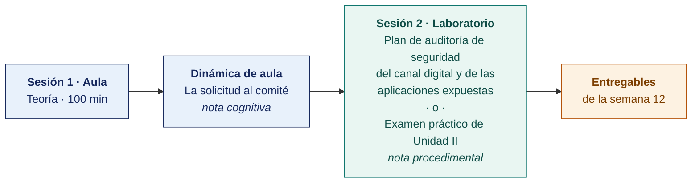

  
  &nbsp;&nbsp;&nbsp;&nbsp;&nbsp;&nbsp;
  

  <strong>Universidad Privada de Tacna</strong> 
  Facultad de Ingeniería · Escuela Profesional de Ingeniería de Sistemas

<h1 align="center">Semana 12</h1>
<h2 align="center">Integración Metodológica · Exposición de Trabajos · Examen de Unidad II</h2>

  <strong>SI-084 · Auditoría de Sistemas</strong> 
  4 horas académicas de 50 min · 100 min de exposiciones y examen de unidad en aula · 100 min de taller en laboratorio

---

## Datos de la asignatura

| | |
|---|---|
| **Asignatura** | SI-084 · Auditoría de Sistemas |
| **Escuela** | Escuela Profesional de Ingeniería de Sistemas |
| **Ciclo** | X · 04 horas semanales · 03 créditos · Obligatorio |
| **Prerrequisito** | SI-985 Gestión de la Configuración de Software |
| **Unidad** | II — Diagnóstico, Evaluación y Metodología de Auditoría de Sistemas (cierre) |
| **Semana** | 12 de 17 |
| **Duración** | 4 horas académicas de 50 min · 100 min de exposiciones y examen de unidad en aula · 100 min en laboratorio, compartidos entre el taller y el examen práctico |
| **Resultados de aprendizaje** | **RA1** Analiza e identifica las responsabilidades que asume un auditor de sistemas · **RA2** Valora la importancia de los roles del auditor de sistemas |
| **Atributos del graduado** | AG-I04 Comunicación (CD1 y CD3, nivel 4) · AG-I08 Análisis de Problemas (CD3, nivel 4) |

### Lo que indica el sílabo

**Contenido conceptual.** Exposición de trabajos. Evaluación de Unidad II.

**Contenido procedimental.** Resuelve su evaluación y expone sus trabajos de investigación.

> **Qué plan construye esta semana.** El laboratorio produce un **plan de auditoría completo** de la seguridad del canal digital y de las aplicaciones expuestas, con los criterios de OWASP ASVS 4.0.3 y OWASP Top 10:2021. La estructura es la del [Modelo del Plan de Auditoría](../MODELO-PLAN-DE-AUDITORIA.md) y el caso es el [Encargo 12](../ENCARGOS-UNIDAD-II/CASO-12-seguridad-del-canal-digital.md).

> **La solicitud de su organización.** Está en [CASOS/](CASOS/README.md), una por organización del banco. La escribe la propia organización, expone sus problemas y pide la auditoría. Con ella el equipo propone el plan.

## Materiales de esta semana

| | Documento | Qué encontrarás | Dónde y cuánto dura |
|---|---|---|---|
| 1 | **[Teoría](1-TEORIA.md)** | Exposición del avance de la unidad · Integración metodológica de los seis planes · Examen de Unidad II | Aula · 100 min |
| 2 | **[Dinámica de aula](2-DINAMICA.md)** | La solicitud al comité, con su material, su ejemplo resuelto y su rúbrica | **Trabajo previo**, se entrega antes de la sesión |
| 3 | **[Taller de laboratorio](3-TALLER.md)** | Plan de auditoría de seguridad del canal digital y de las aplicaciones expuestas | Laboratorio · 100 min · **comparte sesión con el examen práctico** |

> **El laboratorio de esta semana lo reclaman dos documentos y solo caben los 100 minutos de una sesión.** El **examen práctico** y el **[taller](3-TALLER.md)** están escritos completos y son independientes entre sí. El docente publica en el aula virtual el que ocupará la sesión y deja el otro como trabajo fuera de ella, y lo comunica al inicio de la semana. **El plazo no cambia con esa decisión** — ambos vencen contando desde la sesión de laboratorio, que se dicta igual en cualquiera de los dos casos.

## Ruta de la semana

## Entregables

| Entregable | Formato y nombre del archivo | Vence |
|---|---|---|
| **Dinámica de aula** · La solicitud al comité | PDF desde la [plantilla de dinámica](../PLANTILLAS/SI084-PLANTILLA-DINAMICA.docx) · `SI084-S12-DINAMICA-Grupo<N>.pdf` | Según lo programado en el aula virtual |
| **Informe del taller de laboratorio N.º 12** | PDF en formato EPIS desde la [plantilla de taller](../PLANTILLAS/SI084-PLANTILLA-TALLER.docx) · `SI084-S12-TALLER-Grupo<N>.pdf` | Según lo programado en el aula virtual |
| **El plan de auditoría del Encargo 12**, completo | Markdown y PDF en el repositorio, sobre la etiqueta `taller-12` | Según lo programado en el aula virtual |
| Exposición del programa de auditoría del periodo ante «el comité» | Presentación de 10 min | Sesión de teoría |
| **Examen teórico de Unidad II** | Presencial, 40 min, Preguntas de alternativas | Sesión de aula |
| **Examen práctico de Unidad II** | 100 min, individual, con inteligencia artificial permitida y declarada | Sesión de laboratorio, si el docente le asigna la sesión |
| **Plan Integral de Auditoría v2.0** | Repositorio Git con la etiqueta `unidad-2` | 72 h después de la sesión de laboratorio |

> La dinámica y el informe del taller se entregan en **PDF**, con la carátula de la UPT y los códigos de todos los integrantes. Las plantillas obligatorias están en [`PLANTILLAS/`](../PLANTILLAS/).

## Cómo se evalúa

| Criterio | Instrumento | Peso en la unidad |
|---|---|---|
| Actitudinal | Participación, puntualidad, calidad del trato profesional con la empresa auditada en las semanas 07–12 | 15 % |
| Cognitivo | Promedio de las rúbricas de las dinámicas S07 a S11 + exposición del avance + memorando al comité | 25 % |
| Procedimental | Promedio de las listas de cotejo de los laboratorios 07 a 12 + calidad del plan del Encargo 12 | 35 % |
| Examen de Unidad | **Teórico** en aula, 40 min, Preguntas de alternativas · **Práctico** en laboratorio, 100 min, con inteligencia artificial permitida | 25 % |
| | **La Unidad II aporta el 35 % de la nota final del curso** | |

## Preparación para la Unidad III

La Unidad III **ejecuta el plan y produce el informe final de auditoría de la empresa real**. Es la unidad de mayor peso (40 %) y su producto es la evidencia de la competencia del curso.

- **Leer.** ISO 19011:2018, cláusula 6.5 «Preparación y distribución del informe de auditoría».
- **Leer.** ISACA, *COBIT 2019*, dominio EDM completo, e ISO/IEC 38500:2024 (**tercera edición, 11 principios, reemplaza a la de 2015**).
- Coordinar con la empresa auditada las fechas del trabajo de campo de las semanas 13 a 16 y la disponibilidad de las personas a entrevistar.
- Confirmar la asistencia de un representante de la empresa a la sustentación de la Semana 17, si es posible.

---

**Docente** · Dr. Oscar Juan Jimenez Flores
[oscarjimenezflores@upt.pe](mailto:oscarjimenezflores@upt.pe) · [LinkedIn](https://www.linkedin.com/in/oscar-jimenez-flores/) · [CTI Vitae — CONCYTEC](https://ctivitae.concytec.gob.pe/appDirectorioCTI/VerDatosInvestigador.do?id_investigador=33398)

Escuela Profesional de Ingeniería de Sistemas · Universidad Privada de Tacna · Tacna, Perú
