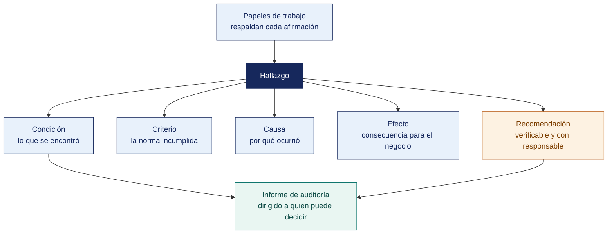

[Semana 13](README.md) · **Teoría** · [Dinámica de aula](2-DINAMICA.md) · [Taller de laboratorio](3-TALLER.md)

# Semana 13

## El Informe de Auditoría · Características y Procedimientos de Elaboración

**SI-084 · Auditoría de Sistemas** · Sesión 1 en aula · 2 horas académicas, 100 min, con la dinámica incluida

> ¿Un término no le resulta claro? Está definido en el [glosario técnico del curso](../GLOSARIO.md).

---

## Supuesto y pregunta

Un equipo entrega un informe de auditoría de cuarenta páginas, con doce hallazgos bien sustentados y evidencia trazable en cada uno, y el comité lo recibe sin tomar ninguna decisión.

Seis meses después nada se ha corregido, y al preguntar por qué, un miembro del comité responde que no llegó a leerlo entero y que no le quedó claro qué le estaban pidiendo que decidiera.

> **¿Por qué un informe técnicamente impecable puede no producir ningún cambio?**

## Mapa de la sesión



---

## Retroalimentación de la Unidad II

Devolución del examen y de los memorandos al comité. Lección — **el memorando que ocupó más de una página no fue leído. En una organización real, tampoco lo habría sido.**

## 1. Qué es un informe de auditoría y para quién se escribe

> **¿Puede un mismo documento servir a un directorio y a un administrador de sistemas?**

**El error de destinatario.** El informe de auditoría de sistemas tiene tres audiencias simultáneas con necesidades incompatibles:

| Audiencia | Qué necesita | Qué le sobra | Cuánto lee |
|---|---|---|---|
| **Directorio / Comité de auditoría** | Riesgo de negocio, decisión que debe tomar, recursos | Todo detalle técnico | 1–2 páginas |
| **Gerencia del área auditada** | Qué debe corregir, con qué prioridad y plazo | Justificación metodológica | 5–10 páginas |
| **Personal técnico** | La condición exacta, cómo reproducirla, la referencia técnica | El lenguaje de negocio | Los anexos |

Un informe que sirve a las tres se construye en **capas**. Resumen ejecutivo → hallazgos → anexos técnicos. Cada capa debe ser autosuficiente y coherente con las demás.

> **Microaplicación (4 min). Cuánto lee cada audiencia.** Antes de seguir, el aula estima a mano alzada **cuántas páginas lee cada una de las tres audiencias**. Las estimaciones suelen ser generosas, y ese es el punto de entrada a la construcción en capas.

**Las siete características de un informe de auditoría de calidad.** La ISO 19011:2018 y el marco ITAF de ISACA convergen en estos atributos:

| Característica | Qué significa | Cómo se pierde |
|---|---|---|
| **Exacto** | Cada afirmación es verificable contra un papel de trabajo | Redactar de memoria al final del encargo |
| **Objetivo** | Presentación imparcial; refleja la posición del auditado cuando difiere | Adjetivos valorativos, ironía, atribución de intención |
| **Claro** | Comprensible por el destinatario sin traducción | Jerga técnica sin explicar; siglas sin desarrollar |
| **Conciso** | Sin repeticiones ni relleno metodológico | Describir la metodología en tres páginas |
| **Constructivo** | Orientado a la mejora, no a la sanción | Nombrar personas en lugar de cargos y procesos |
| **Completo** | Incluye todo lo material dentro del alcance | Omitir el hallazgo incómodo |
| **Oportuno** | Emitido mientras la información aún es útil | Informe entregado seis meses después del campo |

> **El error frecuente del bloque.** Escribir un solo documento para las tres audiencias. Produce lo que le pasó al equipo del caso — un informe que el técnico encuentra superficial y el directorio encuentra ilegible. Se escribe **en capas**, y cada una debe sostenerse sola.

## 2. La estructura CCCER del hallazgo

> **Si falta uno de los cinco elementos, ¿qué se rompe exactamente?**

Todo hallazgo se construye con cinco elementos, en este orden. **La omisión de cualquiera lo debilita de forma predecible.**

| Elemento | Pregunta que responde | Si falta |
|---|---|---|
| **C**ondición | ¿Qué se observó? | No hay hecho: hay opinión |
| **C**riterio | ¿Qué debería ser? | El hallazgo no es exigible |
| **C**ausa | ¿Por qué ocurre? | La recomendación ataca el síntoma |
| **E**fecto | ¿Qué consecuencia tiene? | La gerencia no lo prioriza |
| **R**ecomendación | ¿Qué debe hacerse? | El informe no es accionable |

**Condición. Hechos, no juicios.**

| Mal | Bien |
|---|---|
| «El control de accesos es deficiente» | «De los 87 usuarios activos del ERP, 23 corresponden a personas que cesaron en los últimos ocho meses; la más antigua cesó hace 14 meses y su cuenta registra acceso posterior a su fecha de cese» |
| «No hay respaldos confiables» | «La última prueba de restauración documentada data del 3 de hace más de dos años. El RTO declarado en la política es de 4 horas; la restauración ejecutada durante esta auditoría tomó 6 horas y 20 minutos» |

**Criterio. La norma con su código.** Sin criterio no hay hallazgo, hay preferencia del auditor. El criterio se elige según el régimen de la organización — norma legal (obligatoria), norma técnica (voluntaria u obligatoria según el régimen), política interna (obligatoria dentro de la organización) o contrato.

**Causa. La raíz, no el síntoma.** Técnica de los cinco porqués aplicada a un caso real:

```
Condición: 23 cuentas de personas cesadas siguen activas.
  ¿Por qué?  → Nadie ejecutó la baja.
  ¿Por qué?  → TI no supo que cesaron.
  ¿Por qué?  → RR. HH. no comunica los ceses a TI.
  ¿Por qué?  → No existe un procedimiento de baja que integre ambas áreas.
  ¿Por qué?  → El proceso de gestión del ciclo de vida del usuario nunca se diseñó
               de extremo a extremo; se implementó solo el alta, porque es la que
               alguien reclama.
CAUSA RAÍZ: ausencia de un proceso formal de gestión del ciclo de vida de las
identidades, con responsables definidos en RR. HH. y en TI.
```

La recomendación que sale de la causa raíz («diseñar el proceso de baja integrado con la notificación automática desde RR. HH.») resuelve el problema. La que sale del síntoma («desactivar las 23 cuentas») lo repite el año siguiente.

**Efecto. Cuantificado y en lenguaje de negocio.**

| Nivel | Ejemplo |
|---|---|
| Débil | «Se compromete la seguridad de la información» |
| Aceptable | «Personas ajenas a la organización pueden acceder a información de clientes» |
| **Fuerte** | «23 exempleados conservan acceso a la base de datos de 8 400 clientes, incluidos sus datos de contacto y su historial de compra. Un acceso indebido configuraría una infracción a la Ley 29733 sancionable por la ANPD, además del riesgo comercial de que esa información llegue a la competencia» |

**Recomendación. SMART y con dueño.** Específica, medible, asignable, realista y con plazo. Y **una sola recomendación por hallazgo** tres recomendaciones en un hallazgo producen tres seguimientos que nadie hace.

**Clasificación del hallazgo.** Cada uno recibe una severidad derivada del riesgo, no del esfuerzo de corregirlo:

| Severidad | Criterio | Plazo esperado de corrección |
|---|---|---|
| **Crítico** | Pérdida material inminente, incumplimiento legal con sanción, o compromiso de la continuidad | Inmediato / 30 días |
| **Alto** | Riesgo significativo con probabilidad razonable de materializarse | 90 días |
| **Medio** | Debilidad de control con controles compensatorios parciales | 180 días |
| **Bajo** | Oportunidad de mejora sin exposición material | Siguiente ciclo |

**Ejemplo trabajado — el mismo hecho, mal y bien redactado.**

| | Así no | Así sí |
|---|---|---|
| **Condición** | «Hay problemas con los usuarios del sistema» | «7 cuentas del ERP permanecen habilitadas para personal cuyo cese consta en RR. HH. Cuatro registran accesos posteriores a la fecha de cese, el más reciente 118 días después» |
| **Criterio** | «Buenas prácticas de seguridad» | «NTP-ISO/IEC 27001:2022, control A.5.18: los derechos de acceso deben retirarse al término del empleo. Política interna de accesos, numeral 4.2» |
| **Causa** | «Falta de control» | «La baja de accesos depende de una comunicación verbal de RR. HH. en la reunión semanal. No existe un registro que permita verificar que se ejecutó» |
| **Efecto** | «Riesgo de seguridad» | «Cuatro personas ajenas a la organización pudieron operar el ERP durante el periodo. Dos de esas cuentas tienen perfil de aprobación de compras» |
| **Recomendación** | «Mejorar la gestión de accesos» | «Incorporar la baja de accesos al formulario de cese, con firma de TI. Revisión trimestral cruzando planilla contra usuarios habilitados. Responsable: Jefe de TI. Plazo: 30 días» |

> **La causa es el elemento que más se omite y el que determina si la recomendación sirve.** «Falta de control» no es causa. Es la repetición de la condición. La causa explica **por qué** el control no operó, y de ahí sale la recomendación correcta.

**Ejemplo trabajado — cuándo un efecto está bien cuantificado.**

| Redacción del efecto | ¿Sirve? | Por qué |
|---|---|---|
| «Podría producirse un fraude» | No | Es una posibilidad genérica. Toda debilidad «podría» producir fraude |
| «Alto riesgo de acceso no autorizado» | No | Califica sin medir. «Alto» según qué escala |
| «Cuatro cuentas de personal cesado registran 63 accesos posteriores al cese, dos con perfil de aprobación de compras sobre S/ 340 000 del periodo» | Sí | Cuenta lo ocurrido y lo expuesto, con cifras verificables |

> **Microaplicación (6 min). Quitar un elemento y ver qué pasa.** El docente muestra un hallazgo completo y va **tapando un elemento cada vez**. El aula dice, en cada caso, qué deja de poder hacerse con ese hallazgo. Es la forma más rápida de fijar para qué sirve cada parte.

| Caso | Qué debe contener una buena respuesta |
|---|---|
| ¿Puede un hallazgo no tener efecto cuantificado? | Sí, cuando el dato no existe. Pero entonces se declara la limitación, no se sustituye por un adjetivo |
| El auditado dice que la causa es otra. ¿Se cambia? | Si aporta evidencia, sí, y mejora el hallazgo. La causa es una conclusión del auditor, no una acusación |
| ¿La recomendación puede nombrar una herramienta concreta? | Con cuidado. Recomendar un producto específico acerca al auditor a la venta y compromete su independencia. Se recomienda la **capacidad**, no la marca |
> **El error frecuente del bloque.** Escribir «falta de control» como causa. No es una causa, es la reformulación del hecho en negativo, y produce recomendaciones que atacan el síntoma. La causa responde **por qué llegó a ocurrir**, y suele estar en una decisión, un procedimiento inexistente o una excepción habilitada sin control.

## 3. Los papeles de trabajo

> **¿Qué convierte una carpeta de archivos en un expediente que sostiene un informe?**

**Definición operativa.** El papel de trabajo es el registro del trabajo realizado y de la evidencia obtenida que **sostiene la conclusión**. **Regla de oro.** *Un auditor distinto, con el papel de trabajo en la mano, debe poder rehacer el procedimiento y llegar a la misma conclusión, sin preguntar nada.*

**Estructura mínima.**

| Campo | Contenido |
|---|---|
| Referencia | Código único que enlaza con el programa y con el hallazgo |
| Objetivo del procedimiento | Copiado del programa de trabajo |
| Criterio | Con código de norma |
| Alcance | Población, periodo, muestra y método de selección |
| Fuente de la evidencia | Sistema, quién la entregó, cómo se obtuvo, cuándo |
| Trabajo realizado | Paso a paso, en pasado |
| **Resultado** | Los datos obtenidos, sin interpretación |
| **Excepciones** | Las desviaciones halladas, según la definición fijada a priori |
| Conclusión | Si el control es efectivo o no, y con qué alcance |
| Referencia cruzada | Al hallazgo que origina, si lo hay |
| Ejecutado por / Revisado por / Fechas | |

**Los cuatro defectos que invalidan un papel de trabajo.** Conclusión sin evidencia adjunta; evidencia sin conclusión; muestra sin método de selección declarado; y ausencia de revisión independiente.

## 4. El proceso de emisión del informe

> **¿Qué pasa si el auditado no está de acuerdo con un hallazgo?**

```
Hallazgos preliminares
   → VALIDACIÓN con el responsable del proceso  ← paso que nunca se salta
   → Ajuste por evidencia adicional aportada
   → Borrador de informe
   → REUNIÓN DE CIERRE
   → Respuesta formal de la administración (plan de acción con responsable y plazo)
   → Informe final (incluye la respuesta de la administración)
   → Distribución controlada
   → SEGUIMIENTO
```

**La validación no es negociación.** El auditado puede aportar evidencia que modifique la condición; **no puede modificar el criterio ni suprimir el hallazgo**. Si tras la validación persiste el desacuerdo, el informe recoge ambas posiciones. La del auditor con su evidencia y la de la administración con la suya. Esa transparencia es precisamente lo que exige el principio de presentación imparcial.

**Distribución controlada.** El informe contiene el mapa de las debilidades de la organización. Se distribuye a una lista nominal, marcado con su clasificación, y su circulación queda registrada.

## Cierre

**La respuesta a la pregunta con la que abrimos.** Porque el informe se escribió para el auditor, no para quien decide. Las tres audiencias del informe tienen necesidades incompatibles, y un documento único falla con las tres. El equipo del caso hizo bien el trabajo de campo y falló en la última milla — **no le dijo al comité qué tenía que decidir**.

**Las tres ideas que deben quedar.**

| Idea | Por qué importa en el ejercicio profesional |
|---|---|
| El informe se construye en capas y cada una se sostiene sola | Permite que el directorio decida con dos páginas y el técnico reproduzca el hallazgo con los anexos |
| Los cinco elementos del hallazgo fallan de forma predecible cuando falta alguno | Sin criterio no es exigible; sin efecto no se prioriza; sin recomendación no es accionable |
| «Falta de control» no es una causa | Es el error que produce recomendaciones inútiles, porque ataca el síntoma en lugar del origen |

**Lo que suele fallar frente a este caso.** La mayoría culpa al comité por no leer. La lección profesional es la contraria — **que lo lean es responsabilidad del que escribe**, y por eso el resumen ejecutivo es la parte más difícil del informe y no la más fácil.

**Lo que sigue.** La [dinámica de esta sesión](2-DINAMICA.md) entrega cuatro hallazgos mal redactados de informes reales anonimizados y pide **reescribirlos completos** y clasificar su severidad con justificación. Los cuatro tienen exactamente los defectos que acaba de ver, incluida la causa que repite el síntoma.

---

---

[Semana 13](README.md) · **Teoría** · [Dinámica de aula](2-DINAMICA.md) · [Taller de laboratorio](3-TALLER.md)

---

**Docente** · Dr. Oscar Juan Jimenez Flores
[oscarjimenezflores@upt.pe](mailto:oscarjimenezflores@upt.pe) · [LinkedIn](https://www.linkedin.com/in/oscar-jimenez-flores/) · [CTI Vitae — CONCYTEC](https://ctivitae.concytec.gob.pe/appDirectorioCTI/VerDatosInvestigador.do?id_investigador=33398)

Escuela Profesional de Ingeniería de Sistemas · Universidad Privada de Tacna · Tacna, Perú
