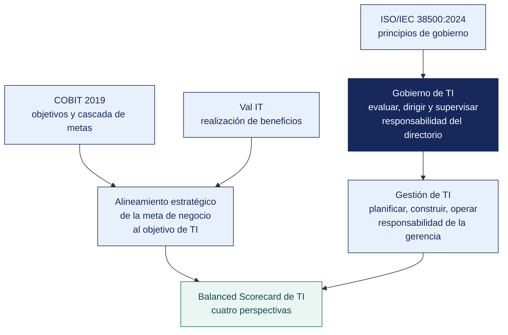

[Semana 14](README.md) · **Teoría** · [Dinámica de aula](2-DINAMICA.md) · [Taller de laboratorio](3-TALLER.md)

# Semana 14

## Estándares y Buenas Prácticas · Gobierno Corporativo de TI · Alineamiento Estratégico y BSC

**SI-084 · Auditoría de Sistemas** · Sesión 1 en aula · 2 horas académicas, 100 min, con la dinámica incluida

> ¿Un término no le resulta claro? Está definido en el [glosario técnico del curso](../GLOSARIO.md).

---

## Supuesto y pregunta

Una empresa renueva su ERP y el proyecto se ejecuta bien —dentro del plazo, dentro del presupuesto y con la aceptación firmada del usuario—, así que la jefatura de sistemas lo presenta como un éxito, y técnicamente lo es.

Pero nadie con autoridad decidió nunca si convenía renovarlo. No hay acta, no se compararon alternativas y no consta el criterio con el que se eligió invertir S/ 380 000 en eso en lugar de en otra cosa.

> **¿Es un hallazgo que un proyecto bien ejecutado nunca haya sido decidido por la dirección?**

## Mapa de la sesión



---

## 1. Gobierno de TI y gestión de TI

> **¿Dónde se audita el gobierno, si no es entrevistando al jefe de sistemas?**

**Gobernar no es gestionar.** COBIT 2019 lo separa de forma tajante y esa separación es la base de toda la auditoría de gobierno:

| | **Gobierno** (dominio EDM) | **Gestión** (dominios APO, BAI, DSS, MEA) |
|---|---|---|
| Quién | Directorio o su equivalente | Alta dirección ejecutiva y sus líneas |
| Verbos | **Evaluar, Dirigir, Supervisar** | Planificar, Construir, Ejecutar, Monitorear |
| Pregunta | ¿Estamos haciendo lo correcto y obteniendo valor? | ¿Lo estamos haciendo bien? |
| Horizonte | Estratégico y de largo plazo | Táctico y operativo |
| Producto | Directrices, apetito de riesgo, asignación de recursos | Servicios, proyectos, operaciones |

**Consecuencia auditora.** El gobierno de TI **no se audita entrevistando al jefe de sistemas**. Se audita revisando actas de directorio, presupuestos aprobados, decisiones de inversión y los informes que la dirección recibe. Si el directorio nunca ha discutido riesgo tecnológico en un acta, el gobierno de TI **no existe**, por sofisticada que sea la gestión.

**Los cinco objetivos de gobierno de COBIT 2019 (dominio EDM).**

| Objetivo | Qué asegura | Evidencia de auditoría |
|---|---|---|
| **EDM01** Marco de gobierno establecido y mantenido | Existe una estructura de gobierno de TI con roles y autoridad definidos | Estatuto o política de gobierno de TI; composición y actas del comité |
| **EDM02** Entrega de beneficios asegurada | Las inversiones de TI generan valor medible | Caso de negocio por inversión; medición del beneficio realizado |
| **EDM03** Optimización del riesgo asegurada | El apetito de riesgo está definido y el riesgo se mantiene dentro de él | Declaración de apetito de riesgo aprobada; informes de riesgo al directorio |
| **EDM04** Optimización de recursos asegurada | Los recursos de TI se asignan según prioridad estratégica | Presupuesto por línea estratégica; análisis de capacidad |
| **EDM05** Transparencia hacia las partes interesadas | Las partes interesadas reciben información suficiente y oportuna | Reportes periódicos con destinatario y frecuencia definidos |

**Ejemplo trabajado — la misma decisión, vista desde el gobierno y desde la gestión.** La empresa debe renovar el ERP.

| | Gobierno | Gestión |
|---|---|---|
| **Quién** | Directorio o comité de TI | Jefatura de TI |
| **Pregunta** | ¿Invertimos S/ 380 000 en renovar, o sostenemos el actual dos años más? | ¿Cómo migramos sin detener la operación? |
| **Qué evalúa** | Beneficio esperado, riesgo de no hacerlo, capacidad de la organización para absorber el cambio | Cronograma, proveedor, pruebas, plan de reversión |
| **Producto** | Decisión aprobada, con presupuesto y responsable | Proyecto ejecutado |
| **Evidencia auditable** | Acta con la decisión, alternativas consideradas y criterio | Plan de proyecto, actas de avance, aceptación |
| **Condición típica** | La decisión se tomó sin comparar alternativas y sin registrar el criterio | El proyecto se ejecutó sin plan de reversión |

> **La confusión más frecuente en los informes de estudiantes** es auditar gestión y llamarlo gobierno. Que el proyecto se ejecutara mal es un hallazgo de gestión. Que **nadie con autoridad decidiera formalmente si hacerlo** es un hallazgo de gobierno, y es más grave. Significa que la organización no dirige su inversión en TI, la deja ocurrir.

> **Microaplicación (5 min). Gobierno o gestión.** El docente enuncia cinco condiciones observadas y el aula clasifica cada una, a mano alzada, como **hallazgo de gobierno o de gestión**. La del caso del ERP se deja para el final.

| Caso | Qué debe contener una buena respuesta |
|---|---|
| ¿Puede haber buena gestión de TI sin gobierno de TI? | **Sí, y es frecuente.** Un área eficiente ejecutando lo que nadie decidió estratégicamente. Funciona hasta que hay que priorizar entre dos cosas imposibles a la vez |
| ¿Quién debe presidir un comité de gobierno de TI? | Alguien del negocio, no el jefe de TI. Si TI se gobierna a sí mismo, no hay contrapeso |
| El comité existe y no se reúne. ¿Es hallazgo? | Sí. La condición es que el órgano de gobierno no operó en el periodo. La evidencia es la ausencia de actas |
> **El error frecuente del bloque.** Auditar gestión y llamarlo gobierno. Que el proyecto se ejecutara sin plan de reversión es un hallazgo de gestión. Que **nadie con autoridad decidiera formalmente si hacerlo** es un hallazgo de gobierno, y es más grave — significa que la organización no dirige su inversión en TI, la deja ocurrir.

## 2. ISO/IEC 38500:2024 — la tercera edición cambia el marco

> **¿Qué le pide una norma al directorio, y no al área de TI?**

**Qué cambió.** La **ISO/IEC 38500:2024**, tercera edición publicada en febrero de 2024, **cancela y reemplaza a la edición de 2015**. El cambio no es cosmético — **los seis principios pasaron a once**, alineados con los principios de gobierno de organizaciones de la **ISO 37000:2021**, y el modelo incorporó explícitamente el compromiso con las partes interesadas.

| Edición 2015 — 6 principios | Edición 2024 — 11 principios, alineados a ISO 37000 |
|---|---|
| Responsabilidad | **Propósito** (principio primario) |
| Estrategia | **Generación de valor** |
| Adquisición | **Estrategia** |
| Desempeño | **Supervisión** |
| Conformidad | **Rendición de cuentas** |
| Comportamiento humano | **Compromiso con las partes interesadas** |
| | **Liderazgo** |
| | **Datos y decisiones** |
| | **Gobierno del riesgo** |
| | **Responsabilidad social** |
| | **Viabilidad y desempeño en el tiempo** |

**Por qué importa para el auditor.** Citar «ISO/IEC 38500:2015, principio de Responsabilidad» en un informe emitido hoy es citar una norma cancelada. El criterio debe ser la edición vigente. Además, los principios nuevos —especialmente **Datos y decisiones**, **Gobierno del riesgo** y **Viabilidad y desempeño en el tiempo**— abren líneas de auditoría que la edición anterior no cubría. ¿Las decisiones de TI se toman con datos o con intuición? ¿el riesgo tecnológico llega al directorio con un apetito declarado? ¿la arquitectura actual es sostenible en cinco años?

**El modelo Evaluar–Dirigir–Supervisar** se conserva y es el que estructura la prueba de auditoría:

```
        ┌──── Presiones del negocio ────┐
        ▼                               ▼
   ╔═══════════════════════════════════════════╗
   ║   ÓRGANO DE GOBIERNO                      ║
   ║   EVALUAR ──→ DIRIGIR ──→ SUPERVISAR ──┐  ║
   ║      ▲                                 │  ║
   ║      └─────────────────────────────────┘  ║
   ╚═══════════════════════════════════════════╝
        │ directrices          ▲ desempeño y conformidad
        ▼                      │
   ┌───────────────────────────────────────────┐
   │   GESTIÓN — Planes, proyectos, operaciones│
   └───────────────────────────────────────────┘
```

**La prueba de auditoría del gobierno** consiste en verificar que el ciclo esté **cerrado**. Si el directorio dirige pero nunca supervisa, no gobierna. Emite deseos.

## 3. Val IT y la gestión del valor de la inversión en TI

> **Un proyecto entregado a tiempo y en presupuesto, ¿generó valor?**

**El problema que resuelve.** COBIT responde «¿estamos gestionando bien TI?». **Val IT** responde una pregunta anterior y más incómoda. **«¿Estamos invirtiendo en las cosas correctas y obteniendo el valor esperado?»**. Sus dominios:

| Dominio | Pregunta | Prueba de auditoría |
|---|---|---|
| **Gobierno del valor** | ¿Existe un marco para decidir en qué se invierte? | Verificar que exista un comité con criterios de priorización documentados |
| **Gestión del portafolio** | ¿El conjunto de inversiones está equilibrado y priorizado? | **Revisar el portafolio.** ¿Cuánto se destina a operar, a crecer y a transformar? |
| **Gestión de la inversión** | ¿Cada inversión tiene caso de negocio y se mide su beneficio? | **Tomar tres proyectos cerrados y pedir la medición del beneficio realizado** |

> **El hallazgo casi universal.** Las organizaciones tienen caso de negocio para **aprobar** la inversión y **ninguna medición del beneficio realizado** después. **La consecuencia.** Se repiten inversiones que nunca generaron valor porque nadie lo verificó. Criterio. COBIT 2019 **EDM02 Ensured benefits delivery**.

**Las cuatro preguntas de Val IT** que estructuran la evaluación de una inversión:

1. ¿Estamos haciendo **lo correcto**? (alineamiento estratégico)
2. ¿Lo estamos haciendo **de la forma correcta**? (arquitectura y estándares)
3. ¿Lo estamos **haciendo bien**? (ejecución y capacidad)
4. ¿Estamos **obteniendo los beneficios**? (realización del valor)

## 4. Alineamiento estratégico y el Balanced Scorecard de TI

> **¿Qué indicador demuestra que TI contribuye al negocio y no solo que funciona?**

**Alineamiento estratégico.** Es el grado en que los objetivos, las inversiones y las capacidades de TI sostienen los objetivos del negocio. COBIT 2019 lo operacionaliza mediante la **cascada de metas**:

```
Metas de las partes interesadas
        ▼
Metas empresariales (13, agrupadas en las 4 perspectivas del BSC)
        ▼
Metas de alineamiento (13, la traducción de negocio a TI)
        ▼
Objetivos de gobierno y gestión (40)
        ▼
Componentes: procesos, estructuras, información, personas, servicios, cultura
```

**La prueba de alineamiento.** Se toma un objetivo estratégico del negocio y se rastrea hacia abajo. ¿Qué meta de alineamiento le corresponde? ¿qué objetivos de COBIT la soportan? ¿esos objetivos están en el plan de TI? ¿tienen presupuesto? **Si la cadena se rompe en algún eslabón, ese es el hallazgo de desalineamiento**, y es un hallazgo de gobierno, no de TI.

**El Balanced Scorecard de TI.** Adaptación del modelo de Kaplan y Norton al área de TI, con cuatro perspectivas reformuladas:

| Perspectiva del BSC clásico | Perspectiva del BSC de TI | Pregunta | Indicadores típicos |
|---|---|---|---|
| Financiera | **Contribución al negocio** | ¿TI aporta valor medible? | Gasto de TI / ingresos; beneficio realizado vs. proyectado; costo por transacción |
| Cliente | **Orientación al usuario** | ¿Los usuarios están satisfechos? | Satisfacción del usuario; cumplimiento de niveles de servicio; tiempo de atención de solicitudes |
| Procesos internos | **Excelencia operativa** | ¿TI opera con eficiencia y control? | Disponibilidad de servicios críticos; incidentes de severidad 1; tasa de cambios fallidos; MTTR |
| Aprendizaje y crecimiento | **Orientación al futuro** | ¿TI está preparada para lo que viene? | Deuda técnica; competencias críticas cubiertas; % de presupuesto en innovación; obsolescencia tecnológica |

**Reglas de calidad de un indicador auditable.** Cada indicador debe tener — nombre, **fórmula explícita**, fuente del dato, frecuencia de medición, **meta**, umbral de alerta y responsable. Un indicador sin fórmula no es medible; un indicador sin meta no es evaluable; un indicador sin responsable no es accionable. **El auditor prueba los tres.**

**El error típico del BSC de TI.** Se construye con indicadores que TI puede medir fácilmente (uptime, tickets cerrados) y ninguno que el negocio valore (¿aumentó la conversión del canal digital? ¿bajó el costo por pedido procesado?). Un BSC de TI sin indicadores de contribución al negocio **no mide alineamiento. Mide actividad**.

## Cierre

**La respuesta a la pregunta con la que abrimos.** Sí, y es más grave que cualquier defecto de ejecución. La gestión responde a *¿lo estamos haciendo bien?* y el gobierno a *¿estamos haciendo lo correcto y obteniendo valor?* El proyecto del caso aprueba la primera pregunta y **nunca se planteó la segunda**. El hallazgo se dirige al directorio, no al jefe de sistemas, y su evidencia es la ausencia del acta.

**Las tres ideas que deben quedar.**

| Idea | Por qué importa en el ejercicio profesional |
|---|---|
| Gobierno y gestión son dominios distintos con destinatarios distintos | Determina a quién se dirige el hallazgo y con qué evidencia se sostiene |
| El gobierno de TI se audita con actas, presupuestos y decisiones de inversión | Si el directorio nunca discutió riesgo tecnológico en un acta, el gobierno de TI no existe |
| Un cuadro de mando necesita indicadores de contribución, no solo de operación | Es lo que permite defender la inversión en TI ante quien la financia |

**Lo que suele fallar frente a este caso.** La mayoría no ve hallazgo alguno, porque el proyecto salió bien. Reconocer que **la ausencia de una decisión es auditable** es el salto conceptual de la sesión.

**Lo que sigue.** La [dinámica de esta sesión](2-DINAMICA.md) toma un objetivo estratégico real de su empresa auditada y pide rastrear la cascada completa hasta los componentes de TI, **señalando dónde se rompe**. La primera respuesta «no» cierra la cascada, y ese punto es el hallazgo de gobierno.

---

---

[Semana 14](README.md) · **Teoría** · [Dinámica de aula](2-DINAMICA.md) · [Taller de laboratorio](3-TALLER.md)

---

**Docente** · Dr. Oscar Juan Jimenez Flores
[oscarjimenezflores@upt.pe](mailto:oscarjimenezflores@upt.pe) · [LinkedIn](https://www.linkedin.com/in/oscar-jimenez-flores/) · [CTI Vitae — CONCYTEC](https://ctivitae.concytec.gob.pe/appDirectorioCTI/VerDatosInvestigador.do?id_investigador=33398)

Escuela Profesional de Ingeniería de Sistemas · Universidad Privada de Tacna · Tacna, Perú

**Ejemplo trabajado — un indicador de TI que no sirve y su corrección.**

| | Indicador mal formulado | Indicador que sí sirve |
|---|---|---|
| Enunciado | «Disponibilidad del sistema» | «Porcentaje de horas del horario de atención en que el sistema comercial estuvo operativo» |
| Fórmula | No declarada | (Horas operativo ÷ horas de horario de atención) × 100 |
| Fuente del dato | «El área lo reporta» | Registro de incidentes con hora de inicio y cierre, conciliado con el monitoreo |
| Periodicidad | «Mensual, cuando se puede» | Mensual, al quinto día hábil |
| Línea base | No existe | 94,2 % en el periodo anterior |
| Meta | «Mejorar» | 99,0 % al cierre del año |
| Responsable | «TI» | Jefe de Tecnologías de la Información |
| **Qué permite** | Nada. No se puede saber si mejoró | Comparar, decidir y exigir |

> **El error frecuente del bloque.** Construir un cuadro de mando solo con indicadores operativos. Disponibilidad, tiempo de atención y número de incidentes miden que TI funciona, no que aporte. Un cuadro de mando sin **al menos tres indicadores de contribución al negocio** deja al área de TI sin argumento el día que se discute su presupuesto.

**Las cuatro perspectivas del BSC de TI, con un indicador cada una.**

| Perspectiva | Pregunta | Ejemplo de indicador |
|---|---|---|
| **Contribución al negocio** | ¿TI aporta valor demostrable? | Costo de TI por transacción procesada |
| **Orientación al usuario** | ¿Los usuarios reciben lo que necesitan? | Tiempo medio de atención de solicitudes, en horas |
| **Excelencia operativa** | ¿Los procesos de TI funcionan? | Porcentaje de cambios aplicados con aprobación previa |
| **Orientación al futuro** | ¿TI está preparada para lo que viene? | Porcentaje de sistemas críticos con soporte vigente |

> **Un tablero sin línea base es un tablero decorativo.** Sin el valor de partida, cualquier resultado se puede presentar como éxito. La primera pregunta del auditor ante un BSC es ¿de dónde salió la línea base y quién la validó?

> **Microaplicación (5 min). El indicador que no dice nada.** El aula responde a mano alzada y después escribe, en una línea, **un indicador de contribución al negocio** para la misma organización. La diferencia entre los dos tipos se ve mejor escribiéndola que explicándola.

| Caso | Qué debe contener una buena respuesta |
|---|---|
| El área reporta 99,8 % de disponibilidad. ¿Qué se verifica primero? | La fórmula y la fuente. Si excluye las paradas programadas y el horario nocturno, el número es cierto y no significa nada para el usuario |
| ¿Cuántos indicadores debe tener un BSC de TI? | Pocos, entre ocho y doce. Un tablero con cuarenta indicadores no se revisa, y lo que no se revisa no gobierna |
| ¿Sirve un indicador que nadie mide hace seis meses? | Como indicador no. Como hallazgo sí el sistema de medición que la organización se dio no opera |
