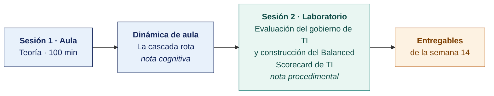

  
  &nbsp;&nbsp;&nbsp;&nbsp;&nbsp;&nbsp;
  

  <strong>Universidad Privada de Tacna</strong> 
  Facultad de Ingeniería · Escuela Profesional de Ingeniería de Sistemas

<h1 align="center">Semana 14</h1>
<h2 align="center">Estándares y Buenas Prácticas · Gobierno Corporativo de TI · Alineamiento Estratégico y BSC</h2>

  <strong>SI-084 · Auditoría de Sistemas</strong> 
  4 horas académicas de 50 min · 100 min de teoría con la dinámica incluida en aula · 100 min de taller en laboratorio

---

## Datos de la asignatura

| | |
|---|---|
| **Asignatura** | SI-084 · Auditoría de Sistemas |
| **Escuela** | Escuela Profesional de Ingeniería de Sistemas |
| **Ciclo** | X · 04 horas semanales · 03 créditos · Obligatorio |
| **Prerrequisito** | SI-985 Gestión de la Configuración de Software |
| **Unidad** | III — Tipos de Auditoría de Sistemas · Informe Final |
| **Semana** | 14 de 17 |
| **Duración** | 4 horas académicas de 50 min · 100 min de teoría con la dinámica incluida en aula · 100 min de taller en laboratorio |
| **Resultados de aprendizaje** | **RA1** Diseña y aplica estrategias para los diversos tipos de auditoría de sistemas · **RA2** Descubre la importancia y diferencia entre auditor interno y externo |
| **Atributos del graduado** | AG-I01 El Profesional y el Mundo · AG-I08 Análisis de Problemas (CD3, nivel 4) |

### Lo que indica el sílabo

**Contenido conceptual.** Estándares de Auditoria de TI, buenas prácticas, COBIT, VAL IT. Gobierno corporativo de TI ISO 38500, Alineamiento estratégico de TI. BSC.

**Contenido procedimental.** Comprende los estándares de auditoría, buenas prácticas, COBIT, VAL IT, gobierno corporativo y su alineamiento estratégico.

> **Qué sección construye esta semana.** El índice completo del entregable de la unidad está en el [Modelo del Informe de Auditoría](../MODELO-INFORME-DE-AUDITORIA.md).

## Materiales de esta semana

| | Documento | Qué encontrarás | Dónde y cuánto dura |
|---|---|---|---|
| 1 | **[Teoría](1-TEORIA.md)** | Gobierno de TI y gestión de TI · ISO/IEC 38500:2024 — la tercera edición cambia el marco · Val IT y la gestión del valor de la inversión en TI | Aula · 100 min |
| 2 | **[Dinámica de aula](2-DINAMICA.md)** | La cascada rota, con su material, su ejemplo resuelto y su rúbrica | Aula · dentro de los 100 min de la sesión de teoría |
| 3 | **[Taller de laboratorio](3-TALLER.md)** | Evaluación del gobierno de TI y construcción del Balanced Scorecard de TI | Laboratorio · 100 min |

## Ruta de la semana

## Entregables

| Entregable | Formato y nombre del archivo | Vence |
|---|---|---|
| **Dinámica de aula** · La cascada rota | PDF desde la [plantilla de dinámica](../PLANTILLAS/SI084-PLANTILLA-DINAMICA.docx) · `SI084-S14-DINAMICA-Grupo<N>.pdf` | Según lo programado en el aula virtual |
| **Informe del taller de laboratorio N.º 14** | PDF en formato EPIS desde la [plantilla de taller](../PLANTILLAS/SI084-PLANTILLA-TALLER.docx) · `SI084-S14-TALLER-Grupo<N>.pdf` | Según lo programado en el aula virtual |
| Evaluación de gobierno y BSC de TI | Commit en Git | Según lo programado en el aula virtual |

> La dinámica y el informe del taller se entregan en **PDF**, con la carátula de la UPT y los códigos de todos los integrantes. Las plantillas obligatorias están en [`PLANTILLAS/`](../PLANTILLAS/).

## Cómo se evalúa

| Criterio | Instrumento | Peso |
|---|---|---|
| Cognitivo | Rúbrica de «La cascada rota» + exposición de 10 min en la Semana 15 | 25 % |
| Procedimental | Lista de cotejo de los 12 resultados del laboratorio | 35 % |
| Actitudinal | Manejo de la información Restringida (actas y presupuestos) conforme al protocolo | 15 % |

## Preparación para la Semana 15

- Leer. **ISO 22301:2019** — cláusulas 8.2 (análisis de impacto en el negocio y apreciación del riesgo), 8.4 (planes y procedimientos de continuidad) y 8.5 (programa de ejercicios).
- **Leer.** ISO/IEC 27001:2022, controles **A.5.29 Information security during disruption** y **A.5.30 ICT readiness for business continuity**.
- **Solicitar a la empresa.** El plan de continuidad si existe, el BIA (*Business Impact Analysis*, análisis de impacto al negocio), la política de respaldo y las actas de pruebas de recuperación.
- Coordinar con TI la posibilidad de ejecutar una **prueba de restauración** en ambiente aislado durante la Semana 15.

---

**Docente** · Dr. Oscar Juan Jimenez Flores
[oscarjimenezflores@upt.pe](mailto:oscarjimenezflores@upt.pe) · [LinkedIn](https://www.linkedin.com/in/oscar-jimenez-flores/) · [CTI Vitae — CONCYTEC](https://ctivitae.concytec.gob.pe/appDirectorioCTI/VerDatosInvestigador.do?id_investigador=33398)

Escuela Profesional de Ingeniería de Sistemas · Universidad Privada de Tacna · Tacna, Perú
