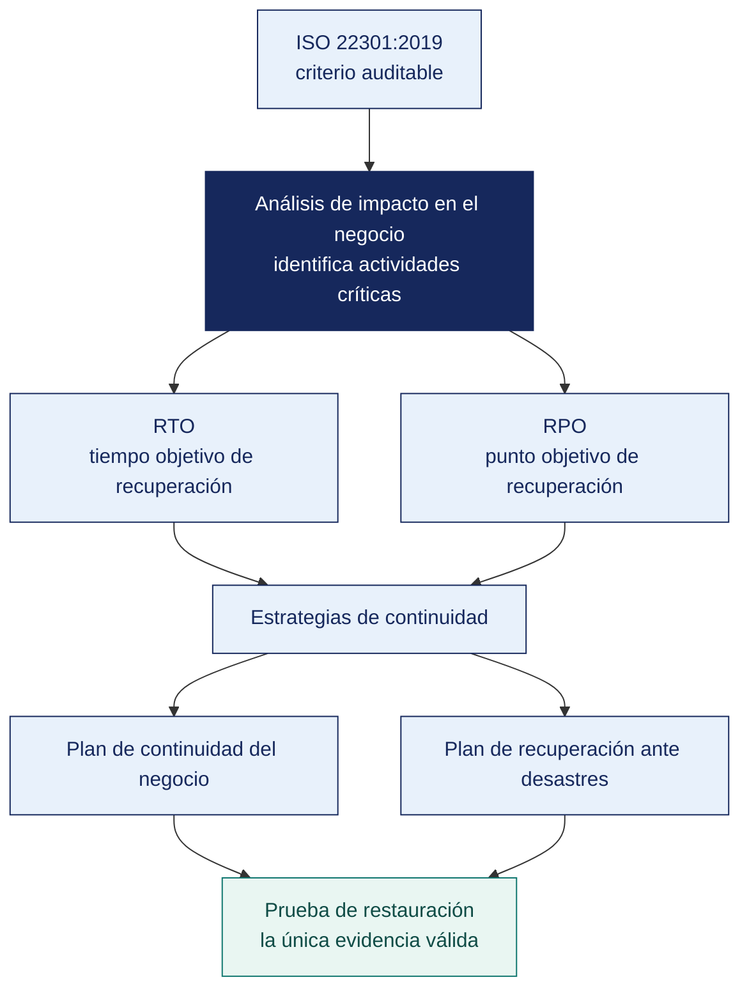

[Semana 15](README.md) · **Teoría** · [Dinámica de aula](2-DINAMICA.md) · [Taller de laboratorio](3-TALLER.md)

# Semana 15

## Plan de Continuidad del Negocio y Contingencias · ISO 22301:2019

**SI-084 · Auditoría de Sistemas** · Sesión 1 en aula · 2 horas académicas, 100 min, con la dinámica incluida

> ¿Un término no le resulta claro? Está definido en el [glosario técnico del curso](../GLOSARIO.md).

---

## Supuesto y pregunta

Una empresa declara que puede recuperar su facturación en cuatro horas, y lo tiene escrito en un plan de continuidad de sesenta páginas, aprobado y firmado.

Pero su análisis de impacto dice que la misma actividad tolera como máximo dos horas de interrupción antes de que el daño sea inaceptable. Las dos cifras están en el mismo documento, en páginas distintas, y nadie las comparó nunca.

> **¿Cómo se audita un plan de continuidad de sesenta páginas sin leerlo entero?**

## Mapa de la sesión



---

## 1. El vocabulario que hay que usar con precisión

> **¿Por qué en continuidad la imprecisión de un término produce planes inútiles?**

La continuidad es el área donde la imprecisión terminológica produce planes inútiles. La ISO 22301:2019 fija los términos:

| Término | Definición | Error frecuente |
|---|---|---|
| **Continuidad del negocio (BCM)** | Capacidad de la organización de continuar entregando productos y servicios dentro de plazos aceptables tras una disrupción | Reducirlo a «tener respaldos» |
| **Disrupción** | Incidente que interrumpe las operaciones, funciones o procesos | Limitarlo a desastres naturales; la mayoría son fallas de proveedor, ransomware o error humano |
| **BIA (*Business Impact Analysis*)** | Análisis del impacto en el tiempo de la interrupción de cada actividad | Hacerlo por sistema en lugar de por **actividad de negocio** |
| **MTPD / MTPoD** | Máximo periodo tolerable de disrupción antes de que el daño sea inaceptable | Confundirlo con el RTO |
| **RTO** (*Recovery Time Objective*) | Plazo objetivo para restaurar la actividad tras la disrupción. **Siempre menor que el MTPD** | Declararlo sin haberlo probado |
| **RPO** (*Recovery Point Objective*) | Máxima pérdida de datos tolerable, medida en tiempo | Confundirlo con la frecuencia de respaldo |
| **MBCO** (*Minimum Business Continuity Objective*) | Nivel mínimo de servicio aceptable durante la disrupción | Asumir que hay que volver al 100 % |
| **BCP** | Plan de continuidad del **negocio** — procesos, personas, instalaciones, proveedores | Llamar BCP a un plan que solo cubre TI |
| **DRP** | Plan de recuperación ante desastres. La **parte tecnológica** del BCP | Creer que el DRP sustituye al BCP |
| **Plan de crisis** | **Gobierno de la respuesta.** Quién decide, quién comunica | No tenerlo, y decidir por WhatsApp durante la emergencia |

**La relación entre los tiempos** —el diagrama que ordena todo el análisis:

```
        Disrupción
            │
            ▼
  ══════════╪═══════════════════════════════════════════════►  tiempo
            │◄──────── RTO ────────►│
            │◄─────────── MTPD ──────────────►│
            │                                 │
  ◄─ RPO ──►│                          Daño inaceptable:
  (pérdida  │                          pérdida de clientes,
   de datos │                          sanción, quiebre
   tolerable)                          de continuidad

  Regla: RPO ≥ 0 · RTO < MTPD · Si RTO ≥ MTPD, el plan NO PROTEGE.
```

**La prueba de auditoría más simple y más reveladora.** Pedir el RTO declarado de un proceso, pedir el MTPD del BIA, y compararlos. **Si el RTO es mayor o igual que el MTPD, el plan de continuidad no protege la actividad**, con independencia de su extensión.

**Ejemplo trabajado — RTO y RPO sobre un caso concreto.** Municipalidad, sistema de rentas, campaña de amnistía.

| Concepto | Definición | En este caso | Qué lo determina |
|---|---|---|---|
| **RTO** — objetivo de tiempo de recuperación | Cuánto puede estar caído el servicio | 4 horas. Más allá, la cola en caja se vuelve inmanejable | El **negocio**, no TI |
| **RPO** — objetivo de punto de recuperación | Cuánta información se puede perder, medida en tiempo | 1 hora. Se puede redigitar lo de una hora desde los comprobantes físicos | El **negocio** |
| **MTD** — tiempo máximo tolerable de caída | El punto a partir del cual el daño es irreversible | 3 días. Se pierde la campaña completa | El negocio |
| **Respaldo diario a las 23:00** | La práctica real | Da un RPO efectivo de **24 horas** | La configuración actual |

**La incoherencia que hay que saber ver.** El negocio necesita RPO de 1 hora y el respaldo entrega 24. **La brecha es de 23 horas de información**. Ese es el hallazgo, y no se resuelve comprando más disco. Se resuelve cambiando la frecuencia del respaldo o replicando en continuo.

**Y la incoherencia imposible.** Si un BIA declara **RPO mayor que RTO**, está mal por definición. Significaría aceptar perder más información de la que caben en el tiempo que el proceso puede estar detenido. Cuando aparece, casi siempre es que se llenó la planilla sin entender los conceptos.

> **Microaplicación (6 min). La comparación que desarma el plan.** Con el caso del inicio a la vista, el aula responde en parejas **qué significa que el objetivo de recuperación supere el periodo máximo tolerable**, y qué se concluye del plan entero. Se recoge una respuesta antes de dar la regla.

| Caso | Qué debe contener una buena respuesta |
|---|---|
| ¿Quién fija el RTO, TI o el negocio? | El negocio. TI dice qué RTO puede entregar y a qué costo. Si TI fija ambos, se fija el que ya cumple |
| Un proceso tiene criticidad Alta y RTO de 72 horas. ¿Es coherente? | No. Si tolera tres días de caída, no es crítico. O la criticidad está inflada o el RTO se copió sin pensar |
| ¿Sirve un respaldo que nunca se restauró? | Como control, no. Un respaldo no probado es una hipótesis. El control es la **restauración verificada**, no la copia |
> **El error frecuente del bloque.** Confundir el objetivo de punto de recuperación con la frecuencia del respaldo. Son cosas distintas — uno es cuánta información tolera perder el negocio, la otra es cada cuánto copia el área de TI. Declarar un objetivo de una hora con respaldo diario es una **imposibilidad aritmética**, y se detecta sin entrar al detalle técnico.

## 2. La ISO 22301:2019 como criterio auditable

> **¿Qué exige la norma que se pueda comprobar, y no solo leer?**

Estructura de alto nivel, igual que la ISO/IEC 27001. Las cláusulas donde se concentran los hallazgos:

| Cláusula | Requisito | Evidencia que exige el auditor |
|---|---|---|
| **4.1–4.3** Contexto y alcance | Cuestiones internas/externas, partes interesadas, **alcance del SGCN** | Documento de alcance con lo excluido justificado |
| **5.2** Política | Política de continuidad aprobada por la dirección | Política vigente y firmada |
| **5.3** Roles | Responsabilidades y autoridades asignadas, incluida la de activar el plan | **Quién tiene autoridad para declarar la crisis** |
| **7.2–7.3** Competencia y toma de conciencia | El personal con rol en el plan es competente y lo conoce | Registros de capacitación y de simulacros |
| **8.2.2** **BIA** | Análisis del impacto en el tiempo, con MTPD, RTO, RPO y MBCO por actividad | BIA por **actividad de negocio**, con la metodología documentada |
| **8.2.3** Apreciación del riesgo | Riesgos de disrupción identificados y evaluados | Registro de riesgos de continuidad |
| **8.3** Estrategias | Estrategias de continuidad seleccionadas y justificadas contra los requisitos del BIA | Análisis de opciones con costo y capacidad |
| **8.4** Planes y procedimientos | Planes documentados, con procedimientos accionables, roles y comunicación | **Plan que una persona ajena pueda ejecutar** |
| **8.5** **Programa de ejercicios y pruebas** | Ejercicios planificados, ejecutados y evaluados | **Actas de simulacro con resultados y acciones correctivas** |
| **9.1–9.3** Evaluación | Seguimiento, auditoría interna y revisión por la dirección | Informes y actas |
| **10** Mejora | No conformidades y acciones correctivas derivadas de ejercicios e incidentes | Registro con causa raíz |

**El control complementario en la ISO/IEC 27001:2022.** **A.5.29 Information security during disruption** (la seguridad no se suspende durante la crisis) y **A.5.30 ICT readiness for business continuity** (control nuevo de la edición 2022, que exige que la preparación TIC se planifique, implemente, mantenga y **pruebe** contra los objetivos de continuidad).

**Los cinco hallazgos que aparecen casi siempre.**

| # | Hallazgo | Por qué ocurre |
|---|---|---|
| 1 | **Plan escrito, nunca probado** | La prueba interrumpe la operación y siempre se pospone |
| 2 | **RTO declarado sin sustento técnico** | Se copió de una plantilla o se fijó por deseo |
| 3 | **BIA hecho por sistema, no por actividad** | Lo elaboró TI sin participación del negocio |
| 4 | **Respaldos sin copia inmutable o fuera de línea** | Toda la protección es accesible desde la red comprometida |
| 5 | **Nadie tiene autoridad definida para activar el plan** | El plan no dice quién declara la crisis, y en la crisis nadie decide |

## 3. El BIA en la práctica y las estrategias de continuidad

> **¿Quién decide cuánto puede estar caído un proceso?**

**Cómo se construye un BIA correcto.** Se parte de **actividades de negocio**, no de sistemas:

| Paso | Contenido |
|---|---|
| 1 | Listar las **actividades** que entregan los productos y servicios (facturar, despachar, atender al cliente, pagar la planilla) |
| 2 | Para cada actividad, describir el impacto de su interrupción **en el tiempo** — a las 4 h, a las 24 h, a los 3 días, a la semana |
| 3 | Evaluar el impacto en cuatro dimensiones. **Financiero, operativo, legal/regulatorio y reputacional** |
| 4 | Determinar el **MTPD** a partir del momento en que el impacto se vuelve inaceptable |
| 5 | Fijar el **RTO** (menor que el MTPD) y el **MBCO** (nivel mínimo aceptable durante la disrupción) |
| 6 | Determinar el **RPO** según la tolerancia a la pérdida de datos de esa actividad |
| 7 | Identificar los **recursos** que la actividad requiere — personas, sistemas, datos, instalaciones, proveedores |
| 8 | Recién ahora, mapear **actividad → sistemas** y derivar los requisitos técnicos |

> **El paso 8 es el que casi todas las organizaciones ejecutan primero, y por eso su BIA no sirve.** Un BIA que empieza por los sistemas produce requisitos técnicos sin justificación de negocio, imposibles de defender ante un recorte presupuestal.

**Estrategias de continuidad y su costo relativo.**

| Estrategia | RTO típico | Costo | Cuándo se justifica |
|---|---|---|---|
| Respaldo en cinta o disco externo, restauración manual | Días | Muy bajo | Actividades con MTPD amplio |
| Respaldo en la nube con restauración a infraestructura nueva | 8–48 h | Bajo | La mayoría de las MYPE |
| Sitio frío (instalación sin equipamiento activo) | 24–72 h | Medio | Cuando el equipamiento puede adquirirse a tiempo |
| Sitio tibio (equipamiento listo, datos por restaurar) | 4–24 h | Alto | Actividades críticas de empresas medianas |
| Sitio caliente / activo-activo | Minutos | Muy alto | Banca, telecomunicaciones, servicios esenciales |
| Acuerdo de reciprocidad con otra organización | Variable | Bajo | Requiere contrato firme y prueba conjunta |

**La regla 3-2-1 del respaldo y su extensión moderna.**

```
3 copias de los datos
2 medios o tecnologías distintas
1 copia fuera de sitio
+ 1 copia INMUTABLE o fuera de línea   ← indispensable frente a ransomware
+ 0 errores verificados en la restauración  ← lo único que prueba que funciona
```

**Por qué la copia inmutable es hoy el control decisivo.** El ransomware moderno busca y cifra los respaldos accesibles desde la red antes de cifrar los datos de producción. Una organización con tres copias, todas alcanzables con la credencial del administrador de dominio, tiene **cero copias** frente a ese escenario.

**Ejemplo trabajado — auditar un BIA sin conocer el negocio.** Se audita el **método**, no el juicio de negocio:

| Verificación | Qué se busca | Condición si falla |
|---|---|---|
| ¿Participaron las áreas dueñas del proceso? | Firma o acta de validación por proceso | El BIA lo llenó TI solo, o un practicante. Los tiempos no representan al negocio |
| ¿RPO ≤ RTO en todas las filas? | Coherencia lógica | **Filas imposibles.** Se declaró aceptar más pérdida de datos que tiempo de caída |
| ¿La criticidad es coherente con el RTO? | Proceso crítico con RTO corto | «Criticidad Alta con RTO de 72 horas»: uno de los dos está mal |
| ¿El impacto a 24 h concuerda con la criticidad? | Consistencia interna | Impacto Alto con criticidad Baja |
| ¿Cada proceso tiene sistema de soporte identificado? | Trazabilidad al activo | **Proceso sin sistema declarado.** No se puede planificar su recuperación |
| ¿Hay prueba de recuperación registrada? | Fecha de la última prueba | «Nunca»: el plan es una hipótesis |
| ¿El RPO declarado es alcanzable con el respaldo real? | Contraste con la frecuencia del respaldo | RPO de 1 h con respaldo diario. Brecha de 23 h |

> **El auditor no discute si el RTO debe ser 4 u 8 horas. Eso lo decide el negocio.** Lo que audita es si alguien del negocio lo decidió, si el método se aplicó de forma consistente y si lo declarado es alcanzable con los medios que existen.

> **Microaplicación (5 min). Quién responde por el tiempo.** El aula responde a mano alzada antes de la explicación. La respuesta mayoritaria suele ser que no es hallazgo, porque TI es quien conoce los sistemas, y ahí está el error que conviene sacar a la luz.

| Caso | Qué debe contener una buena respuesta |
|---|---|
| El BIA lo elaboró TI sin consultar a las áreas. ¿Es hallazgo? | Sí, y de los importantes. Los tiempos de recuperación son una decisión de negocio; si los fija TI, se fijan según lo que TI ya puede cumplir |
| ¿Se puede tener plan de continuidad sin BIA? | Se puede tener un documento. No se puede saber si prioriza bien, porque no se sabe qué proceso duele primero |
| ¿Cada cuánto se actualiza un BIA? | Al menos anual, y ante todo cambio relevante de procesos o sistemas. Un BIA de hace tres años describe una organización que ya no existe |
> **El error frecuente del bloque.** Llamar plan de continuidad del negocio a un plan que solo cubre TI. Eso es un plan de recuperación ante desastres, que es **una parte** del anterior. Un plan que restaura los sistemas y no dice quién atiende a los clientes, desde dónde y con qué proceso alternativo, no protege la continuidad del negocio.

## Cierre

**La respuesta a la pregunta con la que abrimos.** Se piden dos cifras y se comparan. **Si el objetivo de tiempo de recuperación es mayor o igual que el periodo máximo tolerable de disrupción, el plan no protege la actividad**, tenga sesenta páginas o seiscientas. Es la prueba de auditoría más simple y más reveladora de toda la unidad, y cabe en una pregunta.

**Las tres ideas que deben quedar.**

| Idea | Por qué importa en el ejercicio profesional |
|---|---|
| En continuidad, la imprecisión terminológica produce planes que no protegen | Los objetivos temporales son cifras con consecuencia, no vocabulario |
| El objetivo de recuperación lo fija el negocio, no el área de TI | Un objetivo fijado por la capacidad técnica disponible describe lo que se puede hacer, no lo que hace falta |
| Un objetivo declarado y nunca probado es una capacidad supuesta | La única forma de saberlo es cronometrar una restauración real |

**Lo que suele fallar frente a este caso.** La mayoría propone leer el plan o pedir el registro de respaldos. La comparación de las dos cifras, que resuelve el caso en un minuto, casi nunca aparece.

**Lo que sigue.** La [dinámica de esta sesión](2-DINAMICA.md) pide construir el análisis de impacto completo de una actividad real de su empresa auditada, terminando con la estrategia de continuidad recomendada **y su justificación económica**. El objetivo de recuperación se sustenta en el costo de la interrupción, no en lo que sería deseable tener.


**Pregunta de cierre.** *¿cuándo fue la última vez que esta organización restauró un sistema completo desde el respaldo y midió cuánto tardó?* Si la respuesta es «nunca» o «no lo sé», el RTO declarado en el plan es una cifra sin sustento y así debe reportarse.
---

---

[Semana 15](README.md) · **Teoría** · [Dinámica de aula](2-DINAMICA.md) · [Taller de laboratorio](3-TALLER.md)

---

**Docente** · Dr. Oscar Juan Jimenez Flores
[oscarjimenezflores@upt.pe](mailto:oscarjimenezflores@upt.pe) · [LinkedIn](https://www.linkedin.com/in/oscar-jimenez-flores/) · [CTI Vitae — CONCYTEC](https://ctivitae.concytec.gob.pe/appDirectorioCTI/VerDatosInvestigador.do?id_investigador=33398)

Escuela Profesional de Ingeniería de Sistemas · Universidad Privada de Tacna · Tacna, Perú
