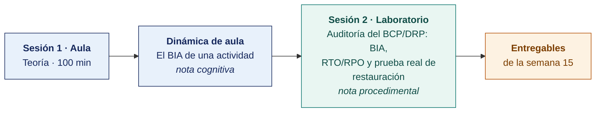

  
  &nbsp;&nbsp;&nbsp;&nbsp;&nbsp;&nbsp;
  

  <strong>Universidad Privada de Tacna</strong> 
  Facultad de Ingeniería · Escuela Profesional de Ingeniería de Sistemas

<h1 align="center">Semana 15</h1>
<h2 align="center">Plan de Continuidad del Negocio y Contingencias · ISO 22301:2019</h2>

  <strong>SI-084 · Auditoría de Sistemas</strong> 
  4 horas académicas de 50 min · 100 min de teoría con la dinámica incluida en aula · 100 min de taller en laboratorio

---

## Datos de la asignatura

| | |
|---|---|
| **Asignatura** | SI-084 · Auditoría de Sistemas |
| **Escuela** | Escuela Profesional de Ingeniería de Sistemas |
| **Ciclo** | X · 04 horas semanales · 03 créditos · Obligatorio |
| **Prerrequisito** | SI-985 Gestión de la Configuración de Software |
| **Unidad** | III — Tipos de Auditoría de Sistemas · Informe Final |
| **Semana** | 15 de 17 |
| **Duración** | 4 horas académicas de 50 min · 100 min de teoría con la dinámica incluida en aula · 100 min de taller en laboratorio |
| **Resultados de aprendizaje** | **RA1** Diseña y aplica estrategias para los diversos tipos de auditoría de sistemas · **RA2** Descubre la importancia y diferencia entre auditor interno y externo |
| **Atributos del graduado** | AG-I09 Diseño y Desarrollo de Soluciones (CD11, nivel 4) · AG-I11 Uso de Herramientas (CD2, nivel 4) |

### Lo que indica el sílabo

**Contenido conceptual.** Plan de Continuidad del negocio y contingencias.

**Contenido procedimental.** Identifica técnicas para realizar un Plan de continuidad del negocio y contingencias.

> **Qué sección construye esta semana.** El índice completo del entregable de la unidad está en el [Modelo del Informe de Auditoría](../MODELO-INFORME-DE-AUDITORIA.md).

## Materiales de esta semana

| | Documento | Qué encontrarás | Dónde y cuánto dura |
|---|---|---|---|
| 1 | **[Teoría](1-TEORIA.md)** | El vocabulario que hay que usar con precisión · La ISO 22301:2019 como criterio auditable · El BIA en la práctica y las estrategias de continuidad | Aula · 100 min |
| 2 | **[Dinámica de aula](2-DINAMICA.md)** | El BIA de una actividad, con su material, su ejemplo resuelto y su rúbrica | Aula · dentro de los 100 min de la sesión de teoría |
| 3 | **[Taller de laboratorio](3-TALLER.md)** | Auditoría del plan de continuidad con BIA, RTO, RPO y prueba de restauración | Laboratorio · 100 min |

## Ruta de la semana

## Entregables

| Entregable | Formato y nombre del archivo | Vence |
|---|---|---|
| **Dinámica de aula** · El BIA de una actividad | PDF desde la [plantilla de dinámica](../PLANTILLAS/SI084-PLANTILLA-DINAMICA.docx) · `SI084-S15-DINAMICA-Grupo<N>.pdf` | Según lo programado en el aula virtual |
| **Informe del taller de laboratorio N.º 15** | PDF en formato EPIS desde la [plantilla de taller](../PLANTILLAS/SI084-PLANTILLA-TALLER.docx) · `SI084-S15-TALLER-Grupo<N>.pdf` | Según lo programado en el aula virtual |
| Acta de prueba de restauración y hallazgo de continuidad | Commit en Git | Según lo programado en el aula virtual |

> La dinámica y el informe del taller se entregan en **PDF**, con la carátula de la UPT y los códigos de todos los integrantes. Las plantillas obligatorias están en [`PLANTILLAS/`](../PLANTILLAS/).

## Cómo se evalúa

| Criterio | Instrumento | Peso |
|---|---|---|
| Cognitivo | Rúbrica del BIA (*Business Impact Analysis*, análisis de impacto al negocio) + exposición de 10 min en la Semana 16 | 25 % |
| Procedimental | Lista de cotejo de los 13 resultados del laboratorio | 35 % |
| Actitudinal | Ejecución de la prueba en ambiente aislado y limpieza posterior verificada | 15 % |

## Preparación para la Semana 16

- **Leer.** ISO 19011:2018, cláusula 6.5 y 6.6 (informe, cierre y seguimiento).
- **Leer.** Normas Generales de Control Gubernamental de la Contraloría (auditoría interna en el sector público) y el Reglamento de Auditoría Interna de la SBS (sector financiero).
- **Consolidar todos los hallazgos** de las semanas 13 a 15 en un solo listado priorizado.
- Coordinar la **reunión de cierre** con la empresa auditada. La Semana 16 valida los hallazgos y recoge la respuesta de la administración.

---

**Docente** · Dr. Oscar Juan Jimenez Flores
[oscarjimenezflores@upt.pe](mailto:oscarjimenezflores@upt.pe) · [LinkedIn](https://www.linkedin.com/in/oscar-jimenez-flores/) · [CTI Vitae — CONCYTEC](https://ctivitae.concytec.gob.pe/appDirectorioCTI/VerDatosInvestigador.do?id_investigador=33398)

Escuela Profesional de Ingeniería de Sistemas · Universidad Privada de Tacna · Tacna, Perú
