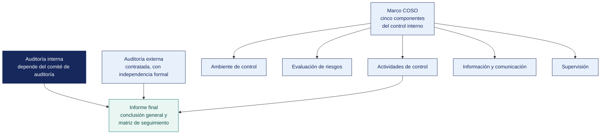

[Semana 16](README.md) · **Teoría** · [Dinámica de aula](2-DINAMICA.md) · [Taller de laboratorio](3-TALLER.md)

# Semana 16

## Auditoría Interna y Externa · Sistema de Control Interno · Elaboración del Informe Final

**SI-084 · Auditoría de Sistemas** · Sesión 1 en aula · 2 horas académicas, 100 min, con la dinámica incluida

> ¿Un término no le resulta claro? Está definido en el [glosario técnico del curso](../GLOSARIO.md).

---

## Supuesto y pregunta

Un informe final concluye que «se observaron oportunidades de mejora en los controles evaluados», aunque los hallazgos que lo sustentan son sólidos, la evidencia está completa y el auditado no objetó nada.

El comité lee la conclusión y entiende que todo está razonablemente bien, cuando uno de los hallazgos describía que cualquier desarrollador podía desplegar a producción sin aprobación.

> **¿Qué tiene que decir una conclusión de auditoría para que quien la lee sepa qué decidir?**

## Mapa de la sesión



---

## 1. Auditoría interna y auditoría externa

> **¿A quién debe reportar el auditor interno para que su función sirva de algo?**

| Dimensión | **Auditoría interna** | **Auditoría externa** |
|---|---|---|
| **Vínculo** | Función permanente de la organización | Firma independiente contratada |
| **Reporta a** | Comité de auditoría o directorio (funcional); gerencia general (administrativo) | Junta de accionistas o comité de auditoría |
| **Objetivo** | Agregar valor y mejorar las operaciones; evaluar y mejorar la eficacia de la gestión de riesgos, control y gobierno | Emitir **opinión** sobre los estados financieros o sobre el cumplimiento de un marco específico |
| **Alcance** | Todo lo que la dirección o el comité determinen | Delimitado por el encargo y las normas de auditoría aplicables |
| **Frecuencia** | Continua, según el plan anual | Periódica, generalmente anual |
| **Destinatario del informe** | Dirección y comité de auditoría | Accionistas, regulador, terceros interesados |
| **Independencia** | **Objetividad**; independencia organizacional respecto de las áreas auditadas | **Independencia** plena, incluidos vínculos económicos |
| **Norma que la rige** | *Global Internal Audit Standards* del IIA; ITAF de ISACA | Normas Internacionales de Auditoría (NIA); ITAF para el componente de sistemas |
| **En el sector público peruano** | **Órgano de Control Institucional (OCI)**, bajo la Contraloría General de la República | Sociedades de auditoría designadas por la Contraloría |
| **En el sistema financiero peruano** | Unidad de Auditoría Interna, regulada por el **Reglamento de Auditoría Interna de la SBS** (modificado por la Res. SBS 504-2021) | Sociedades de auditoría externa inscritas en el registro de la SBS |

**La independencia organizacional del auditor interno.** El punto que define si la función sirve o es decorativa — **el auditor interno reporta funcionalmente al comité de auditoría o al directorio, no al gerente cuya área audita.** Cuando la jefatura de auditoría interna depende jerárquicamente del gerente general y su remuneración la fija él, la objetividad está estructuralmente comprometida, con independencia de la integridad personal del auditor.

**El rol del auditor externo respecto de TI.** El auditor financiero externo no puede opinar sobre los estados financieros sin evaluar los **controles generales de TI** de los sistemas que los producen. Por eso las firmas incorporan especialistas de auditoría de sistemas. No auditan TI por interés en TI, sino porque **la confiabilidad de la cifra depende de la confiabilidad del sistema que la calcula**.

**Confianza en el trabajo de otros.** El auditor externo puede apoyarse en el trabajo de auditoría interna si evalúa previamente su **objetividad, competencia y aplicación de un enfoque sistemático y disciplinado**. Esa evaluación es un procedimiento de auditoría, y su conclusión determina cuánto trabajo propio puede reducir.

> **El error frecuente del bloque.** Creer que la objetividad depende de la integridad personal del auditor. Cuando la jefatura de auditoría interna depende jerárquicamente de quien audita y su sueldo lo fija esa misma persona, **la objetividad está estructuralmente comprometida**, por íntegro que sea el profesional. Es un hallazgo de estructura, no de conducta.

## 2. El sistema de control interno y el marco COSO

> **¿Por qué un marco de control interno contable obliga a auditar la tecnología?**

El **COSO Internal Control — Integrated Framework (2013)** define el control interno como el proceso, efectuado por el directorio, la dirección y el personal, diseñado para proporcionar **seguridad razonable** sobre el logro de objetivos de operación, información y cumplimiento.

**Los cinco componentes y sus 17 principios**, con la traducción a auditoría de sistemas:

| Componente | Principios | Qué evalúa el auditor de sistemas |
|---|---|---|
| **Ambiente de control** (P1–P5) | Compromiso con la integridad, supervisión del directorio, estructura y autoridad, competencia, rendición de cuentas | ¿Existe política de seguridad aprobada por la dirección? ¿El directorio supervisa el riesgo de TI? ¿Los roles de TI están definidos? |
| **Evaluación de riesgos** (P6–P9) | Objetivos claros, identificación y análisis del riesgo, riesgo de fraude, cambios significativos | ¿Existe registro de riesgos de TI? ¿Se consideró el fraude asistido por sistemas? ¿Se reevalúa el riesgo ante cambios tecnológicos? |
| **Actividades de control** (P10–P12) | Selección de actividades de control, **controles generales de tecnología**, despliegue mediante políticas | Aquí viven los **ITGC** — accesos, cambios, operaciones, desarrollo. **El principio 11 es explícitamente sobre tecnología** |
| **Información y comunicación** (P13–P15) | Información relevante, comunicación interna, comunicación externa | ¿La información que sustenta las decisiones es confiable? ¿Existe canal de denuncias? |
| **Actividades de supervisión** (P16–P17) | Evaluaciones continuas y separadas, comunicación de deficiencias | ¿Existe monitoreo continuo? ¿Las deficiencias se comunican y se corrigen? |

**El principio 11 de COSO** —«la organización selecciona y desarrolla actividades de control generales sobre la tecnología para apoyar el logro de los objetivos»— es la razón formal por la que los ITGC entran en el alcance de la auditoría financiera bajo SOX (*Sarbanes-Oxley Act*) y bajo cualquier evaluación de control interno.

**Clasificación de las deficiencias de control.** El vocabulario que el informe debe usar:

| Nivel | Definición | Destinatario |
|---|---|---|
| **Deficiencia de control** | El control no permite prevenir o detectar errores oportunamente | Gerencia del área |
| **Deficiencia significativa** | Deficiencia, o combinación de ellas, lo suficientemente importante para merecer la atención de los responsables del gobierno | Comité de auditoría |
| **Debilidad material** | Existe una posibilidad razonable de que un error material no sea prevenido ni detectado oportunamente | Directorio y, si aplica, revelación al regulador o al mercado |

**En el sector público peruano.** La **Ley 28716** y las directivas de la Contraloría General de la República establecen el Sistema de Control Interno de las entidades del Estado, con sus componentes alineados a COSO y con la obligación de que cada entidad implemente, autoevalúe y reporte su avance. El **OCI** ejecuta el control simultáneo y posterior.

**Ejemplo trabajado — los cinco componentes de COSO sobre una debilidad concreta.** Debilidad. *Pagos aprobados por quien los registra*.

| Componente | Qué aporta al análisis | En este caso |
|---|---|---|
| **Ambiente de control** | El tono de la dirección y la estructura | La gerencia tolera el préstamo de usuarios «para no detener la operación» |
| **Evaluación de riesgos** | Si la organización identificó este riesgo | El registro de riesgos menciona «fraude interno» con probabilidad Baja y sin tratamiento |
| **Actividades de control** | El control que debía operar | El perfil del ERP permite registrar y aprobar. El control declarado no existe técnicamente |
| **Información y comunicación** | Si alguien podía enterarse | No hay reporte de operaciones autoaprobadas |
| **Supervisión** | Si alguien revisa que los controles operen | No se ha hecho revisión de accesos en el periodo |

> **Ese análisis es lo que convierte una debilidad puntual en un hallazgo de control interno.** No falló un permiso mal configurado — fallaron los cinco componentes sobre el mismo riesgo. Y la recomendación cambia no es «corregir el perfil», es establecer supervisión periódica, porque el perfil se volverá a abrir.

> **Microaplicación (4 min). La línea de reporte.** El docente plantea una jefatura de auditoría interna que depende del gerente general y cuya remuneración él fija. El aula responde, a mano alzada, **si la objetividad está comprometida** antes de la explicación.

| Caso | Qué debe contener una buena respuesta |
|---|---|
| ¿Puede el control interno dar seguridad absoluta? | No. COSO habla de **seguridad razonable**. Existen el error humano, la colusión y la anulación del control por la propia dirección |
| ¿Cuál es el componente que más se omite en los informes? | La supervisión. Se recomienda implantar controles y no se recomienda quién verificará que sigan operando |
| ¿Es control interno responsabilidad de auditoría? | No. Es responsabilidad de la dirección. Auditoría lo **evalúa**. Si auditoría lo diseña, después se autoevalúa |
> **El error frecuente del bloque.** Tratar el control interno como un asunto contable ajeno a TI. El principio 11 de COSO trata **explícitamente** sobre las actividades de control generales sobre la tecnología, y es la razón formal por la que los controles generales de TI entran en el alcance de cualquier evaluación de control interno.

## 3. La estructura del informe final de auditoría de sistemas

> **¿Qué distingue una conclusión de un resumen de hallazgos?**

El índice completo, con qué debe contener cada subsección y de qué semana sale, está en el **[Modelo del Informe de Auditoría](../MODELO-INFORME-DE-AUDITORIA.md)**. Lo que sigue es su esqueleto.

```
PORTADA
  Organización · tipo de encargo · periodo auditado · fecha · clasificación
  Lista nominal de distribución

1. RESUMEN EJECUTIVO                                        (máx. 2 páginas)
   1.1 Objetivo y alcance en tres líneas
   1.2 Conclusión general (la opinión del auditor)
   1.3 Tabla resumen: N.º de hallazgos por severidad
   1.4 Los tres asuntos que requieren decisión del directorio
   1.5 Indicador de comparación con el ciclo anterior, si existe

2. INTRODUCCIÓN
   2.1 Antecedentes y origen del encargo
   2.2 Objetivos de la auditoría
   2.3 Alcance: sistemas, procesos, periodo · EXCLUSIONES EXPLÍCITAS
   2.4 Criterios de auditoría aplicados, con su edición vigente
   2.5 Metodología y normas profesionales aplicadas
   2.6 Limitaciones al alcance y su efecto sobre la conclusión
   2.7 Equipo auditor y declaración de independencia

3. DIAGNÓSTICO DE LA SITUACIÓN
   3.1 Descripción del ambiente de TI auditado
   3.2 Nivel de madurez por dominio (radar de la Semana 10)
   3.3 Evaluación del gobierno de TI (Semana 14)
   3.4 Estado del cumplimiento legal (Semana 11)

4. HALLAZGOS                                    ordenados por severidad
   Para cada uno: Condición · Criterio · Causa · Efecto · Recomendación
   · Responsable propuesto · Plazo · RESPUESTA DE LA ADMINISTRACIÓN

5. CONCLUSIONES
   5.1 Conclusión sobre la efectividad del control interno de TI
   5.2 Conclusión sobre el cumplimiento normativo
   5.3 Conclusión sobre la capacidad de continuidad
   5.4 Riesgos residuales que la organización asume

6. RECOMENDACIONES CONSOLIDADAS
   Matriz priorizada con responsable, plazo y verificación de cierre

7. PLAN DE SEGUIMIENTO
   Fechas de verificación · criterio de cierre de cada recomendación

ANEXOS
   A. Programa de trabajo ejecutado
   B. Índice de papeles de trabajo con su referencia
   C. Detalle técnico de los hallazgos
   D. Cadena de custodia de la evidencia
   E. Actas: apertura, validación y cierre
   F. Glosario de términos técnicos       ← lo que hace legible el informe
```

**La conclusión general (1.2).** Es la frase más difícil del informe y la única que todos leen. Debe responder la pregunta del encargo con un grado de seguridad explícito:

> *«Sobre la base de los procedimientos ejecutados y dentro del alcance descrito en 2.3, concluimos que los controles generales de tecnología de información de <organización>, considerados en su conjunto, **no operaron con efectividad** durante el periodo comprendido entre ___ y ___. Las deficiencias identificadas en la gestión del ciclo de vida de los accesos y en la capacidad de recuperación ante disrupciones constituyen, a nuestro juicio, **deficiencias significativas** que requieren la atención de los responsables del gobierno de la entidad.»*

**Respuesta de la administración.** Cada hallazgo cierra con el compromiso formal del auditado — acción, responsable por cargo y fecha. Si la administración **no acepta** la recomendación, el informe registra su posición y la del auditor, y deja constancia de que **la aceptación del riesgo residual corresponde a quien tiene autoridad para asumirla**.

**Ejemplo trabajado — el resumen ejecutivo, mal y bien escrito.** Es la única página que la gerencia lee completa.

| | Así no | Así sí |
|---|---|---|
| Apertura | «Se realizó una auditoría de sistemas conforme al plan aprobado» | «Se revisó la gestión de accesos y el ciclo de compras del sistema comercial, en el periodo enero–diciembre. Se identificaron 3 condiciones de severidad alta» |
| Los hallazgos | «Se detectaron diversas debilidades en los controles» | «Cuatro cuentas de personal cesado permanecieron activas hasta 118 días después del cese, dos con facultad de aprobar pagos» |
| El efecto | «Existe riesgo para la organización» | «S/ 340 000 en pagos del periodo pudieron aprobarse sin control efectivo» |
| Lo que se pide | «Se recomienda mejorar los controles» | «Se solicita al comité aprobar el plan de acción adjunto, con tres medidas y fecha comprometida por la administración» |
| Extensión | Tres páginas | **Una** |

**Los seis errores que hunden un informe.**

| Error | Por qué importa |
|---|---|
| Hallazgos sin criterio citado | El auditado los discute uno por uno y gana |
| Efecto sin cuantificar | La gerencia no prioriza lo que no puede medir |
| Recomendaciones sin responsable ni plazo | Nadie las ejecuta y nadie responde |
| Nombrar personas | Invade la función de gestión y compromete la independencia |
| Omitir la respuesta de la administración | El informe queda como acusación en lugar de acuerdo |
| No declarar las limitaciones del alcance | Se induce a creer que se revisó lo que no se revisó |

> **Microaplicación (5 min). Ubicar la pregunta en su componente.** El docente lee cinco preguntas de auditoría de sistemas y el aula ubica cada una en **su componente de COSO**. La del canal de denuncias y la de los controles generales de tecnología son las que más se fallan.

| Caso | Qué debe contener una buena respuesta |
|---|---|
| ¿Debe el informe incluir los hallazgos que el auditado ya corrigió? | Sí, si existieron en el periodo. Se indica que fueron subsanados, con la evidencia de la corrección |
| ¿A quién se dirige el informe si quien lo contrató es el gerente general? | Al destinatario acordado en la carta de encargo. Si es el comité de auditoría, va al comité, aunque lo pague el gerente |
| ¿Qué se hace con lo detectado fuera del alcance? | Se comunica por separado, se deja constancia y no se desarrolla como hallazgo del encargo |
## 4. Estudio de informes de auditoría reales

Análisis comparado de dos informes públicos, con foco en su estructura y su lenguaje:

- Un **informe de control de la Contraloría General de la República** sobre tecnologías de información en una entidad pública (accesible en el portal institucional). Se examina cómo redacta la condición, cómo cita el criterio normativo y cómo formula las recomendaciones con responsable y plazo.
- Un **informe de gestión de auditoría interna** con formato del IIA. Se examina la comunicación de la conclusión y el tratamiento de la respuesta de la administración.

**Pregunta guía.** *¿qué hace que uno de los dos sea más accionable que el otro?*

## Cierre

**La respuesta a la pregunta con la que abrimos.** Una conclusión necesita **veredicto explícito, alcance referenciado y base**. «Se observaron oportunidades de mejora» no es ninguna de las tres — no dice si los controles son efectivos, no dice sobre qué se concluye y no se apoya en nada. El comité del caso entendió exactamente lo que el texto decía, y por eso no decidió nada.

**Las tres ideas que deben quedar.**

| Idea | Por qué importa en el ejercicio profesional |
|---|---|
| La independencia del auditor interno es organizacional, y se rompe en el organigrama | Determina si la función agrega valor o es decorativa |
| El principio 11 de COSO es la puerta formal de TI al control interno | Es el fundamento de por qué el auditor financiero necesita al auditor de sistemas |
| Una conclusión sin veredicto explícito no es una conclusión | Es el defecto que hace que un informe correcto no produzca ninguna decisión |

**Lo que suele fallar frente a este caso.** Casi nadie llama falsa a la conclusión, porque literalmente no lo es. Que una afirmación pueda ser cierta y aun así inducir a error es el punto más incómodo de la sesión, y el que más se traslada al ejercicio profesional.

**Lo que sigue.** La [dinámica de esta sesión](2-DINAMICA.md) pide redactar **la conclusión general del informe y las tres conclusiones específicas** sobre los hallazgos acumulados en las semanas 13 a 15, clasificando cada deficiencia por su gravedad. La restricción es la del caso de hoy — la conclusión lleva veredicto explícito.

---

---

[Semana 16](README.md) · **Teoría** · [Dinámica de aula](2-DINAMICA.md) · [Taller de laboratorio](3-TALLER.md)

---

**Docente** · Dr. Oscar Juan Jimenez Flores
[oscarjimenezflores@upt.pe](mailto:oscarjimenezflores@upt.pe) · [LinkedIn](https://www.linkedin.com/in/oscar-jimenez-flores/) · [CTI Vitae — CONCYTEC](https://ctivitae.concytec.gob.pe/appDirectorioCTI/VerDatosInvestigador.do?id_investigador=33398)

Escuela Profesional de Ingeniería de Sistemas · Universidad Privada de Tacna · Tacna, Perú
