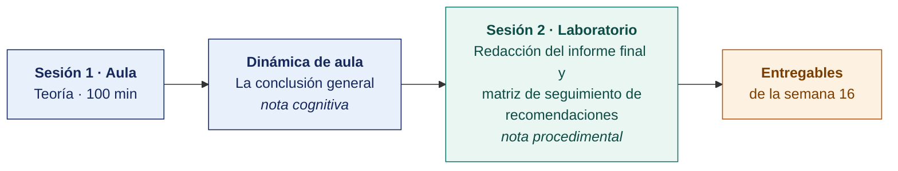

  
  &nbsp;&nbsp;&nbsp;&nbsp;&nbsp;&nbsp;
  

  <strong>Universidad Privada de Tacna</strong> 
  Facultad de Ingeniería · Escuela Profesional de Ingeniería de Sistemas

<h1 align="center">Semana 16</h1>
<h2 align="center">Auditoría Interna y Externa · Sistema de Control Interno · Elaboración del Informe Final</h2>

  <strong>SI-084 · Auditoría de Sistemas</strong> 
  4 horas académicas de 50 min · 100 min de teoría con la dinámica incluida en aula · 100 min de taller en laboratorio

---

## Datos de la asignatura

| | |
|---|---|
| **Asignatura** | SI-084 · Auditoría de Sistemas |
| **Escuela** | Escuela Profesional de Ingeniería de Sistemas |
| **Ciclo** | X · 04 horas semanales · 03 créditos · Obligatorio |
| **Prerrequisito** | SI-985 Gestión de la Configuración de Software |
| **Unidad** | III — Tipos de Auditoría de Sistemas · Informe Final |
| **Semana** | 16 de 17 |
| **Duración** | 4 horas académicas de 50 min · 100 min de teoría con la dinámica incluida en aula · 100 min de taller en laboratorio |
| **Resultados de aprendizaje** | **RA1** Diseña y aplica estrategias para los diversos tipos de auditoría de sistemas · **RA2** Descubre la importancia y diferencia entre auditor interno y externo |
| **Atributos del graduado** | AG-I04 Comunicación (CD1 y CD3, nivel 4) · AG-I02 Ética (CD2, nivel 4) |

### Lo que indica el sílabo

**Contenido conceptual.** Auditoría Interna, externa, Sistema de control. Estudio de casos.

**Contenido procedimental.** Comprende los procedimientos de auditoría interna y externa, sistema de control. Elabora el informe final.

> **Qué sección construye esta semana.** El índice completo del entregable de la unidad está en el [Modelo del Informe de Auditoría](../MODELO-INFORME-DE-AUDITORIA.md).

## Materiales de esta semana

| | Documento | Qué encontrarás | Dónde y cuánto dura |
|---|---|---|---|
| 1 | **[Teoría](1-TEORIA.md)** | Auditoría interna y auditoría externa · El sistema de control interno y el marco COSO (*Committee of Sponsoring Organizations of the Treadway Commission*) · La estructura del informe final de auditoría de sistemas | Aula · 100 min |
| 2 | **[Dinámica de aula](2-DINAMICA.md)** | La conclusión general, con su material, su ejemplo resuelto y su rúbrica | Aula · dentro de los 100 min de la sesión de teoría |
| 3 | **[Taller de laboratorio](3-TALLER.md)** | Redacción del informe final y matriz de seguimiento de recomendaciones | Laboratorio · 100 min |

## Ruta de la semana

## Entregables

| Entregable | Formato y nombre del archivo | Vence |
|---|---|---|
| **Dinámica de aula** · La conclusión general | PDF desde la [plantilla de dinámica](../PLANTILLAS/SI084-PLANTILLA-DINAMICA.docx) · `SI084-S16-DINAMICA-Grupo<N>.pdf` | Según lo programado en el aula virtual |
| **Informe del taller de laboratorio N.º 16** | PDF en formato EPIS desde la [plantilla de taller](../PLANTILLAS/SI084-PLANTILLA-TALLER.docx) · `SI084-S16-TALLER-Grupo<N>.pdf` | Según lo programado en el aula virtual |
| **Informe Final de Auditoría de Sistemas** | PDF en el repositorio, etiqueta `informe-final` | 72 h después del laboratorio |

> La dinámica y el informe del taller se entregan en **PDF**, con la carátula de la UPT y los códigos de todos los integrantes. Las plantillas obligatorias están en [`PLANTILLAS/`](../PLANTILLAS/).

## Cómo se evalúa

| Criterio | Instrumento | Peso |
|---|---|---|
| Cognitivo | Rúbrica de la conclusión general + clasificación de deficiencias | 25 % |
| Procedimental | Lista de cotejo de los 13 resultados del laboratorio | 35 % |
| Actitudinal | Conducción profesional de la reunión de validación con el auditado | 15 % |

## Medición del Atributo del Graduado

> Esta semana la Escuela recoge evidencia para el **Plan de Assessment**. La rúbrica del atributo se aplica sobre el mismo entregable que ya produces. **No modifica tu calificación** ni añade trabajo adicional.

| | |
|---|---|
| **Atributo** | **AG-I02 · Ética** |
| **Criterio medido** | **CD1 + CD2 + CD3** · Los tres criterios del atributo |
| **Alineación con el sílabo** | **RA2** Descubre la importancia y diferencia entre auditor interno y externo —la independencia es su núcleo— · Contenido procedimental del sílabo: «**Elabora el informe final**» · Evidencia de la competencia: **Informe preliminar de auditoría de sistemas** |
| **Evidencia que se lee** | Informe Final de Auditoría · sección **«Declaración de ética e independencia del equipo auditor»**, hallazgos jurídicos y tratamiento de los hallazgos incómodos |
| **Instrumento** | [Rúbrica AG-I02, escala 1–4](../ASSESSMENT/RUBRICAS-AG.md#ag-i02) |
| **Tipo de medición** | **Captura 2 · sumativa** · grupal |
| **Se registra en** | [`ASSESSMENT/REGISTRO-AG-SI084.csv`](../ASSESSMENT/REGISTRO-AG-SI084.csv) |

**Qué mira el evaluador.** Si el informe sostiene los hallazgos que perjudican a quien facilitó el acceso. Esa es la prueba real del atributo. La ética se mide en el hallazgo incómodo, no en la declaración de principios.

> **Ajuste de esta semana.** El Informe Final incorpora la sección **«Declaración de ética e independencia del equipo auditor»**, de media página, con referencia a ISO 19011:2018 cl. 4 y al Código de Ética Profesional de ISACA. Da evidencia escrita y sumativa del CD2.

Mapa completo en [`ASSESSMENT/MAPA-AG.md`](../ASSESSMENT/MAPA-AG.md).

## Preparación para la Semana 17

- Preparar la **sustentación de 6 minutos** ante el panel — 2 de presentación, 2 de demostración y 2 de preguntas, una por integrante.
- Ensayar el resumen ejecutivo **sin diapositivas**. Quien no puede explicar su informe en tres minutos hablando no lo domina.
- Imprimir y anillar el **expediente completo** — los seis planes de la Unidad II, los papeles de trabajo, los hallazgos, las actas y el informe final.
- Preparar el **examen de Unidad III**. Semanas 13 a 17.
- Invitar, si es posible, a un representante de la empresa auditada a la sustentación.

---

**Docente** · Dr. Oscar Juan Jimenez Flores
[oscarjimenezflores@upt.pe](mailto:oscarjimenezflores@upt.pe) · [LinkedIn](https://www.linkedin.com/in/oscar-jimenez-flores/) · [CTI Vitae — CONCYTEC](https://ctivitae.concytec.gob.pe/appDirectorioCTI/VerDatosInvestigador.do?id_investigador=33398)

Escuela Profesional de Ingeniería de Sistemas · Universidad Privada de Tacna · Tacna, Perú
