[Semana 17](README.md) · **Teoría** · [Dinámica de aula](2-DINAMICA.md) · [Taller de laboratorio](3-TALLER.md)

# Semana 17

## Sustentación de Trabajos Finales · Examen de Unidad III · Cierre del Curso

**SI-084 · Auditoría de Sistemas** · Sesión 1 en aula · 2 horas académicas, 100 min, con la dinámica incluida

> ¿Un término no le resulta claro? Está definido en el [glosario técnico del curso](../GLOSARIO.md).

---

## Supuesto y pregunta

Un equipo sustenta su informe ante el panel —presenta el método, describe las herramientas que usó, explica cómo construyó cada papel de trabajo— y se le acaban los seis minutos antes de decir a qué conclusión llegó.

Otro equipo abre diciendo que **los controles de aplicación evaluados no son efectivos para asegurar la trazabilidad**, lo demuestra abriendo el papel de trabajo que lo sostiene, y le sobra un minuto.

> **Después de diecisiete semanas de trabajo, ¿qué es lo primero que hay que decirle al panel?**

## Mapa de la sesión

```mermaid
flowchart LR
    IN["Informe final de auditoría"]
    SU["Sustentación ante panel"]
    RA["Respuesta de la administración"]
    SE["Matriz de seguimiento<br/>de recomendaciones"]
    EX["Expediente del encargo<br/>archivado y trazable"]
    LE["Lecciones aprendidas"]
    IN --> SU --> RA --> SE --> EX --> LE
    class IN concepto
    class SU nucleo
    class RA,SE concepto
    class EX producto
    class LE alerta
    classDef nucleo fill:#16285C,stroke:#16285C,stroke-width:1px,color:#FFFFFF;
    classDef concepto fill:#E8F1FB,stroke:#16285C,stroke-width:1px,color:#16285C;
    classDef producto fill:#E9F6F2,stroke:#0F766E,stroke-width:1px,color:#0F4C46;
    classDef alerta fill:#FDF2E2,stroke:#B45309,stroke-width:1px,color:#7C3E00;
```

---

## Sustentación final ante panel

Cada equipo sustenta **el Informe Final de Auditoría y su evidencia** ante el panel. **6 minutos por equipo**, 10 equipos. Es la evidencia de la competencia de la asignatura y el momento en que se califica a cada integrante por separado.

| Momento | Duración | Qué se evalúa |
|---|---|---|
| Presentación del producto terminado | 2 min | Qué resuelve y para quién |
| **Demostración sobre el producto real** | 2 min | Funcionando. No diapositivas de lo que hace |
| Pregunta individual del panel | 2 min | **Una por integrante.** Se registra el nivel alcanzado en el acta |

> **La pregunta individual es obligatoria y se registra.** Es la única evidencia individual del curso. Sin ella, el dato del Atributo del Graduado sería grupal y no reportable por estudiante.

## Examen de Unidad III

El Examen de Unidad se rinde en dos partes, y juntas valen el 25 % de la nota de la unidad.

| Parte | Dónde y cuándo | Duración | Qué evalúa | Materiales |
|---|---|---|---|---|
| **Teórico** | Aula, al cierre de esta sesión | 40 min | Preguntas de alternativas sobre las Semanas 13 a 16 | Anexo A de la ISO/IEC 27001:2022, listado de los 40 objetivos de COBIT 2019 y apuntes propios. **Sin** internet ni asistentes de inteligencia artificial |
| **Práctico** | Laboratorio | 100 min | Redacción de hallazgo en CCCER, análisis de continuidad, conclusión dentro del alcance y dilema ético | Laboratorio de cómputo, **con inteligencia artificial permitida** y declarada |

## Cierre

**La respuesta a la pregunta con la que abrimos.** Lo primero es **el veredicto**. El método sostiene la conclusión, pero no la sustituye, y un panel que no sabe a qué se concluyó no puede evaluar cómo se llegó. Es la misma regla del resumen ejecutivo de la Semana 13, aplicada a la voz.

**Lo que el curso deja.** Un encargo completo, de la planificación al cierre del expediente, sobre una organización real. Lo que se lleva no son las herramientas, que cambiarán, sino el hábito de no afirmar nada que no pueda señalarse en un papel de trabajo.

**La pregunta individual del panel.** Es la única evidencia individual del curso y se registra en el acta. Cada integrante responde sobre una parte del trabajo que hizo. Responder «eso lo hizo mi compañero» es la única respuesta que no admite recuperación.

---

---

[Semana 17](README.md) · **Teoría** · [Dinámica de aula](2-DINAMICA.md) · [Taller de laboratorio](3-TALLER.md)

---

**Docente** · Dr. Oscar Juan Jimenez Flores
[oscarjimenezflores@upt.pe](mailto:oscarjimenezflores@upt.pe) · [LinkedIn](https://www.linkedin.com/in/oscar-jimenez-flores/) · [CTI Vitae — CONCYTEC](https://ctivitae.concytec.gob.pe/appDirectorioCTI/VerDatosInvestigador.do?id_investigador=33398)

Escuela Profesional de Ingeniería de Sistemas · Universidad Privada de Tacna · Tacna, Perú
