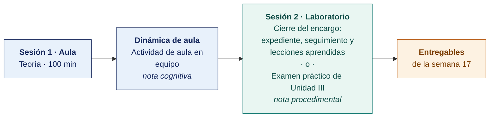

  
  &nbsp;&nbsp;&nbsp;&nbsp;&nbsp;&nbsp;
  

  <strong>Universidad Privada de Tacna</strong> 
  Facultad de Ingeniería · Escuela Profesional de Ingeniería de Sistemas

<h1 align="center">Semana 17</h1>
<h2 align="center">Sustentación de Trabajos Finales · Examen de Unidad III · Cierre del Curso</h2>

  <strong>SI-084 · Auditoría de Sistemas</strong> 
  4 horas académicas de 50 min · 100 min de sustentación ante panel y examen de unidad en aula · 100 min de taller en laboratorio

---

## Datos de la asignatura

| | |
|---|---|
| **Asignatura** | SI-084 · Auditoría de Sistemas |
| **Escuela** | Escuela Profesional de Ingeniería de Sistemas |
| **Ciclo** | X · 04 horas semanales · 03 créditos · Obligatorio |
| **Prerrequisito** | SI-985 Gestión de la Configuración de Software |
| **Unidad** | III — Tipos de Auditoría de Sistemas · Informe Final (cierre) |
| **Semana** | 17 de 17 |
| **Duración** | 4 horas académicas de 50 min · 100 min de sustentación ante panel y examen de unidad en aula · 100 min en laboratorio, compartidos entre el taller y el examen práctico |
| **Resultados de aprendizaje** | **RA1** Diseña y aplica estrategias para los diversos tipos de auditoría de sistemas · **RA2** Descubre la importancia y diferencia entre auditor interno y externo |
| **Atributos del graduado** | AG-I04 Comunicación (CD1 y CD3, nivel 4) · AG-I02 Ética (CD1–CD3, nivel 4) · AG-I11 Uso de Herramientas (CD1 y CD2, nivel 4) |

### Lo que indica el sílabo

**Contenido conceptual.** Sustentación de trabajos finales. Evaluación de Unidad III.

**Contenido procedimental.** Resuelve su evaluación y sustenta informe final de auditoria.

> **Qué sección construye esta semana.** El índice completo del entregable de la unidad está en el [Modelo del Informe de Auditoría](../MODELO-INFORME-DE-AUDITORIA.md).

## Materiales de esta semana

| | Documento | Qué encontrarás | Dónde y cuánto dura |
|---|---|---|---|
| 1 | **[Teoría](1-TEORIA.md)** | Sustentación del informe final ante panel · Examen de Unidad III | Aula · 100 min |
| 2 | **[Dinámica de aula](2-DINAMICA.md)** | Actividad en equipo, con su material, su ejemplo resuelto y su rúbrica | **Trabajo previo**, se entrega antes de la sesión |
| 3 | **[Taller de laboratorio](3-TALLER.md)** | Cierre del encargo, expediente y seguimiento de recomendaciones | Laboratorio · 100 min · **comparte sesión con el examen práctico** |

> **El laboratorio de esta semana lo reclaman dos documentos y solo caben los 100 minutos de una sesión.** El **examen práctico** y el **[taller](3-TALLER.md)** están escritos completos y son independientes entre sí. El docente publica en el aula virtual el que ocupará la sesión y deja el otro como trabajo fuera de ella, y lo comunica al inicio de la semana. **El plazo no cambia con esa decisión** — ambos vencen contando desde la sesión de laboratorio, que se dicta igual en cualquiera de los dos casos.

## Ruta de la semana

## Entregables

| Entregable | Formato y nombre del archivo | Vence |
|---|---|---|
| **Sustentación ante panel** | PDF de las diapositivas · `SI084-S17-SUSTENTACION-Grupo<N>.pdf` | Según lo programado en el aula virtual |
| **Informe del taller de laboratorio N.º 17** | PDF en formato EPIS desde la [plantilla de taller](../PLANTILLAS/SI084-PLANTILLA-TALLER.docx) · `SI084-S17-TALLER-Grupo<N>.pdf` | Según lo programado en el aula virtual |
| Sustentación ante panel | 6 min por equipo · 10 equipos en 60 min | Sesión de teoría |
| **Examen teórico de Unidad III** | Presencial, 40 min, Preguntas de alternativas | Sesión de aula |
| **Examen práctico de Unidad III** | 100 min, individual, con inteligencia artificial permitida y declarada | Sesión de laboratorio, si el docente le asigna la sesión |
| **Expediente completo del encargo** | Repositorio Git con las etiquetas `cierre-encargo` y `curso-completo`, más el `.tar.gz` con su hash | 72 h después de la sesión de laboratorio |

> La dinámica y el informe del taller se entregan en **PDF**, con la carátula de la UPT y los códigos de todos los integrantes. Las plantillas obligatorias están en [`PLANTILLAS/`](../PLANTILLAS/).

## Cómo se evalúa

| Criterio | Instrumento | Peso en la unidad |
|---|---|---|
| Actitudinal | Participación, puntualidad, profesionalismo en el trato con la empresa auditada y cumplimiento del deber de confidencialidad durante las semanas 13–17 | 15 % |
| Cognitivo | Rúbricas de las dinámicas S13–S16 + **sustentación ante panel** | 25 % |
| Procedimental | Listas de cotejo de los laboratorios 13–17 + **calidad del Informe Final de Auditoría** | 35 % |
| Examen de Unidad | **Teórico** en aula, 40 min, Preguntas de alternativas · **Práctico** en laboratorio, 100 min, con inteligencia artificial permitida | 25 % |
| | **La Unidad III aporta el 40 % de la nota final del curso** | |

## Preparación de la evidencia del Atributo del Graduado

> **Esta semana prepara la evidencia del atributo, y no se registra.** Las dos capturas que la Escuela fija son la de la **Semana 05** y la de la **Semana 16**. Lo que se produce aquí alimenta esas dos y **no modifica tu calificación** ni añade trabajo adicional.

| | |
|---|---|
| **Atributo** | **AG-I02 · Ética** |
| **Criterio medido** | **CD1** · Desarrolla razonamiento ético frente a dilemas y actúa en consecuencia |
| **Alineación con el sílabo** | Contenido procedimental del sílabo, **literal**: «Resuelve su evaluación y **sustenta informe final de auditoría**» · Evidencia de la competencia de la asignatura |
| **Evidencia que se lee** | Acta del panel · **respuesta individual** de cada integrante |
| **Instrumento** | [Rúbrica AG-I02, escala 1–4](../ASSESSMENT/RUBRICAS-AG.md#ag-i02) |
| **Tipo de medición** | **Preparación de la evidencia** · no se registra |
| **Adónde va** | Alimenta la captura de la [Semana 16](../SEMANA-16/README.md) |

**Qué mira el evaluador.** La respuesta de cada integrante, por separado, sobre el dilema ético que enfrentó el encargo y cómo lo resolvió. Sostiene la nota individual de la sustentación. El nivel del atributo no se registra aquí, sino en las capturas de las Semanas 05 y 16.

> **Ajuste de esta semana.** El panel formula a **cada integrante** una pregunta obligatoria sobre el dilema ético del encargo y registra el nivel en el acta. Es el único ajuste imprescindible del curso. Sin él, todo el dato del AG-I02 sería grupal.

Mapa completo en [`ASSESSMENT/MAPA-AG.md`](../ASSESSMENT/MAPA-AG.md).

## Cierre del curso — la evidencia de la competencia

> **Competencia de la asignatura.** *Aplica fundamentos de auditoría de sistemas para elaborar el informe técnico según los estándares y normas vigentes.*
> **Evidencia.** Informe preliminar de auditoría de sistemas.

**Trazabilidad de la competencia.**

| Unidad | Producto acumulado | Contribución a la evidencia |
|---|---|---|
| I (S01–S06) | **Expediente de pruebas técnicas.** Entorno auditable, hallazgos con evidencia sellada, CAAT | Aporta la **evidencia técnica** que sostiene los hallazgos del informe |
| II (S07 a S12) | **Seis planes de auditoría completos.** Gobierno, seguridad de la información, ciclo de vida, servicios, cumplimiento legal y canal digital | Aporta el **método y el criterio** que hacen exigible cada hallazgo |
| III (S13–S17) | **Informe Final de Auditoría de Sistemas** de una empresa real, sustentado ante panel | **Es la evidencia de la competencia** |

**Nota final del curso.** Unidad I × 25 % + Unidad II × 35 % + Unidad III × 40 %.

**Lo que el estudiante se lleva.** Un expediente de auditoría completo, reproducible y verificable, ejecutado sobre una organización real, con un informe que resistió la validación del auditado y la sustentación ante un panel. Ese expediente es material de portafolio profesional y punto de partida directo hacia la certificación **CISA** de ISACA.

---

**Docente** · Dr. Oscar Juan Jimenez Flores
[oscarjimenezflores@upt.pe](mailto:oscarjimenezflores@upt.pe) · [LinkedIn](https://www.linkedin.com/in/oscar-jimenez-flores/) · [CTI Vitae — CONCYTEC](https://ctivitae.concytec.gob.pe/appDirectorioCTI/VerDatosInvestigador.do?id_investigador=33398)

Escuela Profesional de Ingeniería de Sistemas · Universidad Privada de Tacna · Tacna, Perú
